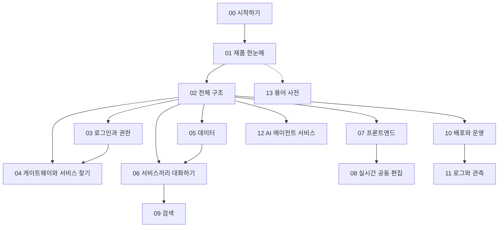
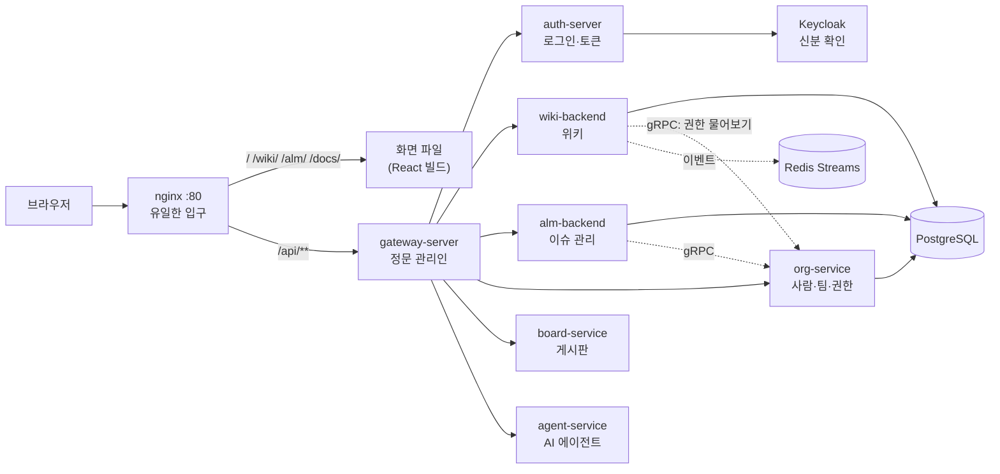

# 00 시작하기 — 이 시리즈 읽는 법과 전체 지도

## 한 줄 요약

이 시리즈는 **우리 제품(MSA_TEMPLATE)이 무엇이고, 어떤 기술로, 왜 그렇게 만들었는지**를 처음부터 쉬운 말로 다시 읽는 교과서다.

---

## 왜 필요한가

`MSA_TEMPLATE 정리` 폴더의 01~45번 노트는 **작업 일지**다. "언제 무엇을 만들었고 무슨 사고가 났나"가 시간 순서로 쌓여 있다.
일지는 기록으로는 좋지만, 처음 읽는 사람에게는 어렵다. 같은 개념이 여러 노트에 흩어져 있고, 중간에 결정이 바뀐 것도 섞여 있다.

비유하자면 이렇다.

- **정리 노트** = 공사 현장의 작업 일지. 날짜별로 "오늘 배관 깔았음, 누수 있었음".
- **이 교육 시리즈** = 완성된 건물의 안내서. "이 건물은 몇 층이고, 물은 어디서 들어와 어디로 나가나".

이 시리즈는 **지금(2026-10-18) main 기준 코드와 문서**에서 확인한 사실만 쓴다.
확인하지 못한 것은 쓰지 않는다. 일지와 다르게 보이는 곳이 있으면, 코드가 바뀐 것이다.

---

## 이 시리즈를 읽는 법

### 각 문서의 모양은 같다

모든 문서는 같은 순서로 되어 있다. 익숙해지면 필요한 칸만 골라 읽으면 된다.

| 칸 | 무엇이 있나 |
|---|---|
| 한 줄 요약 | 이 문서를 한 문장으로 |
| 왜 필요한가 | 이 기술이 푸는 문제와 비유 하나 |
| 우리 제품에서는 어떻게 쓰나 | 실제 파일·설정 경로 |
| 흐름 그림 | mermaid 그림(Obsidian에서 그려진다) |
| 자주 헷갈리는 점 / 함정 | 실제로 사고가 났던 곳 위주 |
| 더 읽을 거리 | 관련 노트 링크와 리포 경로 |
| 스스로 점검 질문 | 질문 3개. 답은 접혀 있다 |

### 추천 읽기 순서

처음이라면 **00 → 01 → 02**를 먼저 읽는다. 전체 그림이 잡힌다.
그다음은 관심 있는 길을 고른다.

| 길 | 순서 | 이런 사람에게 |
|---|---|---|
| 백엔드 길 | 03 → 04 → 05 → 06 → 09 | 요청이 서버 안에서 어떻게 처리되는지 알고 싶다 |
| 프론트 길 | 07 → 08 → 03 | 화면과 디자인 시스템, 공동 편집이 궁금하다 |
| 운영 길 | 10 → 11 → 02 다시 | 설치·배포·장애 대응을 맡는다 |
| AI 길 | 12 → 06 → 03 | 에이전트 서비스가 어떻게 돌아가는지 본다 |

모르는 단어가 나오면 [[13 용어 사전]]을 연다.

---

## 전체 지도 — 문서 목록

| 번호 | 문서 | 한 줄로 |
|---|---|---|
| 00 | [[00 시작하기 — 이 시리즈 읽는 법과 전체 지도]] | 이 문서. 읽는 법과 지도 |
| 01 | [[01 우리 제품 한눈에 — WIKI·ALM·AI 에이전트·게시판·제품 사이트]] | 제품별로 무엇을 하고 어디서 쓰나 |
| 02 | [[02 전체 구조 — 마이크로서비스는 왜 쪼개고 어떻게 연결되나]] | 서비스 목록·포트, 요청 한 번의 여정, 확정 결정 |
| 03 | [[03 로그인과 권한 — Keycloak·OIDC·JWT·개인 API 토큰]] | 누구인지 확인하고, 무엇을 해도 되는지 정하는 법 |
| 04 | [[04 게이트웨이와 서비스 찾기 — Spring Cloud Gateway·Eureka]] | 정문 하나와 서비스 주소록 |
| 05 | [[05 데이터 — PostgreSQL·Flyway·JPA·낙관적 락]] | DB 분리, 스키마 버전 관리, 동시 수정 막기 |
| 06 | [[06 서비스끼리 대화하기 — gRPC·Redis Streams·아웃박스]] | 동기 호출과 비동기 이벤트, 메일 허브 |
| 07 | [[07 프론트엔드 — React·Vite·TypeScript와 디자인 시스템]] | 세 개의 SPA와 공유 디자인 시스템 |
| 08 | [[08 실시간 공동 편집 — 여럿이 한 문서를 고치는 원리]] | Yjs·Hocuspocus로 동시에 편집하기 |
| 09 | [[09 검색 — 라이트 검색과 OpenSearch]] | `SEARCH_MODE` 스위치와 두 가지 검색 |
| 10 | [[10 배포와 운영 — Docker·nginx·GitHub Actions]] | 컨테이너로 띄우고 자동으로 배포하기 |
| 11 | [[11 로그와 관측 — Alloy·Loki·Grafana]] | 로그를 모아서 보는 법 |
| 12 | [[12 AI 에이전트 서비스 — 꺼지지 않는 개발팀]] | 에이전트가 일을 받아 처리하는 구조 |
| 13 | [[13 용어 사전]] | 시리즈에 나오는 용어 모음 |

> [!note] 담당
> 00~06은 이 문서 작가가, 07~13은 다른 작가가 쓴다. 문체와 구조는 같다.

---

## 한 장으로 보는 우리 플랫폼

먼저 큰 그림을 머리에 넣자. 자세한 설명은 02번에서 한다.

세 문장으로 줄이면 이렇다.

1. **입구는 nginx 하나다.** 화면도 API도 같은 주소(`http://localhost`)로 들어온다.
2. **API는 게이트웨이가 받아서 알맞은 서비스로 넘긴다.** 이때 로그인 토큰도 먼저 검사한다.
3. **서비스는 각자 자기 DB를 갖고, 필요하면 gRPC(빠른 내부 전화)나 Redis Streams(게시판식 알림)로 서로 대화한다.**

---

## 리포지토리 지도 — 코드는 어디에 있나

이 플랫폼은 **멀티레포**다. 리포 하나에 다 들어 있지 않고, 서비스마다 git 리포가 따로 있다.
`C:\MSA_TEMPLATE` 폴더에 나란히 체크아웃해서 쓴다. 우산 리포(`infra-settings`)는 인프라와 스크립트만 담는다.

| 폴더 | 무엇 | GitHub 리포 |
|---|---|---|
| `C:\MSA_TEMPLATE` (루트) | 인프라·배포·스크립트, `INSTALL.md` | `infra-settings` |
| `gateway-server` | API 게이트웨이 | `gateway-server` |
| `eureka-server` | 서비스 주소록 | `eureka-server` |
| `auth-server` | 로그인·토큰 발급 | `auth-server` |
| `board-service` | 게시판 | `backend-server` (폴더 이름이 다르다) |
| `platform-backend` | org-service + search-service + 공용 라이브러리 | `platform-backend` |
| `wiki-backend` | 위키 백엔드 | `wiki-backend` |
| `alm-backend` | ALM 백엔드 | `alm-backend` |
| `collaboration-service` | 위키 실시간 공동 편집 | `collaboration-service` |
| `agent-service` | AI 에이전트 | `agent-service` |
| `migration-service` | 컨플루언스·노션 이관 | `migration-service` |
| `myFront` | 포털·제품 소개 사이트 | `myFront` |
| `wiki-front` | 위키 화면 | `WIKI` (폴더 이름이 다르다) |
| `alm-front` | ALM 화면 | `ALM` (폴더 이름이 다르다) |
| `design-system` | 공유 UI 부품 | `design-system` |

> [!warning] 폴더 이름을 바꾸면 안 된다
> `docker-compose.yml`의 `build:` 경로와 nginx 마운트가 **폴더 이름**을 그대로 쓴다.
> 리포 이름과 폴더 이름이 다른 세 곳(`backend-server`→`board-service`, `WIKI`→`wiki-front`, `ALM`→`alm-front`)을 꼭 맞춘다. 근거: `INSTALL.md` §2.

---

## 이 시리즈가 지키는 약속

### 1. 확정 설계 결정은 설명만 한다

루트 `CLAUDE.md`의 "확정 설계 결정"은 실측과 합의로 굳힌 것이다.
이 시리즈는 그 결정이 **왜** 그렇게 됐는지 설명하지만, 바꾸자고 제안하지 않는다.
대표적인 것만 적으면 이렇다.

| 결정 | 어디서 설명하나 |
|---|---|
| 로그인은 Keycloak 리다이렉트(OIDC) + 구글 | 03 |
| 로그아웃은 백채널(서버끼리 `end_session`) | 03 |
| DB는 PostgreSQL 통일, 서비스 간 이벤트는 Redis Streams | 05, 06 |
| 로그는 stdout JSON → Alloy → Loki → Grafana | 11 |
| dev 포트는 운영 포트 +10000 (게이트웨이 dev = `:18000`) | 02, 04 |
| JWT 검증·오류 계약은 `common-starter` 하나로 | 03 |
| 메일은 `MAIL_MODE`, 검색은 `SEARCH_MODE` 스위치 하나로 | 06, 09 |
| 위키 초안은 작성자 + 스페이스 ADMIN + 전역 ADMIN만 본다(2026-10-18) | 03 |
| 서비스 간 gRPC는 공용 토큰 `PLATFORM_GRPC_TOKEN`으로 검사(monitor → enforce), 구성원 비활성은 org가 auth로 전파(2026-10-18) | 03, 06 |

### 2. 숫자는 실제 값이다

포트·버전·서비스 이름은 코드와 설정에서 확인한 값을 쓴다.
예를 들어 Spring Boot는 `4.0.6`, Java는 `24`, React는 `19`다(루트 `README.md` 배지).

### 3. 쉬운 말이 먼저다

전문용어는 처음 나올 때 한 줄로 풀어 쓴다. 예를 들면 이렇다.

- **JWT** — 서버가 서명해 준 출입증.
- **게이트웨이** — 모든 손님이 먼저 들르는 정문 안내 데스크.
- **마이그레이션(Flyway)** — DB 구조를 바꾸는 작업을 번호 붙은 스크립트로 차례대로 적용하는 것.

---

## 직접 띄워 보고 싶다면

이 시리즈는 읽기용이지만, 손으로 해 보면 훨씬 빨리 익는다. 방법은 세 가지다(루트 `README.md` "기동 방식").

| 방식 | 명령 | 언제 |
|---|---|---|
| A. 통합 배포판 | `cd infra/keycloak` → `docker compose up -d` | 제품 전체를 한 번에 띄워 볼 때. 입구는 `http://localhost` |
| B. dev 오프셋 클러스터 | `.\scripts\dev-up-local.ps1` | 코드를 고치며 개발할 때. 포트 +10000, 게이트웨이 `:18000` |
| C. 수동 기동 | 서비스별 `gradlew bootRun` | 서비스 하나만 깊이 볼 때 |

처음 설치라면 반드시 `C:\MSA_TEMPLATE\INSTALL.md`를 위에서 아래로 따라간다.
빠뜨리기 쉬운 것이 다섯 가지 있다: 공유 시크릿, 프론트 `dist` 폴더, 설치 옵션 선택, 기존 볼륨의 DB 초기화, 첫 전역 관리자 지정.

---

## 자주 헷갈리는 점 / 함정

- **"정리 노트 14번이 최신이겠지?"** — 아니다. 14번은 2026-07-17 스냅샷이다. 그 뒤에 org-service·위키·ALM·검색·메일·에이전트가 더 붙었다. 전체 그림은 이 시리즈 02번과 루트 `README.md`가 최신이다.
- **"서비스 수가 문서마다 다르다"** — 시기마다 늘었다. 지금 루트 `README.md` 기준으로 백엔드 서비스 12개(리포 10개), 프론트 4개(포털·위키·ALM·공개 문서)다. 리포와 서비스 수가 다른 이유는 02번에서 설명한다.
- **"교육 문서를 리포 `docs/`에 두면 안 되나?"** — 안 된다. 작업 기록·설명 문서는 Obsidian 보관함에만 둔다. 확정 결정이다.

---

## 더 읽을 거리

- 작업 일지 색인: [[00 개요 — 전체 구조]]
- 2026-07 시점 종합 해설: [[14 전체 구현 심화 해설 — 배경지식으로 읽는 현재 아키텍처 (2026-07-17)]]
- 이 시리즈 문체의 원형: [[42 사람 추가와 권한 — Keycloak 원리부터 초대·grant 판정까지 쉽게 (2026-09-27)]]
- 리포: `C:\MSA_TEMPLATE\README.md`(토폴로지·서비스 표), `C:\MSA_TEMPLATE\INSTALL.md`(설치 순서), `C:\MSA_TEMPLATE\CLAUDE.md`(확정 설계 결정)

---

## 스스로 점검 질문

**1. 브라우저가 우리 플랫폼에 들어오는 입구는 몇 개이고, 무엇인가?**

> [!note]- 답
> 하나다. nginx(`:80`)다. 포털 `/`, 위키 `/wiki/`, ALM `/alm/`, 공개 문서 `/docs/`, API `/api/**`가 모두 같은 주소로 들어온다. 게이트웨이(`:8000`)는 호스트에 포트를 열지 않는다.

**2. `C:\MSA_TEMPLATE` 루트 리포(infra-settings)에는 무엇이 들어 있고, 무엇이 들어 있지 않은가?**

> [!note]- 답
> 인프라(`infra/` — compose, nginx, Keycloak realm, 관측 설정), 배포 워크플로, 스크립트, `INSTALL.md` 같은 문서가 있다. 각 서비스와 프론트의 코드는 없다. 그것들은 별도 리포이고 루트에서는 `.gitignore` 처리돼 나란히 체크아웃된다.

**3. 확정 설계 결정을 바꿔야 할 이유가 생기면 어떻게 하나?**

> [!note]- 답
> 리뷰나 구현에서 "개선 제안"으로 뒤집지 않는다. 먼저 사용자(플랫폼 주인)에게 확인한다. 규약을 바꾸면 루트 `CLAUDE.md`와 `AGENTS.md`를 함께 고친다.
