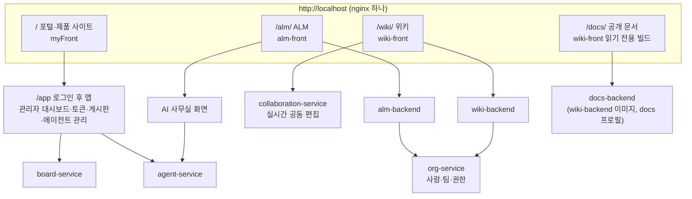
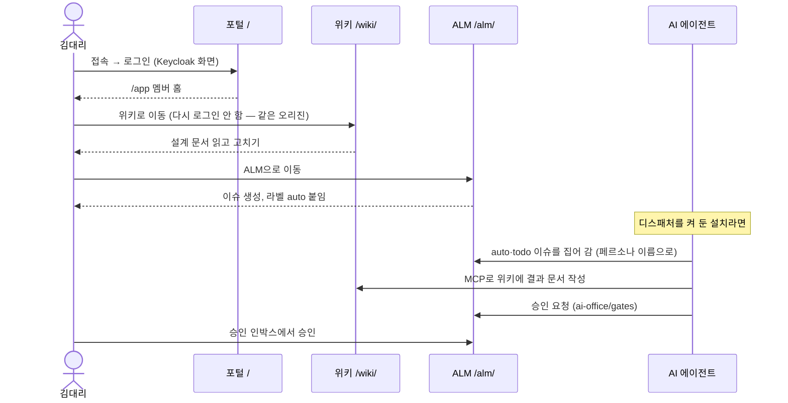
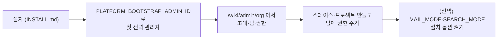

# 01 우리 제품 한눈에 — WIKI·ALM·AI 에이전트·게시판·제품 사이트

## 한 줄 요약

**우리 플랫폼은 컨플루언스를 닮은 WIKI, 지라를 닮은 ALM, 둘을 다루는 AI 에이전트, 그리고 포털(제품 사이트·관리자 대시보드)을 하나의 로그인 아래 묶어 회사가 직접 설치해 쓰는 제품이다.**

---

## 왜 필요한가

### 비유 — 한 건물 안의 여러 가게

쇼핑몰을 떠올려 보자.

- 입구는 하나다. 출입증도 하나다. 한 번 들어오면 어느 가게든 다시 신분 확인 없이 들어간다.
- 가게마다 하는 일이 다르다. 서점(WIKI), 공방(ALM), 안내소(포털), 게시판.
- 가게마다 창고(DB)가 따로 있다. 서점 창고에 불이 나도 공방은 문을 연다.
- 관리 사무소(org-service)가 "누가 어느 가게의 직원인지"를 한 장부로 관리한다.

우리 제품이 바로 이런 모양이다. 루트 `README.md`는 이렇게 소개한다.

> 컨플루언스·지라를 대체하는 위키와 이슈 트래커를, Keycloak SSO 아래 하나의 오리진으로 묶어 직접 호스팅하는 Spring Boot MSA 레퍼런스 플랫폼.

뜻을 풀면 이렇다.

- **직접 호스팅(설치형, 온프렘)** — 클라우드 구독이 아니라 고객 회사 서버에 깔아 쓴다. 하나의 설치본은 한 회사만 쓴다(싱글테넌트).
- **하나의 오리진** — 모든 제품이 `http://localhost` 같은 한 주소의 경로(`/`, `/wiki/`, `/alm/`)로 열린다. 그래서 로그인이 자연스럽게 공유된다.
- **레퍼런스 플랫폼** — "서비스를 하나 더 붙이려면 무엇을 복제하면 되는지"가 코드로 보이게 만든 견본이기도 하다.

---

## 제품 지도

| 제품 | 화면 주소 | 화면 리포 | 백엔드 |
|---|---|---|---|
| WIKI | `/wiki/` | `wiki-front` | `wiki-backend` (`:9110`), `collaboration-service` (`:9150`) |
| ALM | `/alm/` | `alm-front` | `alm-backend` (`:9120`) |
| AI 에이전트 | `/alm/projects/:id/ai-office`, `/app/agents` | `alm-front`, `myFront` | `agent-service` (`:9160`) |
| 게시판 | `/app/board` | `myFront` | `board-service` (`:9100`) |
| 포털·제품 사이트 | `/`, `/products`, `/app` | `myFront` | 여러 서비스 API를 모아 씀 |
| 공개 문서 | `/docs/` | `wiki-front` (`--mode docs`) | `docs-backend` |
| 이관 도구 | `/wiki/admin/migrations` | `wiki-front` | `migration-service` (`:9170`) |

아래부터 하나씩 본다. 화면 경로는 각 앱의 기준 경로(`/wiki/`, `/alm/`) 뒤에 붙는 부분이다.

---

## 우리 제품에서는 어떻게 쓰나

### 1. WIKI — 회사의 문서 창고

**무엇인가.** 직접 호스팅하는 컨플루언스 대체 위키다. 스페이스(문서 묶음), 계층 페이지, 버전 이력, 실시간 공동 편집을 제공한다(`wiki-front/README.md`).

**누가 어떻게 쓰나.** 팀마다 스페이스를 하나씩 만들고, 그 안에 페이지를 나무 모양으로 쌓는다. 회의록·설계 문서·운영 매뉴얼을 쓴다. 권한은 스페이스 단위로 org-service가 정한다(보기·댓글·편집·관리).

**주요 화면** (`wiki-front/src/app/App.tsx`)

| 경로 | 화면 |
|---|---|
| `/home` | 전체 홈 |
| `/spaces` | 스페이스 목록 |
| `/spaces/:spaceId` | 스페이스 개요 |
| `/spaces/:spaceId/pages/:pageId` | 페이지 보기 (`/edit` 붙이면 편집, `pages/new`는 새 페이지) |
| `/spaces/:spaceId/pages/:pageId/history` | 버전 이력 (`/compare` 비교, `/:version` 옛 버전 보기) |
| `/spaces/:spaceId/trash`, `/archive` | 휴지통, 보관함 |
| `/spaces/:spaceId/blog`, `/labels`, `/folder/:folderId` | 블로그, 라벨 탐색, 폴더 |
| `/spaces/:spaceId/settings` | 스페이스 설정 |
| `/search?q=` | 통합 검색(스페이스·종류 필터) |
| `/tasks`, `/settings/notifications` | 내 작업, 알림 설정 |
| `/my/:tab` | 내 항목 — 최근 방문·별표·내 초안 전체 목록(2026-10-18) |
| `/notifications` | 알림 전체 화면 — 이전 알림 계속 읽기·종류 필터(2026-10-18) |
| `/settings/watches` | 내가 구독한 문서·스페이스 목록과 일괄 해제(2026-10-18) |
| `/admin/org/*` | 조직 관리(사용자·초대·팀·권한·권한 이력·승인 대기·메일 설정) — 전역 관리자 |
| `/admin/search`, `/admin/audit`, `/admin/migrations` | 검색 관리, 감사 로그, 이관 — 전역 관리자 |

**핵심 기능** (`wiki-front/README.md`와 백엔드 컨트롤러에서 확인)

- 끌어서 옮기는 페이지 트리
- TipTap 기반 위지윅 편집기. 저장은 마크다운. `[[위키 링크]]`
- 버전 비교(diff)와 복원
- 댓글(1단 답글), 본문 일부에 다는 인라인 댓글
- 기본 템플릿 10종 + 스페이스 템플릿
- KaTeX 수식, Mermaid 다이어그램, `::pages-by-label` 같은 매크로, 다크 모드
- 첨부(버전·복원), 라벨, 휴지통, 보관, 반응, 열람 제한, 구독, 별표, 페이지 검증, PDF 내보내기, 알림, 감사 로그
- 문서 ⋯ 메뉴의 이동·복사, 다른 스페이스·다른 부모 아래로 복사(2026-10-18, F-02·F-03)
- 초안은 작성자 + 스페이스 ADMIN + 전역 ADMIN만 본다. 게시 전에는 알림·검색에서 빠진다(2026-10-18 확정 결정)
- 통합 검색 — `SEARCH_MODE`가 `lite`면 위키가 직접, `opensearch`면 search-service가 답한다([[09 검색 — 라이트 검색과 OpenSearch]])
- 실시간 공동 편집(Yjs) — 화면 플래그 `VITE_WIKI_COLLABORATION_ENABLED`, **기본 꺼짐**([[08 실시간 공동 편집 — 여럿이 한 문서를 고치는 원리]])

> [!note] 콘텐츠 모델의 확정 결정
> 폴더는 페이지의 한 종류(`Page.type`), 초안은 페이지의 상태(`Page.status`), 여러 단 배치는 `:::` 확장 문법이다. 블록 JSON 같은 다른 구조로 바꾸지 않기로 했다. [[22 wiki-front 컨플루언스 복제 리뉴얼 + 폴더·초안·컬럼 콘텐츠 모델 (2026-07-26)]].

### 2. ALM — 일감 관리

**무엇인가.** ALM은 Application Lifecycle Management(애플리케이션 수명 주기 관리)의 줄임말이다. 쉽게 말해 **일감(이슈) 관리 도구**다. 지라의 구조를 본떴다. 한국어 스마트 검색, 필터 URL 공유, 저장 필터, 시간 기록이 특징이다(`alm-front/CLAUDE.md`).

**누가 어떻게 쓰나.** 팀이 프로젝트를 만들고, 할 일을 이슈로 올린다. 이슈는 상태(할 일 → 진행 중 → 완료)를 거친다. 스크럼 팀은 스프린트로, 칸반 팀은 보드로 흐름을 본다. 권한은 프로젝트 단위로 org-service가 정한다.

**주요 화면** (`alm-front/src/app/App.tsx`. README의 표보다 이 파일이 정본이다)

| 경로 | 화면 |
|---|---|
| `/home` | For you 홈 |
| `/search` | 스마트 검색(AQL) |
| `/dashboards`, `/dashboards/:id` | 대시보드 |
| `/projects`, `/projects/new`, `/projects/trash` | 프로젝트 목록·생성·휴지통 |
| `/projects/:projectId/boards/:boardId` | 보드 |
| `/projects/:projectId/backlog` | 백로그·스프린트 |
| `/projects/:projectId/issues` | 이슈 목록 |
| `/projects/:projectId/timeline` | 타임라인(간트) |
| `/projects/:projectId/releases`, `/reports`, `/dashboard`, `/archive` | 릴리스, 리포트, 요약, 보관 |
| `/projects/:projectId/ai-office` | AI 사무실(아래 3절) |
| `/projects/:projectId/settings/:section` | 프로젝트 설정(멤버·워크플로·컴포넌트·필드·가져오기·AI 팀 등) |
| `/settings/:section` | 전역 설정(상태·이슈 타입·우선순위 등) |
| `/settings/org/*` | 조직 관리 — 위키와 같은 화면 패키지 |

이슈 상세는 별도 주소가 아니라 `?issue=KEY`를 붙이면 모달로 열린다(`alm-front/README.md`).

**핵심 기능** (`alm-front/README.md`, `alm-backend/README.md`)

- 스크럼·칸반 보드 여러 개, 스윔레인, WIP 제한(진행 중 개수 상한)
- 백로그와 스프린트(시작·완료, 순서 바꾸기)
- 에픽 → 이슈 → 하위 작업 계층, 이슈 링크
- **AQL** — JQL을 닮은 검색 질의어(`/api/alm/issues/query`). 저장 필터(`/api/alm/me/filters`)
- 타임라인(SVAR Gantt), 대시보드, 리포트, 릴리스·버전
- 작업 시간 기록(워크로그), 첨부(이미지 미리보기), 지켜보기(워처), 알림, 배너, 보관·복원
- 웹 링크(PR·문서 주소 붙이기), 이슈 복제, 예정 스프린트 삭제(이슈는 백로그로), 저장 필터 공유(조직 전체에 공개, 결과는 보는 사람 권한으로 거른다), 여러 이슈 일괄 편집(2026-10-18, F-08~F-12)
- 설정 레지스트리 — 상태·이슈 타입·우선순위·카테고리·링크 타입·스킴을 관리자가 바꾼다
- 프로젝트 생성 템플릿 — 빈 / 스크럼 / 칸반 / 버그 트래킹

> [!note] ALM 첨부는 MinIO
> ALM 첨부와 멤버 아바타는 MinIO(S3 호환 저장소)에 둔다. 위키 첨부는 기본이 S3Mock(개발용 에뮬레이터)이다(`INSTALL.md` §4).

### 3. AI 에이전트 — 페르소나로 일하는 팀원

**무엇인가.** AI 코딩 에이전트(Claude Code, Codex)를 플랫폼의 팀원으로 들이는 서비스다. 에이전트는 **MCP**(AI가 외부 도구를 부르는 표준 규약)로 위키와 ALM을 직접 다룬다. 모든 기록은 사람이 아니라 **페르소나**(에이전트에게 준 직원 신분) 이름으로 남는다(`agent-service/README.md`). 제품 소개 덱은 이를 "꺼지지 않는 개발팀"이라고 부른다(`presentation/src/build.js`).

**누가 어떻게 쓰나.**

- 관리자는 myFront `/app/agents`에서 페르소나·에이전트 토큰·러너·리뷰어를 관리하고 킬 스위치를 켜고 끈다(관리자 전용).
- 프로젝트 멤버는 ALM `/projects/:id/ai-office`에서 에이전트가 하는 일(run)을 보고, `ai-office/gates`(승인 인박스)에서 에이전트가 요청한 승인을 처리한다. 프로젝트 설정의 `ai-team`에서 팀을 꾸린다.

**핵심 기능** (`agent-service/CLAUDE.md`)

- 페르소나 역할 7종: PLANNER, DESIGNER, FRONTEND, BACKEND, OPS, REVIEWER, MANAGER
- 신원 사슬: auth-server 계정 `agent:<slug>` → org-service 멤버(`kind=AGENT`) → agentdb 페르소나. 그래서 에이전트도 사람과 같은 권한 판정을 받는다
- 무인 자동 루프(디스패처)는 **기본 꺼짐**. `SCHEDULER_ENABLED=true`로 켜면 라벨 `auto` + 상태 `todo`인 이슈를 집어 간다
- 리뷰 상시화(완료 전환은 리뷰어 페르소나만), 승인 게이트, 예산 상한·킬 스위치(DB에 저장돼 재시작해도 유지, 켜면 실행 중 run도 멈춘다), 회의 run, 매니저 순찰
- run마다 비용이 보인다(ALM AI 사무실의 run 목록·상세)
- 실행 위치 두 가지: 내 PC의 러너(LOCAL), 비밀이 없는 플랫폼 러너 컨테이너(SERVER, compose 프로필 `agent-runner`). 워커를 agent-service 컨테이너 안에서 돌리는 것은 금지다
- MCP 도구 수는 24종이다(`agent-service/README.md`·`CLAUDE.md` §6). 제품 페이지(`myFront/src/site/content/products.ts`)에는 예전 숫자(18종)가 남아 있다

자세한 구조는 [[12 AI 에이전트 서비스 — 꺼지지 않는 개발팀]].

### 4. 게시판 — 표준 패턴의 견본

**무엇인가.** 게시글·댓글 서비스다(`board-service/README.md`). 2026-10-18부터 화면에도 댓글과 게시글 검색(`GET /api/board/posts?q=`)이 있다. 기능은 단순하지만, 플랫폼의 첫 번째 백엔드로서 "도메인 서비스를 하나 붙이려면 이렇게 한다"를 보여 주는 견본 역할을 한다.

**누가 어떻게 쓰나.** myFront의 `/app/board`에서 쓴다. 위키·ALM 화면은 게시판 API를 쓰지 않는다.

| API | 규칙 |
|---|---|
| `GET /api/board/posts`, `GET /api/board/posts/{id}` | 누구나 읽기(로그인 불필요) |
| `POST /api/board/posts`, 댓글 쓰기 | 로그인 필요 |
| `PUT`·`DELETE` 글·댓글 | 작성자 또는 ADMIN만 |

| 화면 | 경로 |
|---|---|
| 목록 / 새 글 / 상세 / 수정 | `/app/board`, `/app/board/new`, `/app/board/:id`, `/app/board/:id/edit` |

### 5. 포털과 제품 사이트 — myFront

**무엇인가.** React 19 + MUI로 만든 웹 셸이다(`myFront/CLAUDE.md`). 두 얼굴이 있다.

1. **로그인 전 — 제품 소개 사이트**

| 경로 | 화면 |
|---|---|
| `/` | 홈 |
| `/products`, `/products/:slug` | 제품 목록과 상세(`ai-agent`, `wiki`, `alm`, `msa-platform-template`) |
| `/tech`, `/contact`, `/login` | 기술 소개, 문의, 로그인 |

2. **로그인 후 — `/app`**

| 경로 | 화면 |
|---|---|
| `/app` | 전역 관리자면 **관리자 대시보드**, 아니면 멤버 홈. `GET /api/org/me`로 판정한다(`myFront/src/app/admin/AppHomePage.tsx`) |
| `/app/tokens` | 개인 API 토큰(PAT) 발급·이름 변경·폐기·전부 폐기 |
| `/app/board` | 게시판(댓글·검색) |
| `/app/agents` | AI 에이전트 관리·킬 스위치(관리자) |

관리자 대시보드는 위키·ALM·org 통계(`/api/*/admin/stats`), 서비스 상태(`/api/platform/health`), 켜진 기능(`/api/platform/features`), 토큰 통계, 감사 로그, AI 에이전트 카드(킬 스위치 상태 등, agent-service가 죽으면 이 카드만 "확인 불가")를 모아 보여 준다.

### 6. 공개 문서 — `/docs/`

**무엇인가.** 로그인 없이 읽는 읽기 전용 위키다. 이 플랫폼의 설계·운영 문서를 바깥에 공개하는 데 쓴다.

- 화면은 같은 wiki-front를 `--mode docs`로 빌드한 것이다(`.env.docs`: `VITE_BASE=/docs/`, `VITE_WIKI_READONLY=true`). 편집·이력·휴지통·설정·관리 화면이 빠진다.
- 백엔드는 같은 wiki-backend 이미지를 `docs` 프로필로 한 번 더 띄운 `docs-backend`이고, DB도 따로(`docsdb`) 쓴다.
- 게이트웨이를 거치지 않는다. nginx가 `/api/docs/`를 docs-backend로 바로 보낸다.
- 쓰기는 `127.0.0.1:19910` + `X-Docs-Import-Token`을 가진 임포터만 한다. myFront의 `npm run sync:docs`가 옵시디언 노트를 넣는다.
- docs-backend가 죽어도 `/docs/`만 502가 된다. 포털·위키·ALM은 영향이 없다.

### 7. 이관 도구 — migration-service

**무엇인가.** 컨플루언스 Server/DC와 노션의 문서를 우리 위키로 옮기는 엔진이다(`migration-service/README.md`). 단계는 발견 → 추출 → 정규화 → 미디어 복사 → 링크 해석 → 검증 → 링크 정리다.

- 화면은 위키의 `/admin/migrations`(연결 확인·새 작업·목록)와 `/admin/migrations/:jobId`(진행률·손실 보고서)다. 전역 관리자 전용이다.
- 위키에 쓰는 일은 전부 위키의 **내부 import API**(`/internal/wiki/import/**`, `X-Internal-Token`)로만 한다. 이관 로직은 위키 밖에 둔다는 것이 확정 결정이다.
- 2026-09-06 사용자 지시로 이관 모듈의 추가 작업은 **보류** 중이다. 배포본은 유지한다.

### 8. 모든 제품이 함께 쓰는 것

| 공통 기능 | 담당 | 어디서 보나 |
|---|---|---|
| 로그인(SSO) | Keycloak + auth-server | [[03 로그인과 권한 — Keycloak·OIDC·JWT·개인 API 토큰]] |
| 사람·팀·권한·초대·승인 | org-service | 위키 `/admin/org`, ALM `/settings/org` |
| 메일 발송 | org-service 메일 허브 (`MAIL_MODE`) | [[06 서비스끼리 대화하기 — gRPC·Redis Streams·아웃박스]] |
| 통합 검색 | wiki-backend 라이트 검색 또는 search-service (`SEARCH_MODE`) | [[09 검색 — 라이트 검색과 OpenSearch]] |
| 개인 API 토큰 | auth-server + 게이트웨이 | `/app/tokens` |
| 디자인 시스템 | `design-system` (`@chanho` 패키지) | [[07 프론트엔드 — React·Vite·TypeScript와 디자인 시스템]] |

---

## 흐름 그림

### 한 사람의 하루 — 제품을 넘나드는 모습

### 관리자의 첫 설치 직후

---

## 자주 헷갈리는 점 / 함정

1. **"게시판은 위키 안에 있다"** — 아니다. 게시판 화면은 myFront `/app/board`에만 있다.
2. **"공동 편집이 기본으로 켜져 있다"** — 아니다. collaboration-service 컨테이너는 뜨지만 화면 플래그(`VITE_WIKI_COLLABORATION_ENABLED`)는 기본 false다. 운영 투입 전에 남은 과제가 있다.
3. **"검색을 끄면 검색이 없다"** — `SEARCH_MODE=lite`는 "검색 없음"이 아니다. 위키 라이트 검색이 같은 계약으로 답한다. 다만 형태소 분석이 없고 위키만 찾는다. ALM 이슈는 AQL로 따로 찾는다.
4. **"ALM 통합 검색이 있다"** — 옛 기록(28번)에는 ALM 이슈 통합 검색이 완료로 적혀 있지만, 그 브랜치(`feat/wave-d-alm-search`)는 main에 없다. 재이식하지 않는 것이 확정 결정이다. 제품 기능으로 세지 않는다.
5. **"AI 에이전트는 켜 두면 알아서 일한다"** — 무인 루프는 기본 꺼짐이다. `SCHEDULER_ENABLED=true` + 저장소 매핑 + 워커 구독이 모두 있어야 돈다(`INSTALL.md` §4).
6. **"`/app`이 모두에게 같다"** — 같은 주소라도 전역 관리자에게는 관리자 대시보드, 다른 사람에게는 멤버 홈이 뜬다.
7. **"README 숫자를 그대로 믿자"** — ALM README의 라우트 표, 제품 페이지의 MCP 도구 수(18종)는 코드보다 늦다. 화면 경로는 각 앱의 `App.tsx`·`main.tsx`가 정본이다.

---

## 더 읽을 거리

- [[02 전체 구조 — 마이크로서비스는 왜 쪼개고 어떻게 연결되나]] — 제품 뒤의 서비스 구성
- [[22 wiki-front 컨플루언스 복제 리뉴얼 + 폴더·초안·컬럼 콘텐츠 모델 (2026-07-26)]], [[34 위키 컨플루언스 파리티 W21 + 규모 대응 — 휴지통·라벨·첨부·인라인댓글·지연트리 (2026-08-29)]] — 위키 기능이 늘어난 과정
- [[35 ALM 화면 손질 2차 + 필드 구성 스킴 + DS 0.8 모달 버그 + 이메일·휴지통 V19 (2026-09-04)]], [[41 ALM 검색 질의어(AQL)·값 아이콘·해결일·저장 필터 + 후속 정리 (2026-09-06~09-23)]] — ALM 기능
- [[37 이관 모듈 분리(migration-service) + 유실·중복 방지 + 페이지 히스토리 컨플 복제 (2026-09-05)]] — 이관 도구
- 코드: `wiki-front/src/app/App.tsx`, `alm-front/src/app/App.tsx`, `myFront/src/main.tsx`, `myFront/src/site/content/products.ts`, `agent-service/CLAUDE.md`, `board-service/README.md`, `migration-service/README.md`

---

## 스스로 점검 질문

**1. 위키에서 로그인한 사람이 ALM으로 넘어갈 때 다시 로그인하지 않아도 되는 이유는?**

> [!note]- 답
> 모든 제품이 nginx 하나 뒤에서 같은 오리진(`http://localhost`)의 경로(`/wiki/`, `/alm/`)로 열리기 때문이다. auth-server가 심은 RT 쿠키(`/api/auth` 경로)가 세 앱 모두에 공유되고, 각 앱은 화면이 뜰 때 `/api/auth/refresh`로 AT를 받는다.

**2. 공개 문서 `/docs/`는 위키와 무엇을 같이 쓰고 무엇을 따로 쓰나?**

> [!note]- 답
> 같이 쓰는 것: 화면 코드(wiki-front, `--mode docs` 빌드)와 백엔드 이미지(wiki-backend). 따로 쓰는 것: 백엔드 컨테이너(`docs-backend`, `docs` 프로필), DB(`docsdb`), 경로(nginx가 게이트웨이를 거치지 않고 직접 보냄). 로그인이 없고 읽기 전용이며, 쓰기는 임포터 토큰으로만 된다.

**3. AI 에이전트가 위키 페이지를 고치면 누구 이름으로 기록되나? 그리고 그 권한은 누가 판정하나?**

> [!note]- 답
> 사람이 아니라 페르소나 이름으로 남는다. 페르소나는 auth-server 계정(`agent:<slug>`)과 org-service 멤버(`kind=AGENT`)를 가지므로, 권한도 사람과 똑같이 org-service가 grant 원장으로 판정한다.
