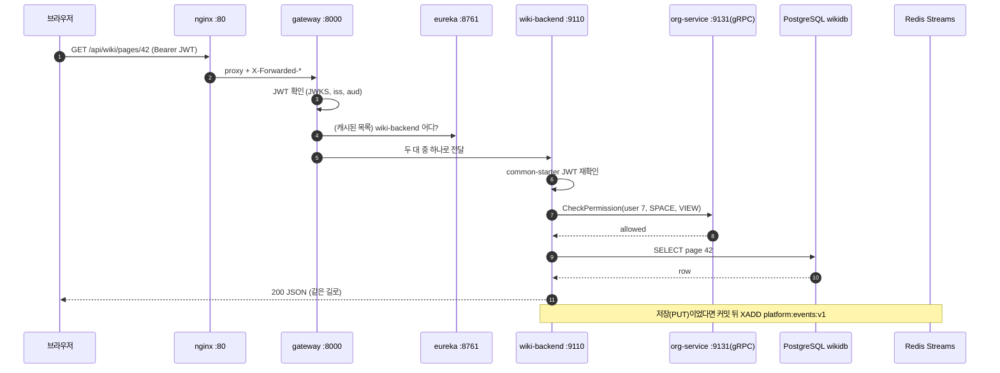
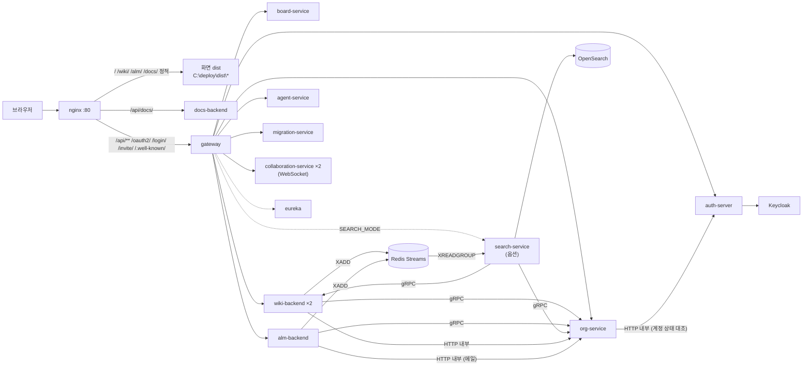

# 02 전체 구조 — 마이크로서비스는 왜 쪼개고 어떻게 연결되나

## 한 줄 요약

**우리 플랫폼은 백엔드 12개 서비스(리포 10개)와 화면 4개를 Docker Compose 한 벌로 띄우고, 브라우저 요청은 nginx → 게이트웨이 → 각 서비스 → 각자의 DB 순서로 흐른다.**

---

## 왜 필요한가

### 비유 — 큰 식당 하나 vs 푸드코트

**모놀리스**(한 덩어리 프로그램)는 큰 식당 하나다. 주방 하나에서 한식·양식·디저트를 다 만든다.
- 처음엔 편하다. 재료도 같이 쓰고, 주방장 한 명이 다 안다.
- 커지면 문제가 생긴다. 디저트 오븐이 고장 나면 주방 전체가 멈춘다. 메뉴 하나 바꾸려고 식당 전체를 닫는다.

**마이크로서비스(MSA)**는 푸드코트다. 가게마다 주방·재료 창고·직원이 따로 있다.
- 디저트 가게가 문을 닫아도 한식 가게는 판다. → **장애 격리**
- 한식 가게만 리모델링할 수 있다. → **독립 배포**
- 대신 공통으로 필요한 것이 생긴다. 입구 안내(게이트웨이), 손님 확인(인증), 가게 위치 안내판(유레카), CCTV(로그 수집). 이것을 **횡단 관심사**라고 한다. MSA는 이 비용을 치르는 구조다.

### 우리가 쪼갠 이유

루트 `README.md`는 목표를 이렇게 적는다.

> "서비스를 하나 더 추가할 때 무엇을 복제하면 되는지"가 코드로 드러나는 표준 패턴을 제공한다.

그리고 제품 경계가 실제로 나뉜다. 위키와 ALM은 서로 다른 제품이고, 사람·팀·권한(org)은 둘이 같이 쓴다. 검색은 쓰기 경로에서 떼어 내야 한다. 그래서 이렇게 나눴다([[15 ALM·Wiki 백엔드 요구사항 + 서비스 분할 설계 (2026-07-19)]]).

- **도메인 서비스** — 위키, ALM, 게시판: 각자 자기 데이터의 주인
- **플랫폼 서비스** — org(사람·권한), search(검색), auth(로그인): 모두가 함께 쓰는 것
- **기반 서비스** — 게이트웨이, 유레카: 길 안내

---

## 우리 제품에서는 어떻게 쓰나

### 1. 서비스 목록 — 이름·역할·포트

포트는 "운영 / dev"다. dev 오프셋 클러스터는 **운영 포트 +10000**이다(확정 결정). 출처: 루트 `README.md` 컴포넌트 표, `infra/keycloak/docker-compose.yml`.

**백엔드 (12개)**

| 서비스 | 포트 (운영 / dev) | 하는 일 | 리포 |
|---|---|---|---|
| gateway-server | 8000 / 18000 | 정문. 라우팅·JWT 1차 검사·속도 제한·서킷 브레이커·CORS | `gateway-server` |
| eureka-server | 8761 / 18761 | 서비스 주소록 | `eureka-server` |
| auth-server | 9000 / 19000 | Keycloak 로그인 위임, 플랫폼 JWT 발급, JWKS, PAT | `auth-server` |
| board-service | 9100 / 19100 | 게시판 | `backend-server` |
| wiki-backend | 9110 · gRPC 9111 / 19110 · 9111 | 위키 스페이스·페이지·버전·첨부. 이벤트 발행 | `wiki-backend` |
| docs-backend | 9110(내부) / — | 공개 문서. wiki-backend 이미지 + `docs` 프로필 | `wiki-backend` |
| alm-backend | 9120 · gRPC 9121 / 19120 · 19121 | 프로젝트·이슈. 이벤트 발행 | `alm-backend` |
| org-service | 9130 · gRPC 9131 / 19130 · 19131 | 사람·팀·권한(RBAC), 초대, 메일 허브 | `platform-backend` |
| search-service | 9140 / 19140 | 통합 검색(GraphQL). **설치 옵션** — 기본으로는 안 뜬다 | `platform-backend` |
| collaboration-service | 9150 / 19150 | 위키 실시간 공동 편집(Hocuspocus/Yjs, Node.js) | `collaboration-service` |
| agent-service | 9160 / 19160 | AI 에이전트 REST·MCP | `agent-service` |
| migration-service | 9170 / 19170 | 컨플루언스·노션 이관 | `migration-service` |

**왜 서비스는 12개인데 리포는 10개인가?**
- `org-service`와 `search-service`는 `platform-backend`라는 한 리포의 두 모듈이다(공용 `common-proto`, `common-starter`도 같은 리포).
- `docs-backend`는 `wiki-backend` 이미지를 설정만 바꿔 한 번 더 띄운 것이다.

**화면 (4개)** — 모두 nginx가 정적 파일로 서빙한다.

| 화면 | 경로 | dev 포트 | 리포 |
|---|---|---|---|
| 포털·제품 사이트 | `/` | 5173 | `myFront` |
| 위키 | `/wiki/` | 5174 | `wiki-front` |
| ALM | `/alm/` | 5175 | `alm-front` |
| 공개 문서 | `/docs/` | — | `wiki-front`(읽기 전용 빌드) |

**기반 인프라**

| 구성 | 이미지·포트 | 역할 |
|---|---|---|
| nginx | `nginx:1.27-alpine`, 80 | **유일한 사용자 입구** |
| Keycloak | `keycloak:26.0`, 8080 | 로그인 화면·신원 확인 (realm `sso-demo`) |
| PostgreSQL | `postgres:16`, 호스트 `127.0.0.1:5433` | 모든 DB (05번) |
| Redis | `redis:7-alpine`, 호스트 `127.0.0.1:16379` | 속도 제한 카운터, 이벤트 스트림, 공동 편집 입장권 |
| OpenSearch | `platform-opensearch:2.19.0-nori`, 내부 9200 | 검색 색인. 설치 옵션 |
| MinIO / S3Mock | 내부 | ALM 첨부 / 위키 첨부(개발용) |
| Loki · Alloy · Grafana | Grafana `127.0.0.1:3000` | 로그 수집·조회 (11번) |

**컨테이너 수** — 기본 `docker compose up -d`는 상시 20개 + 1회성 초기화 4개다. 검색을 켜면 상시 22개, 에이전트 러너(`agent-runner` 프로필 — 송신 가드 `agent-runner-guard` + `agent-runner` 두 개)까지 켜면 24개다. 메일(`mail-dev`/`mail-relay`/`mail-full`)도 프로필로 따로 켠다(루트 `README.md`, `INSTALL.md` §1).

2026-10-18부터 상시 컨테이너마다 메모리 상한(`mem_limit`)이 있고, Java 서비스는 그 50%를 최대 힙으로 쓴다(`INSTALL.md` §1 "메모리", 10번).

### 2. 호스트에 열린 포트는 몇 개 안 된다

`INSTALL.md` §1 기준, 호스트에 실제로 열리는 포트는 nginx `80`, Keycloak `8080`, 그리고 `127.0.0.1`(루프백)에만 열린 몇 개(PostgreSQL 5433, Redis 16379, Grafana 3000, S3Mock 9090, MinIO 콘솔 9001, docs 임포터 19910)뿐이다.

게이트웨이 8000, 유레카, 모든 백엔드 REST·gRPC, OpenSearch, Loki는 **호스트에 열지 않는다.** 컨테이너 내부 이름(예: `http://org-service:9130`)으로만 닿는다. 바깥에서 닿을 수 있는 문이 적을수록 지킬 곳이 적다.

### 3. 저장소 구조 — 우산 리포 + 서비스 리포

`C:\MSA_TEMPLATE`(= `infra-settings` 리포)는 **인프라·배포·스크립트만** 담는다.

```
MSA_TEMPLATE/               ← infra-settings
├─ infra/keycloak/          전체 스택 docker-compose.yml, realm-export.json, init-authdb.sql
├─ infra/nginx/             default.conf (3-SPA 통합 서빙 + 게이트웨이 프록시)
├─ infra/observability/     Alloy·Grafana 설정
├─ infra/runbooks/          운영 매뉴얼(백업·복원·장애·비밀번호 교체·Keycloak 운영 모드)
├─ infra/backup/            백업 인벤토리·예약 작업
├─ infra/agent-runner-guard/ 플랫폼 러너 송신 가드 이미지
├─ scripts/                 dev-up-local, smoke-stack, mail-up, search-up ...
├─ .github/workflows/       deploy.yml (self-hosted runner), ci.yml (스크립트 테스트)
└─ (나란히 체크아웃하는 서비스 리포들 — gitignore)
```

서비스마다 리포가 따로인 이유: 리포 = 독립 배포 단위 = 독립 버전 이력이다. 위키만 고쳐서 위키만 배포한다.

---

## 요청 한 번의 여정 — 브라우저에서 DB까지

김대리가 위키에서 페이지 하나를 연다고 하자. `GET /api/wiki/pages/42`.

### 단계별로

1. **브라우저 → nginx** — 주소는 `http://localhost/api/wiki/pages/42`. 같은 오리진이라 CORS가 없다. 헤더에 `Authorization: Bearer <JWT>`가 있다(AT는 프론트 메모리에 있다 — 03번).
2. **nginx → 게이트웨이** — `/api/`로 시작하니 `gateway:8000`으로 넘긴다. `X-Forwarded-For`(진짜 접속 IP), `X-Forwarded-Host`, `X-Forwarded-Proto`를 붙인다(`infra/nginx/default.conf`).
3. **게이트웨이 1층(보안)** — PAT인가? 아니다. JWT 서명·발급자·대상을 공개키로 확인한다. 실패하면 여기서 401.
4. **게이트웨이 2층(라우팅)** — `/api/wiki/**` 라우트 → `lb://wiki-backend`. 유레카 목록에서 위키 두 대 중 하나를 고른다. 요청 로그를 남긴다.
5. **wiki-backend 보안** — `common-starter`가 JWT를 **한 번 더** 확인한다(이중 방어).
6. **권한 판정** — 위키가 gRPC로 org-service(`:9131`)에 묻는다. "사용자 7이 이 페이지의 스페이스를 볼 수 있나?" (30초 캐시가 있으면 생략) 이 gRPC 호출에는 서비스 간 공용 토큰 `PLATFORM_GRPC_TOKEN`이 메타데이터로 실린다(06번).
7. **DB 읽기** — 위키가 `wikidb`에서 페이지를 읽는다.
8. **응답** — JSON이 같은 길을 거꾸로 돌아간다.

만약 김대리가 **저장**했다면 두 단계가 더 붙는다.

9. **저장과 버전 확인** — 행을 잠그고 `expectedVersion`을 비교해 저장한다(05번).
10. **이벤트** — 커밋 뒤 Redis Streams에 "페이지 42가 바뀌었다" 쪽지를 붙인다(06번). 검색을 켠 설치라면 search-service가 나중에 읽어 색인한다.

### 흐름 그림



### 전체 연결 지도



그림의 gRPC 화살표에는 모두 공용 토큰 `PLATFORM_GRPC_TOKEN`이 실린다. 검사 모드(`PLATFORM_GRPC_AUTH_MODE`)는 compose가 org-service에만 넘기고, 2026-10-18 enforce까지 올렸다. wiki·alm의 gRPC 서버도 같은 인터셉터를 걸지만 모드 값을 받지 않아 기본 monitor(경고만)다. `OR → AU`는 구성원을 정지·퇴사시키면 org-service의 대조 워커가 auth-server 계정을 닫는 내부 API다(03·06번).

---

## 확정 설계 결정과 그 이유

루트 `CLAUDE.md`의 "확정 설계 결정"은 실측과 합의로 굳힌 것이다. 리뷰·구현에서 "개선 제안"으로 뒤집지 않는다. 이유를 알면 왜 바꾸면 안 되는지 보인다.

| 결정 | 이유 (쉽게) | 더 보기 |
|---|---|---|
| 로그인은 Keycloak 리다이렉트(OIDC) + 구글. 자체 폼·ROPC 금지 | 우리 앱이 비밀번호를 보지 않는다. 표준 SSO. 모양 불만은 테마로 푼다 | 03 |
| 로그아웃은 백채널(서버끼리 `end_session`) | id_token이 금방 만료돼 프론트채널 로그아웃이 실패했다 | 03 |
| 컨테이너 auth-server ↔ Keycloak은 수동 `ClientRegistration` | 브라우저와 컨테이너가 Keycloak을 다른 주소로 부른다(split-horizon) | 03 |
| DB는 PostgreSQL 통일 | 설치형 제품 운영자가 다룰 DB 종류를 하나로 | 05 |
| 서비스 간 이벤트는 Redis Streams(Kafka 아님) | 이미 있는 Redis 재사용, 목표 규모에 Kafka는 과함 | 06 |
| 로그는 stdout JSON → Alloy → Loki → Grafana. 앱에서 Loki 직결 금지 | 앱이 로그 전송 방식에 묶이지 않게 | 11 |
| dev 포트는 운영 +10000 (게이트웨이 dev `:18000`) | 도커 배포판을 끄지 않고 같은 PC에서 개발 | 이 문서 |
| 작업기록 문서는 Obsidian에만 | 리포 `docs/`에 기록이 흩어지지 않게 | 00 |
| `.ps1`은 UTF-8 BOM | 없으면 Windows PowerShell에서 한글이 깨진다 | 10 |
| 리소스 서버 공통 규약은 `common-starter` | JWT 검증·오류 계약을 서비스마다 복사하다 어긋났다 | 03 |
| 이관은 위키 밖 `migration-service` | 위키 코드에 이관 로직을 섞지 않는다. 위키엔 내부 import API만 | 01 |
| 공유 아티팩트 버전은 하나 | wiki·alm·board가 같은 `common-proto`/`common-starter` 발행본을 본다 | 06 |
| 설치 옵션은 모드 스위치 하나(`MAIL_MODE`, `SEARCH_MODE`) | 스위치가 여러 곳이면 반쪽만 바뀐 배포가 생긴다 | 06, 09 |
| 위키 초안은 작성자 + 스페이스 ADMIN + 전역 ADMIN만 본다. 게시 전에는 알림·검색에서 뺀다 | 다 쓰지 않은 글이 스페이스 전체에 새지 않게(2026-10-18 사용자 결정) | 03 |
| 서비스 간 gRPC는 공용 토큰 `PLATFORM_GRPC_TOKEN`으로 검사(monitor → enforce 단계 배포). 구성원 비활성은 org가 auth로 전파 | "내부망이니 무인증"이면 망 안에 들어온 누구나 권한 판정을 흉내 낸다. 구성원 상태의 정본은 org다(2026-10-18 사용자 결정) | 03, 06 |

### dev 오프셋 +10000 조금 더

개발할 때도 도커 배포판(운영 모양)은 그대로 켜 두고 싶다. 그런데 같은 PC에서 같은 포트를 둘이 쓸 수 없다. 그래서 개발용은 전부 +10000이다. 게이트웨이 8000 → 18000, auth 9000 → 19000.

`scripts/dev-up-local.ps1`이 하는 일은 이렇다.
1. 도커 compose 기본 스택을 올린다(Postgres·Keycloak·Redis 등 백킹을 쓰기 위해).
2. Redis 포트(16379)가 IntelliJ 실행 설정과 맞는지 확인한다.
3. Keycloak에 dev용 돌아올 주소(`:18000`, `:19000`)를 추가한다.
4. 프론트 3개를 Windows Terminal 탭으로 띄운다(5173/5174/5175).
5. 백엔드는 띄우지 않는다. IntelliJ에서 각 리포 `.run/`의 `bootRun (dev)`로 켠다. 순서는 자유다. 유레카에 등록되는 대로 라우팅이 살아난다.

예외가 하나 있다. 위키 gRPC는 dev에서도 `9111`이다(정리되지 않은 미결 사항).

---

## 자주 헷갈리는 점 / 함정

1. **"게이트웨이에 `localhost:8000`으로 붙으면 되겠지"** — 도커 배포판은 게이트웨이 포트를 호스트에 열지 않는다. `http://localhost`(nginx)로 들어간다. Windows가 8000을 예약 구간으로 잡아가는 일이 있어서 아예 없앴다.
2. **"서비스는 다 유레카로 찾는다" / "도커에선 유레카를 안 쓴다"** — 둘 다 틀렸다. 도커에서 auth·board·wiki는 유레카(`lb://`), org·alm·agent·search·migration은 컨테이너 이름으로 직접 찾는다(04번).
3. **"search-service가 안 떠 있다 = 고장"** — 기본 `SEARCH_MODE=lite`에서는 원래 안 뜬다. 검색은 위키가 답한다.
4. **"위키가 두 대인 건 compose 파일에 적혀 있다"** — 파일에는 `scale`이 없다. 배포 워크플로가 `--scale wiki-backend=2 --scale collaboration-service=2`로 띄운다. 손으로 `up -d` 할 때 이 옵션을 빼면 한 대로 줄어든다(`INSTALL.md` §9).
5. **"루트 README의 토폴로지 그림이 전부다"** — 그림에는 collaboration·agent·migration이 다 그려져 있지 않다. 서비스 목록은 README의 "컴포넌트" 표와 compose 파일이 더 정확하다.
6. **"폴더 이름은 리포 이름과 같겠지"** — 세 곳이 다르다: `backend-server`→`board-service`, `WIKI`→`wiki-front`, `ALM`→`alm-front`. compose `build:`가 폴더 이름을 쓴다.

---

## 더 읽을 거리

- [[00 개요 — 전체 구조]] — 작업 일지 색인과 옛 토폴로지
- [[14 전체 구현 심화 해설 — 배경지식으로 읽는 현재 아키텍처 (2026-07-17)]] — MSA·BFF·단일 오리진의 배경지식(2026-07 스냅샷)
- [[15 ALM·Wiki 백엔드 요구사항 + 서비스 분할 설계 (2026-07-19)]] — 서비스를 이렇게 나눈 이유
- [[21 dev-offset 개발환경 클러스터 + 6롤 에이전트 하네스 (2026-07-22)]] — +10000 개발 클러스터
- [[31 온프렘 토폴로지 분석 — 단일 노드·다중 노드·고객 규모별 (2026-08-29)]] — 설치 규모별 배치
- [[03 로그인과 권한 — Keycloak·OIDC·JWT·개인 API 토큰]] · [[04 게이트웨이와 서비스 찾기 — Spring Cloud Gateway·Eureka]] · [[05 데이터 — PostgreSQL·Flyway·JPA·낙관적 락]] · [[06 서비스끼리 대화하기 — gRPC·Redis Streams·아웃박스]]
- 리포: `C:\MSA_TEMPLATE\README.md`, `INSTALL.md`, `CLAUDE.md`, `infra/keycloak/docker-compose.yml`, `infra/nginx/default.conf`, `scripts/dev-up-local.ps1`

---

## 스스로 점검 질문

**1. 백엔드 서비스는 12개인데 리포는 10개다. 차이 2개는 어디서 오나?**

> [!note]- 답
> `org-service`와 `search-service`가 `platform-backend` 한 리포의 두 모듈이라 하나가 줄고, `docs-backend`가 `wiki-backend`와 같은 이미지(설정만 `docs` 프로필)라서 또 하나가 준다.

**2. 브라우저의 `GET /api/wiki/pages/42`에서 JWT는 몇 번, 어디서 확인되나?**

> [!note]- 답
> 두 번이다. 게이트웨이의 Spring Security가 1차로(무효면 내부망에 들어오기 전 401), wiki-backend의 `common-starter`가 2차로 확인한다. 둘 다 auth-server의 JWKS 공개키와 `iss`·`aud`로 스스로 확인하며 auth-server에 묻지 않는다.

**3. dev 클러스터의 게이트웨이 포트는? 왜 운영과 다른 포트를 쓰나?**

> [!note]- 답
> `18000`이다. 운영 포트 +10000 규칙 때문이다. 같은 PC에서 도커 배포판(운영 모양)을 켜 둔 채 개발 서비스를 함께 띄우려면 포트가 겹치지 않아야 한다.
