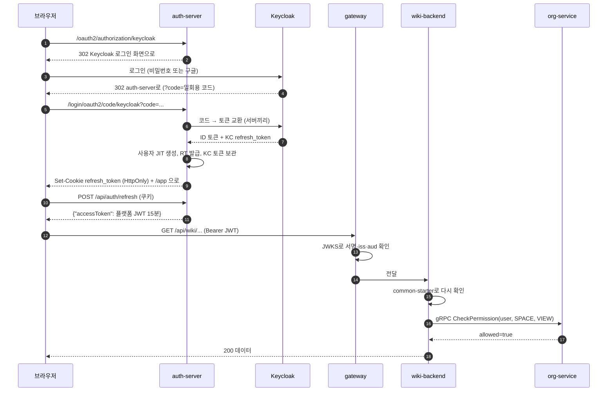
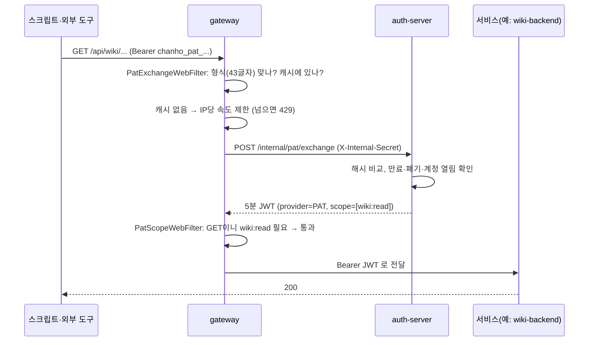
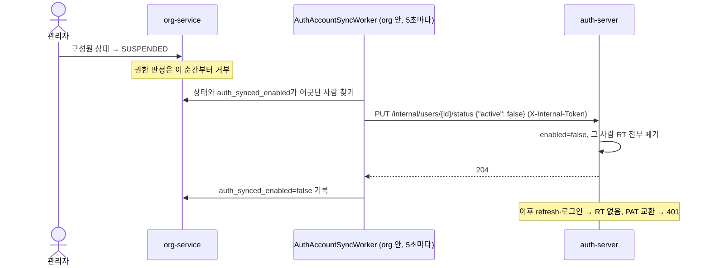
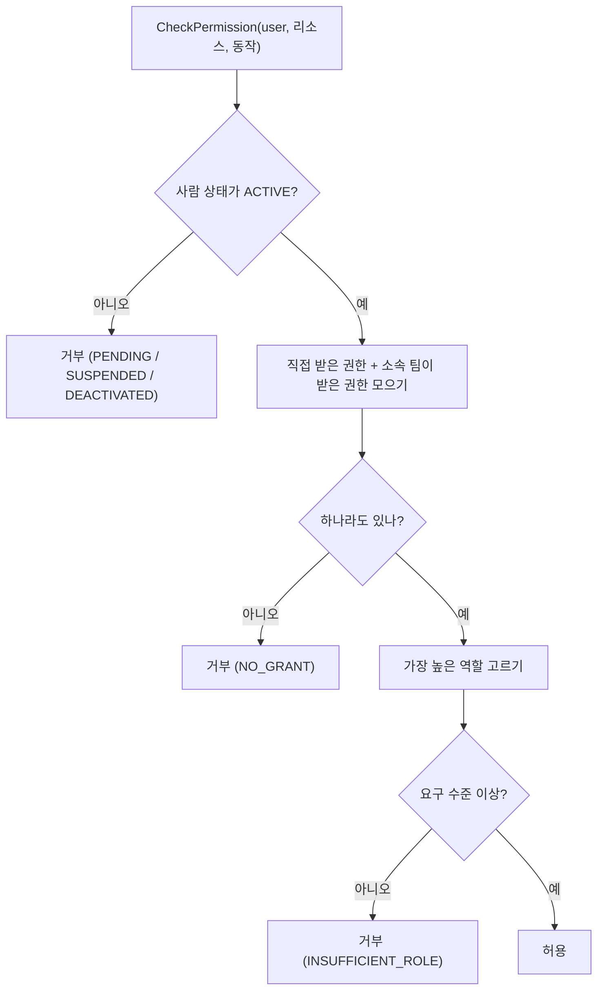

# 03 로그인과 권한 — Keycloak·OIDC·JWT·개인 API 토큰

## 한 줄 요약

**Keycloak은 "이 사람이 누구인가"만 확인하고, auth-server는 우리 플랫폼용 출입증(JWT)을 새로 찍어 주며, "이 사람이 무엇을 해도 되나"는 org-service가 매번 DB를 보고 정한다.**

---

## 왜 필요한가

### 비유 — 회사 건물 출입

회사 건물에 들어가는 과정을 떠올려 보자.

1. **신분 확인 창구(Keycloak)** — 주민등록증이나 사원증(구글 계정, 비밀번호)으로 "당신이 김철수인 것"을 확인한다.
2. **출입증 발급기(auth-server)** — 확인이 끝나면 이 건물 전용 출입증을 찍어 준다. 출입증에는 이름, 사번, 만료 시각이 적혀 있고 위조 방지 도장이 찍혀 있다.
3. **각 층의 문(각 서비스)** — 출입증의 도장이 진짜인지, 만료되지 않았는지 스스로 확인한다. 발급기에 매번 전화하지 않는다.
4. **층별 권한표(org-service)** — "김철수는 3층 회의실은 들어갈 수 있지만 5층 서버실은 안 된다"는 표. 문은 권한표 담당에게 물어본다.

여기서 핵심은 **두 질문을 분리**한 것이다.

- **인증(Authentication)** — "너 누구야?" → Keycloak
- **인가(Authorization)** — "너 이거 해도 돼?" → org-service

### 왜 둘을 나눴나

- 로그인 수단을 바꿔도 권한이 그대로다. 고객사가 구글 대신 사내 AD를 Keycloak에 붙여도 org-service의 팀·권한은 영향이 없다.
- "스페이스 A의 편집자, 프로젝트 B의 보기 전용"처럼 리소스마다 다른 권한을 Keycloak 역할로 만들면 역할 수가 폭발한다.
- 권한 변경이 바로 반영된다. 권한을 토큰에 실으면 토큰이 만료될 때까지 옛 권한이 남는다. org-service는 요청마다 DB를 본다.

---

## 먼저 용어 몇 개

| 용어 | 한 줄 뜻 |
|---|---|
| **OAuth2** | "다른 서비스에 권한을 맡기는" 표준 약속 |
| **OIDC (OpenID Connect)** | OAuth2 위에 "이 사람이 누구인지"를 얹은 표준 |
| **IdP (Identity Provider)** | 신원을 확인해 주는 쪽. 우리에게는 Keycloak |
| **Keycloak** | 오픈소스 로그인 서버. 로그인 화면·비밀번호·구글 연동을 맡는다 |
| **JWT** | 서버가 서명해 준 출입증. 내용(누구, 언제까지)과 서명이 한 줄 문자열에 들어 있다 |
| **RS256** | 개인키로 서명하고 공개키로 확인하는 서명 방식 |
| **JWKS** | 공개키를 나눠 주는 표준 주소(`/.well-known/jwks.json`) |
| **AT (Access Token)** | API를 부를 때 내미는 짧은 출입증(15분) |
| **RT (Refresh Token)** | AT가 만료되면 새 AT를 받는 데 쓰는 긴 교환권(14일) |
| **PAT** | 개인 API 토큰. 스크립트나 외부 도구가 쓰는 장기 토큰 |

---

## 우리 제품에서는 어떻게 쓰나

### 1. 로그인 — Keycloak 리다이렉트(OIDC Authorization Code)

**우리 앱은 비밀번호를 보지 않는다.** 로그인 화면은 Keycloak이 그린다. 이것은 확정 설계 결정이다. 자체 로그인 폼이나 ROPC(아이디·비밀번호를 우리 폼으로 받아 대신 전달하는 방식)로 바꾸지 않는다. 로그인 화면 모양이 마음에 안 들면 Keycloak **테마**로 바꾼다.

설정은 `auth-server/src/main/resources/application.yml`에 있다.

| 항목 | 값 |
|---|---|
| Keycloak realm | `sso-demo` (`infra/keycloak/realm-export.json`) |
| 클라이언트 id | `platform-bff` (`OIDC_CLIENT_ID`) |
| 요청 범위 | `openid,profile,email` |
| 돌아올 주소 | `{baseUrl}/login/oauth2/code/keycloak` |
| auth-server 포트 | `9000` (dev `19000`) |

프론트의 로그인 버튼은 `/oauth2/authorization/keycloak`로 보낸다. 구글로 바로 가고 싶으면 `?kc_idp_hint=google`을 붙인다(`wiki-front/src/auth/client.ts`, `myFront`·`alm-front`에도 같은 파일이 있다).

로그인이 성공하면 `LoginSuccessHandler`가 네 가지를 한다(`auth-server/.../auth/LoginSuccessHandler.java`).

1. 처음 온 사람이면 사용자를 그 자리에서 만든다(JIT — Just-In-Time 생성). 그래서 별도 회원가입 화면이 없다. 이미 있는 사람인데 계정이 **닫혀 있으면**(`users.enabled=false`, 아래 8절의 비활성 전파) 여기서 멈춘다. RT를 발급하지 않고, 초대도 소진하지 않고, 안내로 끝낸다.
2. 우리 플랫폼의 RT를 발급하고, Keycloak이 준 id_token·refresh_token을 그 옆에 저장한다(나중에 로그아웃에 쓴다).
3. RT를 쿠키로 심는다.
4. 초대 링크로 들어온 경우 초대 토큰을 처리하고, 원래 가려던 곳(또는 `/app`)으로 보낸다.

여기서 **AT는 주지 않는다.** 화면이 뜨면 프론트가 `POST /api/auth/refresh`를 불러 AT를 받는다.

> [!note] Keycloak 역할(roles)은 어떻게 넘어오나
> Keycloak ID 토큰의 `realm_access.roles`(예: `USER`, `ADMIN`)를 auth-server가 읽어 우리 JWT의 `roles` 칸으로 옮긴다(`OidcClaims.java`). 로그인 수단은 `identity_provider`에서 읽고, 없으면 `KEYCLOAK`이다.

### 2. 컨테이너 안에서의 "주소 두 개" 문제 — 수동 ClientRegistration

도커로 띄우면 Keycloak 주소가 둘이 된다.

- 브라우저가 보는 주소: `http://localhost:8080`
- 컨테이너끼리 보는 주소: `http://keycloak:8080`

Keycloak은 토큰의 발급자(`iss`)를 **브라우저가 접속한 주소**로 찍는다. 그런데 자동 설정(디스커버리)은 한 주소만 쓴다. 그래서 auth-server는 도커 프로필에서만 `ClientRegistration`을 손으로 만든다(`auth-server/.../config/ContainerClientRegistrationConfig.java`, `@Profile("docker")`).

| 용도 | 쓰는 주소 |
|---|---|
| 브라우저를 보내는 로그인 주소, 발급자 확인 | `KEYCLOAK_FRONT_ISSUER` (기본 `http://localhost:8080/realms/sso-demo`) |
| 서버끼리 토큰 교환, 공개키 받기 | `issuer-uri` (컨테이너 안 `keycloak:8080`) |
| userinfo 주소 | 일부러 뺐다. 내부 주소로 부르면 Keycloak이 401을 준다. 사용자 정보는 ID 토큰에서 읽는다 |

이것을 **split-horizon**(같은 대상을 안과 밖에서 다른 이름으로 부르는 상황)이라고 한다. 자동 디스커버리로 되돌리지 않는 것이 확정 결정이다. 도커 밖(IDE로 띄울 때)은 보통의 `issuer-uri` 자동 설정을 쓴다.

### 3. 우리 출입증 — 플랫폼 JWT

auth-server는 Keycloak 토큰을 그대로 넘기지 않고 **자기 JWT를 새로 발급**한다(`auth-server/.../jwt/JwtService.java`).

왜 그럴까? Keycloak 토큰을 그대로 쓰면 모든 서비스가 Keycloak 토큰 모양에 묶인다. 우리 JWT를 쓰면 토큰의 모양(클레임 구조)을 우리가 정한다. 이런 구조를 **BFF**(Backend For Frontend — 프론트 대신 서버가 토큰 교환을 맡는 패턴)라고 부른다.

| 항목 | 값 |
|---|---|
| 서명 | RS256, RSA 2048비트 키. 키 파일 `platform.jwk-path`(없으면 만들어 저장). 헤더에 `kid` |
| 발급자 `iss` | `PLATFORM_ISSUER` (기본 `http://localhost:9000`) |
| 대상 `aud` | `PLATFORM_AUDIENCE` (기본 `platform-api`) |
| 담긴 정보 | `sub`(내부 사용자 id), `email`, `name`, `provider`, `roles`, `iat`, `exp` |
| AT 수명 | 900초(15분) — `ACCESS_TOKEN_TTL_SECONDS` |
| 공개키 주소 | `GET /.well-known/jwks.json` (`JwksController.java`) |

**RS256의 좋은 점**은 이렇다. 서명은 auth-server만 가진 개인키로 한다. 확인은 누구나 공개키로 한다. 그래서 위키·ALM·게시판·게이트웨이는 auth-server에 묻지 않고 스스로 출입증을 확인한다. 서비스가 늘어도 "JWKS 주소 하나 설정"이면 끝이다.

### 4. AT는 메모리에, RT는 쿠키에

프론트(`wiki-front/src/auth/client.ts` 등)는 이렇게 한다.

- **AT는 자바스크립트 변수(메모리)에만** 둔다. localStorage에 두지 않는다.
- 새로고침하면 AT가 사라진다. 그래서 `POST /api/auth/refresh`(`credentials: 'include'`)로 다시 받는다.
- API가 401을 주면 한 번 refresh하고 다시 시도한다.
- 여러 곳에서 동시에 refresh를 부르면 하나로 합친다(`refreshInFlight`). 그래야 React StrictMode의 이중 호출이 아래 "재사용 탐지"에 걸리지 않는다.

RT 쿠키는 `auth-server/.../token/CookieFactory.java`가 만든다.

| 속성 | 값 | 뜻 |
|---|---|---|
| 이름 | `refresh_token` | |
| HttpOnly | 켜짐 | 자바스크립트가 못 읽는다. XSS로 훔치기 어렵다 |
| SameSite | `Lax` | 다른 사이트에서 몰래 보내는 요청을 줄인다 |
| Path | `/api/auth` | 이 경로로 가는 요청에만 실린다 |
| Secure | `COOKIE_SECURE`(기본 false) | HTTPS 운영에서는 켠다 |

### 5. RT 회전과 재사용 탐지

RT는 오래 산다(14일). 도둑맞으면 피해가 크다. 그래서 두 장치가 있다(`RefreshTokenService.java`).

- **DB에는 SHA-256 해시만** 저장한다(`refresh_tokens.token_hash`). DB가 새도 원문을 모른다.
- **쓸 때마다 새 RT로 바꾼다(회전).** 옛 RT에는 "교체됨" 표시가 남는다.
- **교체된 RT가 다시 오면**
  - 30초 안이면(`rotation-grace-seconds: 30`) 여러 탭이 동시에 refresh한 경쟁으로 본다. 401만 주고 쿠키는 건드리지 않는다.
  - 30초가 지났으면 도난으로 본다. 그 RT 계보(family) 전체를 폐기한다. 모두 다시 로그인해야 한다.
- 아무리 회전해도 **최초 로그인부터 90일**(`session-absolute-ttl-seconds: 7776000`)이 지나면 끝난다.
- 회전할 때 사용자 계정이 닫혀 있으면(`enabled=false`) 새 AT·RT를 주지 않는다.

### 6. 로그아웃 — 백채널

프론트의 `logout()`은 `POST /api/auth/logout` 하나만 부른다. 브라우저를 Keycloak으로 보내지 않는다.

auth-server는 이렇게 한다(`AuthController.java`, `KeycloakLogoutClient.java`).

1. 우리 RT 계보를 폐기한다. 이때 저장해 둔 Keycloak refresh_token을 꺼낸다.
2. 그 토큰으로 Keycloak의 `/protocol/openid-connect/logout`을 **서버끼리** 부른다(연결 2초, 읽기 3초).
3. RT 쿠키를 지운다.

Keycloak 호출이 실패해도 로그만 남기고 로그아웃은 진행한다.

**왜 이렇게 하나?** 예전에는 브라우저를 `id_token_hint`를 붙여 Keycloak으로 보내는 **프론트채널** 방식이었다. 그런데 id_token은 몇 분이면 만료되고, 우리 세션은 14일이다. 로그아웃할 때 id_token이 이미 만료돼 Keycloak 세션이 안 끊겼다. 그래서 "로그아웃했는데 다시 누르면 바로 로그인되는" 버그가 났다. Keycloak refresh_token은 SSO 세션과 함께 살아서 이 문제가 없다. 프론트채널로 되돌리지 않는 것이 확정 결정이다(근거: `auth-server`의 `V2__add_kc_refresh_token.sql` 주석).

### 7. 서비스들이 출입증을 확인하는 법 — common-starter

위키·ALM·게시판은 각자 JWT를 확인해야 한다. 예전에는 서비스마다 같은 코드를 복사해 두었다가 조금씩 어긋났다. 지금은 공용 라이브러리 **common-starter** 하나가 한다(`platform-backend/common-starter`).

| 제공하는 것 | 클래스 |
|---|---|
| JWT 확인(JWKS 공개키 + `iss` + `aud`), `roles` → `ROLE_*` | `com.platform.common.security.PlatformResourceServerAutoConfiguration` |
| 오류 응답을 `{"error": "메시지"}` 한 모양으로 | `com.platform.common.web.PlatformApiExceptionHandler` |
| 어드바이스가 못 잡은 오류(500·405·406·413·415 등)도 같은 모양으로 | `com.platform.common.web.PlatformErrorController` (`/error`) |
| 보안 체인이 끊는 401/403에도 같은 본문 | `com.platform.common.security.PlatformSecurityErrorHandlers` (서비스가 자기 체인에 꽂는다) |
| `/internal/**` 공유 토큰 검사 | `com.platform.common.security.InternalTokenFilter` |
| 서비스 간 gRPC 토큰 검사·송신 | `com.platform.common.grpc.*` ([[06 서비스끼리 대화하기 — gRPC·Redis Streams·아웃박스]]) |
| 공용 예외 | `com.platform.common.error.{NotFoundException, ForbiddenException, ConflictException, ServiceUnavailableException, BadRequestException}` |

공용 예외는 HTTP 상태와 짝이 정해져 있다. `NotFound`→404, `Forbidden`→403, `Conflict`→409, `ServiceUnavailable`→503, `BadRequest`→400이다. 사용자에게 보일 400 문구는 `BadRequestException`으로 던진다. `IllegalArgumentException`은 라이브러리도 던지므로, 원문이 한국어가 아니면 사용자에게 내보내지 않는다. 5xx는 원인을 본문에 싣지 않고 로그에만 남긴다.

**0.17.0에서 달라진 것** (`PlatformResourceServerAutoConfiguration.java` 주석)

- **켜지는 조건이 `jwk-set-uri`다.** 예전에는 `platform.jwt.issuer`·`platform.jwt.audience`가 있어야 켜져서, 새 서비스가 그 키를 빠뜨리면 audience를 검사하지 않는 Boot 기본 디코더가 조용히 떴다. 이제 JWKS를 쓰는데 issuer·audience가 비어 있으면 **기동이 실패한다**(fail-fast). 일부러 검증을 빼는 인스턴스(공개 문서 `docs` 프로필)는 이 자동 구성을 `exclude`한다.
- **JWKS 조회에 타임아웃**이 있다. 연결 2초·읽기 3초(`platform.jwt.jwks-connect-timeout`·`jwks-read-timeout`). 예전 기본값은 무한 대기라, 키 캐시가 만료되는 순간 auth-server가 느리면 모든 서비스의 인증이 함께 멈췄다.
- **내부 토큰 필터가 하나로** 합쳐졌다. org·wiki·auth에 흩어져 있던 사본을 `InternalTokenFilter` 하나로 모았다. 규칙은 앞뒤 공백 버리기(trim)·상수시간 비교·토큰이 비면 무조건 403(fail-closed)·`{"error"}` 본문이다. auth-server는 스타터를 쓰지 않아(JWT를 발급하는 쪽이라) 같은 규칙의 사본(`InternalSecretFilter`)을 둔다.

서비스는 **경로 정책(`SecurityFilterChain`)만** 직접 가진다. "어느 경로는 공개, 어느 경로는 로그인 필요"만 서비스가 정한다는 뜻이다.

지금 쓰는 버전은 **`0.17.0`**이다. `wiki-backend`·`board-service`는 `0.17.0`으로 적혀 있고, `alm-backend`·`agent-service`는 `commonProtoVersion` 기본값 `0.17.0`을 쓴다(각 `build.gradle`). wiki·alm·board가 같은 발행본을 보는 것도 확정 결정이다.

### 8. 권한 판정 — org-service

출입증이 진짜여도 "이 페이지를 고쳐도 되나"는 별개다. 이것은 org-service가 정한다. 자세한 이야기는 [[42 사람 추가와 권한 — Keycloak 원리부터 초대·grant 판정까지 쉽게 (2026-09-27)]]에 있고, 여기서는 뼈대만 본다.

- 권한은 org-service의 `grant_entry` 테이블 한 곳에 있다. 한 줄 = "누가(사람·팀), 어디에(전역·스페이스·프로젝트), 어떤 역할".
- 역할은 계단이다: `VIEWER(1) < COMMENTER(2) < EDITOR(3) < ADMIN(4)` (`org-service/.../domain/GrantRole.java`).
- 사람 상태는 `PENDING`, `ACTIVE`, `SUSPENDED`, `DEACTIVATED` 넷이다(`MemberStatus.java`). **`ACTIVE`가 아니면 권한이 뭐가 있든 거부**한다. 이것을 fail-closed(모르거나 애매하면 막는다)라고 한다.
- wiki-backend·alm-backend는 gRPC로 org-service의 `CheckPermission`을 부른다. 거부되면 이유(`PENDING`, `NO_GRANT`, `INSUFFICIENT_ROLE` 등)가 같이 온다(`common-proto`의 `org.proto`).
- 판정 본체는 `PermissionFacade.check(...)`다. 그 사람에게 직접 준 권한과, 그 사람이 속한 팀에 준 권한 중 **가장 높은 역할**로 정한다.

> [!warning] org-service가 죽으면?
> 권한을 못 물어보면 거부하는 것이 기본(fail-closed)이다. 다만 위키는 연결 자체가 안 될 때(`UNAVAILABLE`, `DEADLINE_EXCEEDED`)는 **503**을 낸다. 목록 API가 "권한 없음 → 빈 목록"을 돌려주면 사용자는 "내 문서가 다 사라졌다"고 오해하기 때문이다. 자세한 이야기는 06번과 [[20 프론트-백엔드 듀얼모드 연동 — 경계 매퍼·낙관적 락·503 전파 (2026-07-22)]].

**정지·퇴사한 사람의 세션 닫기 — 대조 워커**

org-service에서 사람을 `SUSPENDED`·`DEACTIVATED`로 바꾸면 권한 판정은 바로 거부된다. 그런데 예전에는 auth-server가 그 사실을 몰라서, 그 사람의 RT·PAT가 계속 새 출입증을 받아 갔다. 지금은 org-service가 auth-server에 알린다(확정 결정 — 구성원 상태의 정본은 org다).

- org-service `member` 표에 `auth_synced_enabled`(auth-server에 "마지막으로 반영됐다고 확인된 값") 칸이 있다(`V9__member_auth_sync.sql`).
- `AuthAccountSyncWorker`가 5초마다(`platform.org.auth-sync.poll-ms`) "원하는 값(상태)과 반영된 값이 어긋난 사람"을 최대 50명씩 찾아, auth-server 내부 API `PUT /internal/users/{id}/status {"active": bool}`을 부른다. 헤더는 `X-Internal-Token`, 값은 `ORG_INTERNAL_TOKEN`이다(`org-service/.../authsync/`).
- auth-server는 계정을 닫으면서(`enabled=false`) 그 사람의 **RT를 전부 폐기**한다. 모든 브라우저 세션이 끝난다. PAT는 지우지 않지만 **교환을 거부**한다(닫힌 계정의 PAT는 401). 그래서 정지를 풀면 PAT를 다시 만들 필요가 없다(`UserService.setActive`).
- 닫힌 사람은 다시 로그인해도 RT를 못 받는다(1절). 이미 나간 AT(최대 15분)·PAT 교환 JWT(최대 5분)는 만료까지 남는다.

왜 이벤트(Redis Streams)가 아니라 내부 API + 대조인가? org·auth 둘 다 Redis를 쓰지 않아 이벤트를 고르면 의존이 새로 생긴다. 그리고 "보냈다"가 아니라 "원하는 값과 반영된 값이 같은가"를 주기적으로 보므로, auth-server가 잠깐 죽어 있어도 다음 주기에 맞춰진다(`AuthAccountSyncService.java` 주석).

**위키 초안은 누가 보나**

초안(`Page.status`가 초안)은 **작성자 + 그 스페이스 ADMIN + 전역 ADMIN**만 본다. 게시하기 전에는 구독·멘션 알림을 보내지 않고, 검색(라이트·OpenSearch)에서도 뺀다. 스페이스 읽기 권한자 전체로 넓히지 않는 것이 확정 결정이다(2026-10-18). 판정은 페이지 열람 제한과 같은 자리(조상 체인)에서 하므로, 초안 아래 하위 문서도 함께 가려진다(`wiki-backend/.../permission/EffectivePermissionService.java`).

### 9. 관리자가 두 종류다

헷갈리기 쉽다. 둘은 별개다(`INSTALL.md` §6).

| | Keycloak realm 역할 `ADMIN` | org-service `GLOBAL ADMIN` 권한 |
|---|---|---|
| 저장 | Keycloak realm | `orgdb.grant_entry` |
| 전달 | JWT `roles` → `ROLE_ADMIN` | org-service가 DB를 직접 본다 |
| 여는 것 | 에이전트 관리, PAT·예산, 게시판 관리 우회 | 관리 화면 전체(사용자·초대·팀·권한·메일 설정), 검색 재색인 |

`/api/me`가 돌려주는 `roles`는 **Keycloak 역할**이다. 전역 관리자인지는 `GET /api/org/me`로 본다.

### 10. 개인 API 토큰(PAT)

스크립트나 외부 도구(예: AI 에이전트)가 API를 부르려면 장기 토큰이 필요하다. 그게 PAT다.

**발급** — 화면은 myFront `/app/tokens`, API는 auth-server다(`PersonalAccessTokenController.java`).

- `GET /api/auth/tokens`, `POST /api/auth/tokens`, `DELETE /api/auth/tokens/{id}`
- 이름 바꾸기 `PATCH /api/auth/tokens/{id}`, 내 토큰 **모두 폐기** `DELETE /api/auth/tokens`(204). 화면에도 같은 버튼이 있다. 모두 폐기해도 게이트웨이 교환 캐시(최대 60초)와 이미 나간 교환 JWT는 수명 동안 남는다
- 모양: `chanho_pat_` + 무작위 32바이트(base64url, 43글자)
- DB에는 **SHA-256 해시와 끝 4글자**만 저장한다. 원문은 발급할 때 한 번만 보인다.
- 만료 1~365일(기본 90일), 한 사람당 활성 토큰 최대 25개, 스코프는 반드시 고른다.

**스코프 10종** (`auth-server/.../pat/PatScopes.java`)

| 스코프 | 여는 곳 |
|---|---|
| `wiki:read` / `wiki:write` | `/api/wiki/**` |
| `alm:read` / `alm:write` | `/api/alm/**` |
| `org:read` / `org:write` | `/api/org/**` |
| `board:read` / `board:write` | `/api/board/**` |
| `search:read` | `/api/search/**` (검색은 POST여도 읽기로 본다. `search:write`는 없다) |
| `admin` | 경로에 `/admin`이 있을 때, 또는 아래 "관리 경로 표"에 있을 때 추가로 필요. `/api/migration/**`·`/api/agent/**`는 `admin` 필수 |

규칙: GET·HEAD·OPTIONS는 `:read`, 나머지는 `:write`다. `:write`는 `:read`를 포함한다. `/api/me`는 스코프 없이 통과한다.

**관리 경로 표** — 예전에는 경로에 `/admin`이 들어 있을 때만 `admin`을 요구해서, `/admin`이 없는 관리 API(권한 바꾸기 등)는 `org:write`만으로 열렸다. 지금은 실제 컨트롤러 경로를 옮겨 적은 표가 있다(`PatScopeRules.ADMIN_PATHS`).

| 서비스 | `admin`을 더 요구하는 경로 |
|---|---|
| org | `/api/org/grants/**`·`/invitations/**`·`/settings/**`(메서드 무관), 구성원 상태 변경·승인·에이전트 등록·남의 아바타(쓰기), `/members/pending`·`/members/*/events`(읽기), `/api/org/teams/**`(쓰기) |
| wiki | 페이지 제한 변경(쓰기), 스페이스 삭제·휴지통 비우기·영구 삭제(DELETE) |
| alm | `/api/alm/settings/**`·프로젝트 설정(쓰기), 프로젝트 삭제·영구 삭제(DELETE) |

경로는 정규화해서 본다. `/api/org//grants`나 `/api/org/%67rants`처럼 모양을 바꿔 표를 비켜 가지 못한다.

**PAT는 어떻게 통과하나 — 게이트웨이가 바꿔 준다**

리소스 서비스는 여전히 JWT만 본다. PAT를 JWT로 바꾸는 일은 게이트웨이가 한다.

1. `PatExchangeWebFilter`(`gateway-server/.../filter/`, 순서 `-101`, 보안 검사보다 먼저)가 `Bearer chanho_pat_…`를 알아본다. **형식 검사**를 먼저 한다. `chanho_pat_` + 43글자(base64url)가 아니면 auth-server에 묻지 않고 바로 401 `invalid_token`이다.
2. 캐시에 없으면 **속도 제한**을 거친다. IP당 초당 10회, 순간 20회(`platform.pat-exchange.rate-limit.*`, Redis). 넘으면 429 `rate_limited`. 캐시에 든 정상 토큰은 auth-server를 부르지 않으니 제한하지 않는다(`PatExchangeRateLimitConfig.java`).
3. auth-server의 내부 주소 `POST /internal/pat/exchange`를 부른다. 헤더 `X-Internal-Secret`에 공유 비밀(`AGENT_INTERNAL_SECRET`)을 싣는다.
4. auth-server가 PAT를 확인하고(해시·만료·폐기, 그리고 **계정이 열려 있는지**) **5분짜리 JWT**(`provider=PAT`, `scope` 칸 포함)를 준다.
5. 게이트웨이가 헤더를 `Bearer <JWT>`로 바꿔 끼운다. 결과는 잠깐 캐시한다(정상 60초, 무효 10초, auth-server 불능 2초).
6. `PatScopeWebFilter`(순서 `-100`)가 스코프를 검사한다. 모자라면 403 `insufficient_scope`. `scope` 칸이 없는 PAT JWT는 빈 스코프로 본다. 예전에 있던 "구버전 PAT는 그냥 통과" 분기는 2026-10-18에 지웠다(교환 JWT 수명이 5분이라 구버전 토큰이 더는 있을 수 없다).

**PAT로 절대 못 가는 곳**: `/api/platform/**`, 그리고 목록에 없는 모든 `/api/**`(예: `/api/auth/**`). auth-server도 따로 `provider=PAT` 토큰이 `/api/auth/tokens/**`·`/api/auth/agents/**`를 못 쓰게 막는다(`PatJwtGuardFilter.java`). PAT로 새 PAT를 만드는 일을 막기 위해서다.

> [!warning] 공유 비밀이 비면 PAT가 통째로 잠긴다
> `AGENT_INTERNAL_SECRET`은 gateway·auth-server·agent-service **세 곳에 같은 값**이어야 한다. 비어 있으면 `/internal/**`이 전부 403이라 PAT 인증이 안 된다. 값이 서로 다르면 PAT가 전부 401이다(`INSTALL.md` §3).

### 11. 게이트웨이의 1차 검사

게이트웨이도 JWT를 확인한다(`gateway-server/.../config/SecurityConfig.java`). 무효한 토큰이 내부망에 들어오기 전에 401로 돌려보낸다. 서비스도 다시 확인한다(이중 방어).

토큰 없이 통과시키는 경로는 이렇다.

- `OPTIONS`(CORS 사전 확인), `/oauth2/**`, `/login/**`, `/invite/**`, `/api/auth/**`, `/.well-known/**`, `/fallback/**`
- `/actuator/health`, `/actuator/info`
- `/api/wiki/collaboration/**` (공동 편집 WebSocket — Redis 1회용 입장권으로 따로 확인)
- `GET /api/board/posts/**` (게시판 읽기는 공개)
- 에이전트 MCP·러너 경로(`/api/agent/mcp/**`, `/api/agent/runners/...`) — agent-service가 자기 토큰으로 직접 확인

나머지는 전부 로그인이 필요하다.

---

## 흐름 그림

### 로그인부터 첫 API 호출까지

### PAT 한 번의 여정

### 사람을 정지하면 무엇이 닫히나

### 권한 판정의 생각 순서

---

## 자주 헷갈리는 점 / 함정

1. **"Keycloak `ADMIN` 역할을 주면 관리 화면이 열린다"** — 아니다. 관리 화면은 org-service의 `GLOBAL ADMIN` 권한으로 연다. 첫 관리자는 `.env`의 `PLATFORM_BOOTSTRAP_ADMIN_ID`로 만든다(`INSTALL.md` §6).
2. **"로그인했는데 모든 화면이 403이다"** — 초대 없이 들어와 `PENDING`(승인 대기)으로 격리된 것이다. `/api/org/me`만 통과한다. 관리자가 승인하거나 초대해야 한다.
3. **"proto의 Role 숫자가 계단 순서겠지"** — 아니다. `org.proto`의 `Role`은 `VIEWER=1, EDITOR=2, ROLE_ADMIN=3, COMMENTER=4`라 순서가 아니다. 진짜 계단은 org-service의 `GrantRole`(1~4)이다.
4. **"수동 ClientRegistration은 항상 쓰인다"** — 도커 프로필에서만이다. IDE로 띄우면 보통의 자동 설정이다.
5. **"realm 설정을 바꿨는데 반영이 안 된다"** — `realm-export.json`은 빈 볼륨 최초 1회만 import된다. 이미 떠 있으면 admin 콘솔·kcadm으로 고친다. 볼륨을 지워서 해결하지 않는다.
6. **"AT가 쿠키에 있다"** — 오래된 정리 노트(14번)에는 그렇게 적힌 곳이 있다. 지금 코드는 AT를 **프론트 메모리**에, RT만 쿠키에 둔다.
7. **"PAT는 서비스가 직접 확인한다"** — 아니다. 서비스는 PAT를 모른다. 게이트웨이가 JWT로 바꿔 준다.
8. **"정지하면 그 자리에서 모든 출입증이 죽는다"** — 거의 그렇지만 바로는 아니다. RT는 대조 워커가 auth-server에 반영하는 순간(보통 몇 초) 폐기되고, 이미 받은 AT(최대 15분)와 PAT 교환 JWT(최대 5분)는 만료까지 산다. 그 사이 권한 판정은 org-service가 이미 거부한다. 워커가 `ORG_INTERNAL_TOKEN`이나 auth-server 주소를 몰라 반영을 못 하면 org-service 로그에 오류가 한 번 남는다.
9. **"새 서비스에 `platform.jwt.issuer`를 빠뜨려도 대충 돈다"** — 0.17.0부터는 아니다. JWKS 주소가 있는데 issuer·audience가 비면 기동이 실패한다. 예전에는 audience 검사 없이 조용히 떴던 것을 일부러 막았다.
10. **"`org:write` PAT면 권한도 바꿀 수 있다"** — 아니다. 권한·초대·팀·구성원 상태 같은 관리 경로는 경로에 `/admin`이 없어도 `admin` 스코프를 더 요구한다(관리 경로 표).

---

## 더 읽을 거리

- [[42 사람 추가와 권한 — Keycloak 원리부터 초대·grant 판정까지 쉽게 (2026-09-27)]] — 초대·승인·grant 판정을 더 자세히
- [[01 인증 플랫폼 (Keycloak BFF + 자체 JWT)]] — 처음 만들 때의 기록
- [[18 배포 로그인·로그아웃 사건 — KC iss-호스트 대조와 split-horizon의 한계 (2026-07-19)]] — 주소 두 개 문제의 실제 사건
- [[auth-server RT 하드닝 — 동시성·롤백 버그·수명 관리 (2026-07-19)]] — RT 회전의 세부
- [[04 게이트웨이와 서비스 찾기 — Spring Cloud Gateway·Eureka]] — 게이트웨이 필터 순서
- [[45 전체 검수 96건과 기능 공백 보완 — 병합·보안·성능·운영 하드닝 (2026-10-18)]] — 비활성 전파·PAT 관리 경로 표·스타터 0.17.0이 들어온 날
- 코드: `auth-server/src/main/java/com/platform/authserver/{auth,jwt,token,pat,user,config}/`, `gateway-server/.../filter/PatExchangeWebFilter.java`·`PatScopeWebFilter.java`·`PatScopeRules.java`, `gateway-server/.../config/PatExchangeRateLimitConfig.java`, `platform-backend/common-starter/`, `platform-backend/org-service/.../authsync/`, `platform-backend/org-service/.../permission/PermissionFacade.java`, `platform-backend/common-proto/src/main/proto/platform/org/v1/org.proto`, `wiki-backend/.../permission/EffectivePermissionService.java`

---

## 스스로 점검 질문

**1. 위키 백엔드는 JWT가 진짜인지 확인하려고 매 요청마다 auth-server에 물어보는가? 그렇지 않다면 어떻게 확인하나?**

> [!note]- 답
> 물어보지 않는다. auth-server는 개인키로 RS256 서명을 하고, 공개키를 `/.well-known/jwks.json`으로 공개한다. 위키는 `common-starter`가 만든 디코더로 공개키를 받아 서명을 확인하고, `iss`(`http://localhost:9000`)와 `aud`(`platform-api`)도 맞는지 본다.

**2. 로그아웃을 프론트채널(`id_token_hint` 리다이렉트)에서 백채널로 바꾼 이유는?**

> [!note]- 답
> id_token은 몇 분이면 만료되는데 우리 세션(RT)은 14일이다. 로그아웃 시점에 id_token이 이미 만료돼 있으면 Keycloak 세션이 안 끊겨서, 다시 로그인을 누르면 바로 로그인되는 버그가 났다. 백채널은 auth-server가 보관한 Keycloak refresh_token으로 서버끼리 `end_session`을 부르므로 이 문제가 없다.

**3. `wiki:read` 스코프만 있는 PAT로 `POST /api/wiki/...`를 부르면 어떻게 되나? `POST /api/search/graphql`은?**

> [!note]- 답
> 위키 POST는 쓰기라서 `wiki:write`가 필요하다. 게이트웨이 `PatScopeWebFilter`가 403 `insufficient_scope`를 돌려준다. 검색은 POST여도 읽기로 보므로 `search:read`가 필요하다. `wiki:read`만으로는 검색도 403이다.
