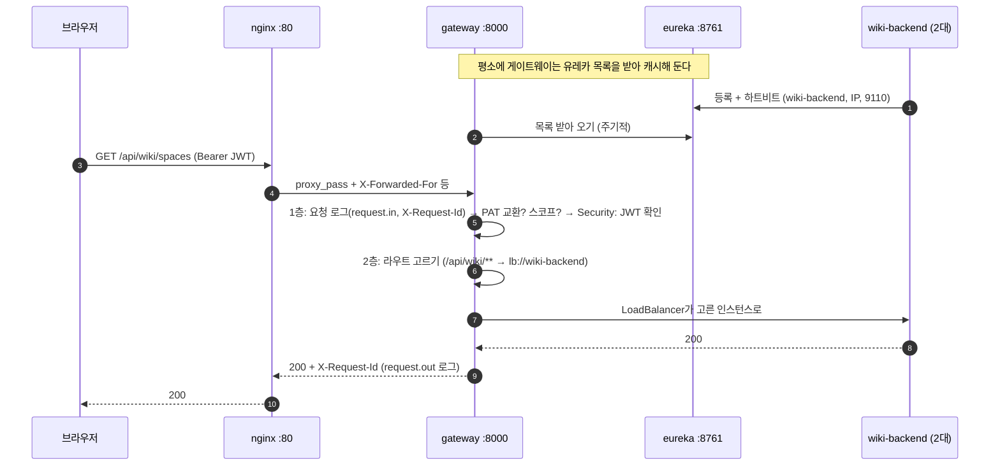
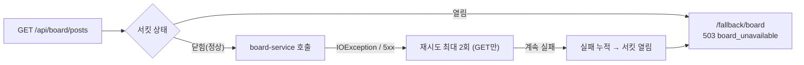
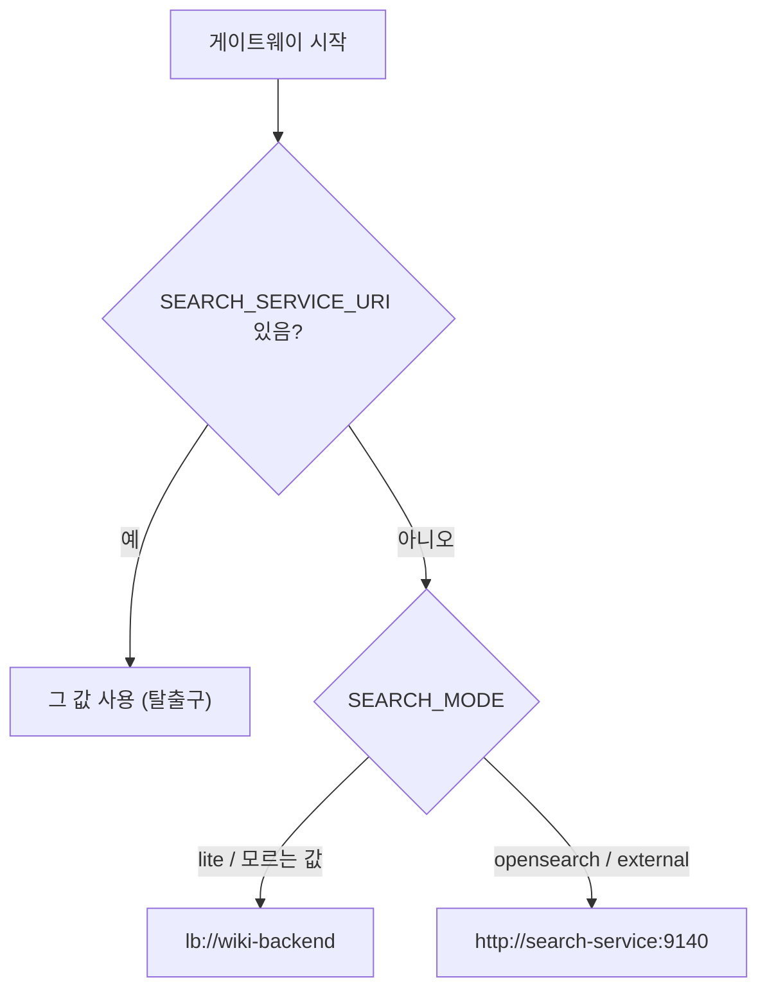

# 04 게이트웨이와 서비스 찾기 — Spring Cloud Gateway·Eureka

## 한 줄 요약

**게이트웨이(gateway-server)는 모든 API 요청이 거치는 정문이고, 유레카(eureka-server)는 "어느 서비스가 지금 어디에 살고 있나"를 적어 둔 주소록이다.**

---

## 왜 필요한가

### 비유 — 큰 병원의 안내 데스크와 내선 전화번호부

큰 병원에 처음 가면 바로 진료실을 찾아가지 않는다. 먼저 **안내 데스크**에 간다.

- 안내 데스크는 "내과는 3층 왼쪽입니다"라고 길을 알려 준다. → **라우팅**
- 환자 등록증이 있는지 먼저 본다. → **인증 1차 검사**
- 한 사람이 1분에 백 번 접수하려 하면 막는다. → **속도 제한(rate limit)**
- 내과가 오늘 휴진이면 "지금은 진료가 어렵습니다"라고 바로 말해 준다. → **서킷 브레이커와 fallback(대신 돌려주는 안내 응답)**

안내 데스크 직원은 의사의 방 번호를 외우지 않는다. **내선 전화번호부**를 본다.
의사가 방을 옮기면 번호부만 바뀐다. 안내 데스크는 그대로 일한다. 이 번호부가 **유레카**다.

### 정문이 없으면 생기는 일

브라우저가 서비스 열 개의 주소를 직접 안다고 해 보자.

- 로그인 검사, 속도 제한, CORS 설정이 열 군데로 흩어진다.
- 서비스 내부 구조(포트, 몇 대인지)가 바깥 계약이 되어 버린다. 서비스를 하나 옮기면 프론트를 고쳐야 한다.

게이트웨이는 이 모든 공통 일을 **한 곳**에서 처리한다. 이것을 **API Gateway 패턴**이라고 한다.

---

## 먼저 용어 몇 개

| 용어 | 한 줄 뜻 |
|---|---|
| **Spring Cloud Gateway (SCG)** | 스프링으로 만든 API 게이트웨이 라이브러리 |
| **WebFlux / Netty** | 요청 하나에 스레드 하나를 붙잡지 않는 "논블로킹" 방식의 웹 서버. 기다림이 많은 프록시에 맞는다 |
| **라우트(route)** | "이 경로로 온 요청은 저 서비스로" 규칙 한 줄 |
| **프레디케이트(predicate)** | 라우트가 맞는지 판단하는 조건(예: `Path=/api/wiki/**`) |
| **필터(filter)** | 요청을 넘기기 전·후에 끼어드는 처리(속도 제한, 재시도 등) |
| **서비스 디스커버리** | 서비스 주소를 설정에 박지 않고, 실행 중에 이름으로 찾는 방식 |
| **`lb://`** | "유레카에서 이 이름의 인스턴스를 찾아 골라 보내라"는 주소 표기 |
| **서킷 브레이커** | 계속 실패하는 곳에는 잠시 요청을 보내지 않고 바로 실패를 돌려주는 차단기 |

---

## 우리 제품에서는 어떻게 쓰나

### 1. 게이트웨이의 기본 정보

| 항목 | 값 | 근거 |
|---|---|---|
| 리포 | `gateway-server` | |
| 종류 | WebFlux(리액티브) 변형 — `spring-cloud-starter-gateway-server-webflux` | `gateway-server/build.gradle` |
| 버전 | Spring Boot `4.0.6`, Spring Cloud `2025.1.2`, Java 24 | 같은 파일 |
| 포트 | `8000` (dev `18000`) | `application.yml`, `application-dev.yml` |
| 호스트 공개 | **안 한다.** 컨테이너 안에서만 닿는다. 입구는 nginx다 | `INSTALL.md` §1 |
| 라우트 정의 | 전부 YAML(`spring.cloud.gateway.server.webflux.routes`). 자바 코드 라우트는 없다 | `application.yml` |

### 2. 라우트 — 어떤 경로가 어디로 가나

`gateway-server/src/main/resources/application.yml`에 라우트가 18개 있다(2026-10-18 기준).

| 경로 | 보내는 곳 | 붙은 필터 |
|---|---|---|
| `/oauth2/**`, `/login/**`, `/invite/**` | `lb://auth-server` | 속도 제한 초당 10, 순간 20 |
| `/api/auth/**` | `lb://auth-server` | 속도 제한 초당 5, 순간 10 |
| `/.well-known/**`, `/api/me` | `lb://auth-server` | 없음 |
| `/api/board/**` | `lb://board-service` | 서킷 브레이커 + 재시도(GET만 2회) |
| `/api/org/**` | `ORG_SERVICE_URI` (기본 `lb://org-service`) | 서킷 브레이커 + 재시도(GET만 2회, 연결 실패일 때만) |
| `/api/wiki/collaboration/**` | collaboration-service (WebSocket) | 없음. 위키 라우트보다 먼저 검사(`order: -1`, `-2`) |
| `/api/wiki/pages/*/export.pdf`, 위키 첨부 올리기·확정 | `lb://wiki-backend` | **응답 제한 60초**(장시간 라우트 `wiki-long`) + 서킷 브레이커 + 재시도 |
| `/api/wiki/**` | `lb://wiki-backend` | 서킷 브레이커 + 재시도 |
| `/api/alm/issues/*/attachments`, `/api/alm/projects/*/issues/import` | `ALM_SERVICE_URI` | **응답 제한 60초**(`alm-long`) + 서킷 브레이커 + 재시도 |
| `/api/alm/**` | `ALM_SERVICE_URI` (기본 `lb://alm-backend`) | 서킷 브레이커 + 재시도 |
| `/api/agent/office/stream` | agent-service (SSE, 응답 시간 제한 없음) | 서킷 브레이커만(재시도 없음 — 재연결은 브라우저 몫) |
| `/api/agent/**` | `AGENT_SERVICE_URI` (기본 `lb://agent-service`) | 서킷 브레이커 + 재시도 |
| `/api/migration/**` | `MIGRATION_SERVICE_URI` | 서킷 브레이커 + 재시도 |
| `/api/search/**` | `SEARCH_MODE`로 정해진 곳 | `StripPrefix=2`, 서킷 브레이커, 속도 제한 초당 5, 순간 15 |

장시간 라우트(`wiki-long`, `alm-long`)는 일반 라우트보다 **위에** 적혀 있어야 먼저 맞는다. 전역 응답 제한 10초가 큰 문서 PDF 생성·20MB 첨부 저장을 504로 자르던 경로만 골라 60초로 늘렸다(P-10).

`StripPrefix=2`는 앞 두 조각을 떼는 필터다. `/api/search/graphql`이 `/graphql`로 바뀌어 넘어간다. 경로를 바꾸는 필터는 이것 하나뿐이다.

> [!note] `${ORG_SERVICE_URI:lb://org-service}`는 무슨 뜻?
> "환경변수 `ORG_SERVICE_URI`가 있으면 그 값, 없으면 `lb://org-service`"라는 뜻이다. 도커에서는 compose가 이 변수에 컨테이너 주소를 넣어 준다. 그래서 같은 설정 파일로 도커와 개발 환경을 모두 돌린다.

### 3. 요청이 게이트웨이 안에서 지나가는 순서

게이트웨이 안은 **두 층**이다.

**1층 — 라우팅 이전(WebFilter)**

1. `RequestLoggingFilter` (순서 `-102`) — **맨 앞**에서 돈다. 요청 id(`X-Request-Id`)를 붙이고 `request.in` / `request.out` 로그를 남긴다. 같은 id를 **응답 헤더**에도 실어 돌려준다(`gateway-server/.../filter/RequestLoggingFilter.java`).
2. `PatExchangeWebFilter` (순서 `-101`) — 개인 API 토큰(`chanho_pat_…`)이면 JWT로 바꿔 끼운다. 03번 참고.
3. `PatScopeWebFilter` (순서 `-100`) — PAT 스코프를 검사한다.
4. **Spring Security** — CORS 처리, JWT 확인(공개키·`iss`·`aud`). 실패하면 여기서 401로 끝난다.

**2층 — 게이트웨이 라우팅**

5. 경로로 라우트를 고른다.
6. 라우트별 필터 — 속도 제한, 서킷 브레이커, 재시도.
7. 실제 서비스 호출 — 연결 3초, 응답 10초 제한(장시간 라우트는 60초).

> [!note] 예전에는 401 요청이 접근 로그에 안 남았다
> 2026-10-18 전까지 로깅 필터는 2층(GlobalFilter)에 있었다. 그래서 1층 보안 검사에서 401/403으로 끝난 요청, PAT 거부, `/api/platform/**`·`/fallback/**` 같은 컨트롤러 응답은 로그에 한 줄도 없었다. 조사할 때 가장 필요한 것들이다. 그래서 로깅을 PAT 필터보다도 앞(`-102`)의 WebFilter로 옮겼다(P-12).
>
> 응답의 `X-Request-Id`는 사용자가 오류 화면에서 "요청 번호"를 보고할 수 있게 하려는 것이다. 클라이언트가 보낸 값은 영문·숫자·`._-` 64자 이내일 때만 그대로 쓰고, 아니면 새로 만든다(로그 인젝션 방지). CORS 노출 헤더에도 넣어서 다른 오리진의 개발 서버 화면도 읽을 수 있다.

### 4. 속도 제한 — 토큰 버킷과 Redis

로그인 경로는 비밀번호 대입 공격의 표적이다. 그래서 `/api/auth/**` 같은 경로에 속도 제한을 건다.

- 방식은 **토큰 버킷**이다. 양동이에 일정 속도로 토큰이 차고, 요청 하나가 토큰 하나를 쓴다. 평균 속도(초당 N)와 순간 허용량(버스트)을 따로 정할 수 있다.
- 카운터는 **Redis**에 둔다. 게이트웨이가 여러 대여도 같은 카운터를 본다.
- **Redis가 죽으면 통과시킨다(fail-open).** 속도 제한기가 고장 났다고 로그인 전체가 막히면 안 되기 때문이다.
- 누구를 기준으로 셀까? **사용자 IP**다. 그런데 게이트웨이 앞에 nginx가 있어서 게이트웨이가 보는 IP는 nginx 것이다. 그래서 `X-Forwarded-For` 헤더의 **맨 오른쪽 값**(nginx가 붙인 실제 접속 IP)을 쓴다. 코드는 `XForwardedRemoteAddressResolver.maxTrustedIndex(1)`이다(`gateway-server/.../config/RateLimitConfig.java`). 맨 왼쪽 값은 사용자가 마음대로 써 넣을 수 있어서 믿지 않는다.

nginx에도 따로 속도 제한이 하나 있다. PAT로 오는 요청(`chanho_pat_`, `agp_`, `agr_`로 시작하는 토큰)은 IP당 초당 20, 순간 40까지만 받고 넘치면 429를 준다(`infra/nginx/default.conf`의 `pat_exchange` 존). PAT 교환은 게이트웨이 라우트 속도 제한보다 앞에서 일어나기 때문이다.

게이트웨이 안의 PAT 교환 필터도 2026-10-18부터 두 겹을 더 막는다(P-08, 자세한 건 03번).

- **형식 검사** — `chanho_pat_` + 43자가 아니면 auth-server에 묻지도 않고 401이다. 아무 문자열이나 보내 auth-server·DB를 두드리는 것을 막는다.
- **교환 직전 속도 제한** — 캐시에 없는 PAT만 auth-server를 부르는데, 그 직전에 IP당 초당 10, 순간 20(`PAT_EXCHANGE_RATE`/`PAT_EXCHANGE_BURST`)을 건다. 넘치면 429 `{"error":"rate_limited"}`. 같은 Redis를 쓰므로 Redis가 죽으면 마찬가지로 통과시킨다.

### 5. 서킷 브레이커와 재시도 — 모든 제품 라우트

처음에는 게시판(`/api/board/**`)에만 장애 대비 장치가 있었다. 2026-10-18부터는 **org·wiki·alm·agent·migration·search 라우트에도** 서킷 브레이커가 붙었다(P-10).

| 장치 | 설정 | 이유 |
|---|---|---|
| 서킷 브레이커(Resilience4j) | 연결 실패·응답 시간 초과가 쌓이면 바로 `/fallback/<서비스>`로 → **503 `{"error": 메시지}`** | 죽은 서비스에 계속 요청을 보내 시간을 버리지 않으려고 |
| 재시도 | GET만, 2회. 게시판은 서버 오류·`IOException`일 때, 나머지 제품 라우트는 **연결 실패(`IOException`)일 때만** | GET은 여러 번 해도 결과가 같아(멱등) 안전하다. 5xx까지 재시도하면 이미 힘든 서비스에 부하를 3배로 얹는다 |
| 시간 제한 | 게시판만 `timelimiter` 11초. 나머지는 **TimeLimiter를 끈다** | 시간 한도는 httpclient 응답 제한(10초, 장시간 라우트 60초)이 맡는다 |

fallback 응답(`gateway-server/.../web/FallbackController.java`)은 공용 오류 계약과 같은 모양이다. 위키·ALM 화면은 `error` 문장을 그대로 토스트로 띄운다.

| 서킷 이름 | `error` 값 |
|---|---|
| `board` | `board_unavailable` (myFront가 코드로 매핑하는 옛 계약이라 유지) |
| `wiki`, `alm`, `org`, `agent`, `migration`, `search` | "위키 서비스에 일시적으로 연결할 수 없습니다. 잠시 후 다시 시도해 주세요." 같은 한국어 문장 |

> [!note] 실제로 있었던 사고
> 처음에는 Resilience4j 기본 시간 제한(1초)이 그대로라서 정상 응답까지 503으로 바뀌었다. 그래서 게시판은 응답 제한보다 긴 11초로 맞췄다. [[08 게이트웨이 트래픽 제어 + JWT 조기차단 (2026-07-03)]].
> 제품 라우트에서 TimeLimiter를 아예 끈 것도 같은 교훈이다. TimeLimiter는 "응답을 다 쓸 때까지"의 상한이라, 큰 첨부 다운로드처럼 바이트가 계속 흐르는 정상 응답도 자른다.

> [!warning] 서비스가 직접 낸 503은 fallback이 아니다
> 서킷 브레이커에 상태 코드 조건을 걸지 않았다. 그래서 위키가 "org가 응답하지 않는다"며 직접 낸 503 `{"error": …}`은 그대로 전달된다. fallback은 게이트웨이가 서비스에 **닿지 못했을 때**만 나온다.

### 6. CORS는 게이트웨이 한 곳에서

**CORS** — "다른 주소(오리진)의 웹페이지가 이 응답을 읽어도 되나"를 브라우저가 판단하는 규칙. 서버를 지키는 장치가 아니라 브라우저 규칙이다.

- CORS 설정은 게이트웨이 `SecurityConfig`의 `CorsConfigurationSource` 하나뿐이다. 허용 오리진은 `platform.cors-allowed-origin`(기본 `http://localhost:5173`, **쉼표로 여러 개** 적을 수 있다), 쿠키를 보내도록 `allowCredentials(true)`.
- 허용 메서드는 `GET, POST, PUT, PATCH, DELETE, OPTIONS`다. 예전에는 `PATCH`가 빠져 있어서 개발 서버에서 PATCH 요청이 CORS로 막혔다(P-16). 노출 헤더는 `X-Request-Id`.
- **Spring Security 안에 넣은 이유** — 그래야 401 응답에도 CORS 헤더가 붙는다. 안 붙으면 브라우저가 401 응답을 가려 버려서, 프론트가 "401이면 토큰 갱신"을 할 수 없다.
- 운영(nginx 한 주소)에서는 화면과 API가 같은 오리진이라 CORS가 아예 등장하지 않는다. CORS 설정은 개발 모드용이다.

### 7. trusted-proxies — 전달 헤더를 믿을 상대

nginx는 `X-Forwarded-Host`, `X-Forwarded-Proto`, `X-Forwarded-For`를 붙여 보낸다. 이 헤더로 auth-server가 로그인 후 돌아올 주소(`redirect_uri`)를 만든다.

그런데 이 헤더는 누구나 위조할 수 있는 평문이다. 그래서 SCG 4.1부터는 **`trusted-proxies`를 설정하지 않으면 이 헤더를 버린다.**

예전에는 설정 하나가 루프백과 사설 대역 전체를 믿었다. 2026-10-18부터 **프로필마다 믿는 범위가 다르다**(P-23).

| 프로필 | 믿는 상대 | 파일 |
|---|---|---|
| 없음(기본) | 루프백만 — 같은 호스트의 프록시(vite·로컬 nginx) | `application.yml` |
| `dev` | 루프백 + 사설 대역 전체(10.x, 172.16~31.x, 192.168.x) — 도커 NAT로 호스트의 dev 게이트웨이에 붙는 경우까지 | `application-dev.yml` |
| `docker` | 도커 브리지 주소 풀(172.16~31.x, 192.168.x)만. `GATEWAY_TRUSTED_PROXIES`로 nginx IP 하나까지 좁힐 수 있다 | `application-docker.yml` |

이 값은 "전달 헤더를 서비스에 넘길지"만 정한다. 속도 제한의 IP 기준(XFF 맨 오른쪽 한 칸)과는 별개다.

> [!warning] 실제로 있었던 사고
> 이 보안 변경을 몰라서 로그인 `redirect_uri`가 거부된 적이 있다. [[12 크로스앱 내비게이션 + redirect_uri 사건 + 운영 전환 로드맵 (2026-07-15)]].

### 8. 검색 라우트는 스위치가 정한다 — SEARCH_MODE

`/api/search/**`의 목적지는 설정 파일에 박혀 있지 않다. 게이트웨이가 시작할 때 `SEARCH_MODE` 값을 보고 계산한다(`gateway-server/.../search/SearchModeEnvironmentPostProcessor.java`, `SearchMode.routeUri()`).

| `SEARCH_MODE` | 목적지 |
|---|---|
| `lite` (기본) | `lb://wiki-backend` — 위키의 라이트 검색 |
| `opensearch` | `http://search-service:9140` |
| `external` | `http://search-service:9140` (search-service가 고객사 OpenSearch에 붙는다) |

`SEARCH_SERVICE_URI`가 있으면 계산을 이긴다. 비상 탈출구라서 평소에는 비워 둔다. 남아 있으면 모드를 바꿔도 라우트가 안 바뀐다. compose 기본값으로 되살리지 않는 것이 확정 결정이다.

같은 값으로 `/api/platform/features`도 답한다(`PlatformFeaturesController.java`). 응답은 `{"search":{"mode","unified","reindex"}}`이고, 프론트는 이걸 보고 화면을 바꾼다. 자세한 건 [[09 검색 — 라이트 검색과 OpenSearch]].

### 9. 관리자 대시보드용 헬스 모음

`/api/platform/health`는 서비스들의 상태를 한 번에 모아 준다(`HealthAggregator.java`). 전역 관리자만 쓸 수 있다.

- 서비스 하나당 3초, 전체 5초 안에 묻는다.
- 결과를 **20초 동안 캐시**한다. 대시보드를 여러 명이 열어도 서비스에 질문이 몰리지 않는다.
- 검색 행은 `SEARCH_MODE`에 따라 빠진다.

### 10. 유레카 — 서비스 주소록

| 항목 | 값 | 근거 |
|---|---|---|
| 리포 | `eureka-server` | |
| 포트 | `8761` (dev `18761`) | `application.yml`, `application-dev.yml` |
| 구성 | 단일 노드. 자기 자신을 등록하지 않고(`register-with-eureka: false`) 다른 유레카를 조회하지 않는다(`fetch-registry: false`) | `application.yml` |

유레카가 움직이는 방식은 세 단계다.

1. **자기 등록** — 각 서비스가 켜질 때 `spring.application.name`(예: `wiki-backend`)과 자기 IP·포트를 유레카에 적는다.
2. **하트비트** — 살아 있다고 주기적으로 신고한다. 신고가 끊기면 목록에서 빠진다.
3. **이름으로 찾기** — 게이트웨이가 `lb://wiki-backend`를 만나면 목록에서 인스턴스를 하나 골라 보낸다. 고르는 일은 **Spring Cloud LoadBalancer**가 한다. 이렇게 호출하는 쪽이 직접 고르는 것을 **클라이언트 사이드 로드밸런싱**이라고 한다.

> [!note] 유레카가 죽으면 다 멈출까?
> 아니다. 클라이언트는 목록을 **자기 쪽에 캐시**해 둔다. 유레카가 죽어도 마지막 목록으로 계속 보낸다. 대신 새로 뜨거나 죽은 서비스가 반영되지 않는다. 같은 이유로 반영에 수십 초 지연이 있다. [[09 유레카 서비스 디스커버리 (2026-07-05)]].

### 11. 도커에서는 "섞어서" 찾는다 — 하이브리드 디스커버리

헷갈리기 쉬운 부분이다. 도커 배포판에서도 유레카는 쓰인다. 다만 **모든 서비스가 등록하지는 않는다.**

| 서비스 | 도커에서 유레카 등록 | 게이트웨이가 찾는 법 |
|---|---|---|
| auth-server, board-service | 한다 | `lb://` |
| wiki-backend | 한다 (`WIKI_EUREKA_ENABLED` 기본 true) | `lb://wiki-backend` — 여러 대로 나눠 보낸다 |
| org-service, alm-backend, agent-service, search-service | 안 한다(`docker` 프로필에서 `enabled: false`) | compose가 넣어 준 `*_SERVICE_URI`로 컨테이너 이름에 직접 |
| migration-service | 안 한다(compose가 `false`로) | `MIGRATION_SERVICE_URI` |
| docs-backend | 안 한다 | 게이트웨이를 아예 안 거친다. nginx가 직접 보낸다 |

**위키만 등록하는 이유**는 위키를 두 대로 띄우기 때문이다. 배포 워크플로가 `--scale wiki-backend=2`로 띄운다(`INSTALL.md` §9). compose 파일에는 위키의 `container_name`이 없어서 여러 대로 늘릴 수 있다. 두 대에 나눠 보내려면 이름 하나로 여러 인스턴스를 찾는 `lb://`가 필요하다.

그래서 `lite` 검색의 목적지를 `http://wiki-backend:9110`처럼 직접 적으면 안 된다. 한 대에만 붙어서 분산이 조용히 사라진다(`INSTALL.md` §4).

개발 환경(dev 오프셋)에서는 모든 서비스가 `localhost:18761` 유레카에 등록한다. 그래서 IntelliJ에서 서비스를 켜는 순서가 자유롭다. 등록되는 대로 라우팅이 살아난다.

### 12. nginx와 게이트웨이의 관계

브라우저는 게이트웨이를 직접 보지 못한다. nginx가 경로를 보고 나눈다(`infra/nginx/default.conf`).

| nginx 경로 | 가는 곳 |
|---|---|
| `/api/` · `/oauth2/` · `/login/` · `/invite/` · `/.well-known/` (정규식 한 줄) | `gateway:8000` |
| `/api/wiki/collaboration` | `gateway:8000` (WebSocket 업그레이드, 읽기 1시간) |
| `/api/agent/office/stream` | `gateway:8000` (SSE, 버퍼링 끔) |
| `/api/docs/` | `docs-backend:9110` (게이트웨이를 거치지 않음, `/api/wiki/`로 바꿔서) |
| `/wiki/`, `/alm/`, `/docs/` | `/srv/apps`의 화면 파일 |
| `/` | `/srv/portal`(myFront) |

정규식 끝의 `/`가 중요하다. `/login/`은 게이트웨이로 가지만 `/login`(슬래시 없음)은 myFront의 로그인 화면이 받는다.

---

## 흐름 그림

### 요청 하나가 게이트웨이를 지나는 길

### 제품 서비스가 죽었을 때 (게시판 예시)

위키·ALM 등도 모양은 같다. 다만 재시도는 연결 실패일 때만이고, fallback은 `/fallback/wiki` 같은 이름으로 가서 503 `{"error":"위키 서비스에 일시적으로 연결할 수 없습니다. …"}`를 준다.

### SEARCH_MODE가 라우트를 정하는 과정

---

## 자주 헷갈리는 점 / 함정

1. **"도커에서는 유레카를 안 쓴다"** — 틀렸다. auth·board·wiki는 도커에서도 등록하고 `lb://`로 찾는다. org·alm·agent·search·migration만 DNS 직결이다. 그래서 유레카도, `*_SERVICE_URI`들도 둘 다 필요하다. 루트 `README.md`의 일부 문장은 위키를 "미등록"으로 적고 있지만, 지금 위키 설정(`WIKI_EUREKA_ENABLED` 기본 true)과 `INSTALL.md` §4는 등록이 맞다.
2. **"`localhost:8000`으로 게이트웨이에 붙어 보자"** — 도커 배포판은 게이트웨이 포트를 호스트에 열지 않는다. 8000이 Windows 예약 포트 구간에 걸리는 일이 있어서 아예 없앴다. nginx(`http://localhost`)로 들어간다. dev 클러스터는 `:18000`이다.
3. **"유레카 등록 이름이 다르다"** — `lb://board-service`의 이름은 그 서비스의 `spring.application.name`과 정확히 같아야 한다.
4. **"Windows에서 lb:// 라우팅이 전부 500"** — 서비스가 호스트 이름(`DESKTOP-xxx.mshome.net`)으로 등록되면 이름을 못 풀어 실패한다. `eureka.instance.prefer-ip-address: true`로 IP를 등록하게 한다. 게이트웨이 설정에도 들어 있다.
5. **"공개 경로를 서비스에서만 바꿨다"** — 게이트웨이도 JWT를 검사하므로, 서비스에서 공개로 바꾼 경로는 게이트웨이 `SecurityConfig`에도 같이 열어야 한다. 두 목록은 손으로 맞추는 약속이다.
6. **"503이 떴으니 서비스가 오류를 냈다"** — 게이트웨이 fallback일 수 있다. 본문이 "…에 일시적으로 연결할 수 없습니다"면 게이트웨이가 서비스에 닿지 못한 것이다. 응답의 `X-Request-Id`로 게이트웨이 로그(`request.out`)를 찾으면 어디서 끊겼는지 보인다.
7. **"WebSocket이 64KB에서 끊긴다"** — 게이트웨이 WebSocket 프레임 상한은 설정(`max-frame-payload-length: 16777216`, 16MiB)으로 키워 두었다. 공동 편집 사건의 배경은 [[43 위키 실시간 공동 편집 — 구조·설계 이유·2인 실측·운영 투입 판정 (2026-09-30)]].

---

## 더 읽을 거리

- [[05 API 게이트웨이 설계 (구현 완료)]], [[08 게이트웨이 트래픽 제어 + JWT 조기차단 (2026-07-03)]], [[10 게이트웨이 동작 흐름 코드 워크스루 (2026-07-05)]] — 게이트웨이를 만든 기록과 코드 순서
- [[09 유레카 서비스 디스커버리 (2026-07-05)]] — 유레카 도입과 Windows 함정
- [[19 게이트웨이 평가 + rate-limit XFF 수정 + Loki 로그 관측 스택 (2026-07-20)]] — XFF 맨 오른쪽 값을 쓰게 된 사연
- [[03 로그인과 권한 — Keycloak·OIDC·JWT·개인 API 토큰]] — PAT 필터와 JWT 확인
- [[09 검색 — 라이트 검색과 OpenSearch]] — 검색 모드
- [[45 전체 검수 96건과 기능 공백 보완 — 병합·보안·성능·운영 하드닝 (2026-10-18)]] — 제품 라우트 fallback·장시간 라우트·로그 순서·trusted-proxies 분리
- 코드: `gateway-server/src/main/resources/application{,-dev,-docker}.yml`(라우트·trusted-proxies), `gateway-server/.../config/{SecurityConfig,RateLimitConfig}.java`, `.../filter/`, `.../web/FallbackController.java`, `.../search/SearchMode*.java`, `.../platform/`, `eureka-server/src/main/resources/application.yml`, `infra/nginx/default.conf`

---

## 스스로 점검 질문

**1. 게이트웨이 속도 제한은 왜 `X-Forwarded-For`의 맨 오른쪽 값을 IP로 쓰나?**

> [!note]- 답
> 게이트웨이 앞에 nginx가 있어서 게이트웨이가 직접 보는 접속 IP는 nginx 것이다. nginx는 실제 접속 IP를 `X-Forwarded-For` 맨 오른쪽에 붙인다. 맨 왼쪽 값은 사용자가 헤더에 아무 값이나 써서 보낼 수 있어 믿을 수 없다. 그래서 `maxTrustedIndex(1)`로 맨 오른쪽 하나만 믿는다.

**2. 위키는 도커에서도 유레카에 등록하는데, ALM은 등록하지 않는다. 왜 위키만 다른가?**

> [!note]- 답
> 위키는 두 대(`--scale wiki-backend=2`)로 띄운다. 이름 하나로 여러 인스턴스를 찾아 나눠 보내려면 유레카 + `lb://`가 필요하다. ALM 등은 한 대라서 compose가 넣어 준 `*_SERVICE_URI`로 컨테이너 이름에 직접 붙는다.

**3. CORS 설정을 게이트웨이 YAML(`globalcors`)이 아니라 Spring Security 안에 둔 이유는?**

> [!note]- 답
> Security가 401로 끊은 응답에도 CORS 헤더가 붙게 하려고다. 헤더가 없으면 브라우저가 401 응답을 CORS 오류로 가려서, 프론트가 "401이니 토큰을 갱신하자"는 흐름을 탈 수 없다.
