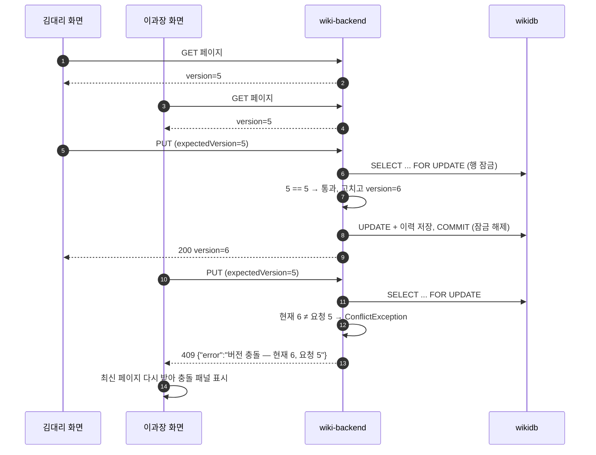
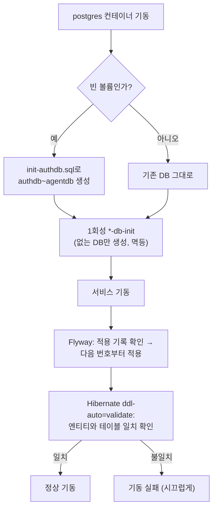
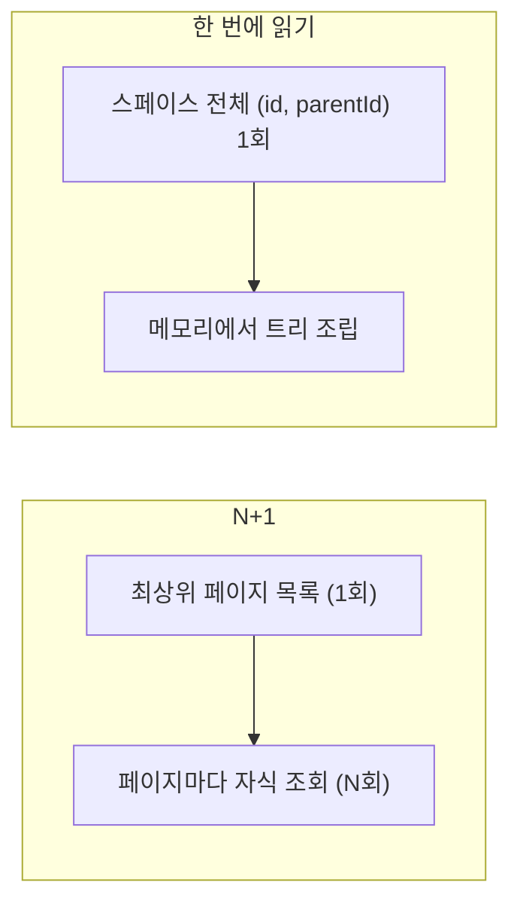

# 05 데이터 — PostgreSQL·Flyway·JPA·낙관적 락

## 한 줄 요약

**서비스마다 자기 DB(논리 DB)를 PostgreSQL 한 대 안에 따로 갖고, 테이블 구조는 Flyway 번호 스크립트로만 바꾸며, 두 사람이 같은 문서를 동시에 고치면 "버전 번호 비교"로 나중 사람에게 409를 돌려준다.**

---

## 왜 필요한가

### 비유 — 한 건물 안의 여러 금고

PostgreSQL 서버 한 대를 **건물**, 그 안의 DB 하나하나를 **금고**라고 생각하자.

- 위키는 `wikidb` 금고, ALM은 `almdb` 금고 열쇠만 갖는다.
- 위키가 ALM 금고를 열어 보지 않는다. ALM 데이터가 필요하면 ALM에게 **물어본다**(06번의 gRPC).
- 금고 안 선반 배치(테이블 구조)를 바꿀 때는 **번호 붙은 작업 지시서**(Flyway 마이그레이션)를 순서대로 따른다. 지시서는 한 번 붙이면 고쳐 쓰지 않는다.

그리고 **두 사람이 같은 서류를 동시에 고치는 문제**가 있다.

> 김대리와 이과장이 같은 문서를 연다. 둘 다 버전 5를 보고 있다.
> 김대리가 먼저 저장한다 → 버전 6.
> 이과장이 저장한다. 이과장은 아직 버전 5를 기준으로 고쳤다.
> 그냥 저장하면 김대리의 수정이 **조용히 사라진다**.

이것을 "마지막에 쓴 사람이 이긴다(last-write-wins)" 문제라고 한다. 우리는 이과장의 저장 요청에 "나는 버전 5를 보고 고쳤다"를 함께 보내게 한다. 서버는 지금 버전이 6이니 거절한다(409 Conflict). 이과장 화면은 "다른 사람이 먼저 고쳤다"고 알려 준다.

---

## 먼저 용어 몇 개

| 용어 | 한 줄 뜻 |
|---|---|
| **PostgreSQL** | 오픈소스 관계형 DB. 우리 플랫폼의 유일한 DB 종류 |
| **논리 DB** | DB 서버 한 대 안에 나뉜 독립 공간(`wikidb`, `almdb` …) |
| **Flyway** | DB 구조 변경을 `V1__init.sql`, `V2__...sql`처럼 번호 순서로 적용하는 도구 |
| **JPA / Hibernate** | 자바 객체와 DB 테이블을 연결해 주는 표준(JPA)과 그 구현체(Hibernate) |
| **엔티티(Entity)** | DB 테이블 한 줄에 대응하는 자바 클래스(예: `Page`) |
| **`ddl-auto`** | Hibernate가 테이블을 자동으로 만들지 정하는 설정. 우리는 `validate`(확인만) |
| **트랜잭션** | "전부 되거나 전부 안 되거나" 묶음 |
| **낙관적 락** | "충돌은 드물다"고 보고, 저장할 때 버전을 비교해 충돌을 잡는 방식 |
| **비관적 락** | 읽는 순간 행을 잠가 다른 사람이 못 건드리게 하는 방식(`SELECT ... FOR UPDATE`) |
| **N+1 문제** | 목록 1번 + 항목마다 1번씩 질의가 더 나가는 성능 문제 |

---

## 우리 제품에서는 어떻게 쓰나

### 1. DB는 PostgreSQL 하나로 통일

확정 설계 결정이다. 서비스마다 MySQL·MongoDB 같은 다른 DB를 고르지 않는다. 설치형 제품이라 고객사 운영자가 다뤄야 할 DB 종류가 하나인 편이 낫다.

| 항목 | 값 | 근거 |
|---|---|---|
| 이미지 | `postgres:16` | `infra/keycloak/docker-compose.yml` |
| 컨테이너 | `platform-postgres` | 같은 파일 |
| 컨테이너 안 포트 | `5432` | |
| 호스트 포트 | `127.0.0.1:5433` (루프백 전용) | `INSTALL.md` §1 |
| 데이터 볼륨 | `platform-db` | |

### 2. 서비스마다 자기 DB — 9개

한 컨테이너 안에 DB가 9개 있다(루트 `README.md` "데이터·이벤트 규약").

| DB | 주인 | 최신 마이그레이션 (main 기준) |
|---|---|---|
| `keycloak` | Keycloak | (Keycloak이 스스로 관리) |
| `authdb` | auth-server | `V7__refresh_token_user_index.sql` |
| `boarddb` | board-service | `V2__add_comment.sql` |
| `orgdb` | org-service | `V9__member_auth_sync.sql` |
| `wikidb` | wiki-backend (+ collaboration-service가 공동 편집 데이터를 같이 씀) | `V43__notification_pref_page_published.sql` |
| `almdb` | alm-backend | `V28__saved_filter_shared.sql` |
| `docsdb` | docs-backend (공개 문서) | wiki-backend와 같은 스크립트 |
| `agentdb` | agent-service | `V18__usage_ledger_run_index.sql` |
| `migrationdb` | migration-service | `V2__job_level_issue.sql` |

- **search-service는 DB가 없다.** 색인은 OpenSearch가 갖고, 원본은 위키·ALM이 갖는다. 색인은 재색인으로 언제든 다시 만들 수 있는 **파생 데이터**다.
- **collaboration-service**는 Node.js(TypeScript)로 만든 서비스라 Flyway가 없다. 공동 편집용 테이블도 wiki-backend 마이그레이션이 만든다.
- 마이그레이션 위치는 서비스마다 `src/main/resources/db/migration/`이다.

> [!note] 왜 서버를 따로 두지 않고 한 서버에 DB만 나눴나
> MSA 교과서는 "서비스마다 DB 서버"를 말하지만, 소규모 설치에서는 한 서버 안에서 논리 DB를 나눠도 핵심은 지켜진다. 핵심은 **"남의 테이블을 직접 읽지 않는다"는 규율**이다. 물리 분리는 부하나 장애 격리가 필요해질 때 한다. 장기적으로 ALM·위키·공통 DB를 독립 인스턴스로 나누는 계획과 절차는 `infra/runbooks/database-separation.md`와 [[40 ALM 위키 DB 분리와 데이터 보호 정책 및 운영 매뉴얼 (2026-09-13)]]에 있다.

### 3. DB는 누가 만드나 — 빈 볼륨 최초 1회

DB "그릇"을 만드는 일과 테이블을 만드는 일은 다르다.

| 단계 | 누가 | 언제 |
|---|---|---|
| `keycloak` DB | postgres 이미지(`POSTGRES_DB`) | 빈 볼륨 최초 기동 |
| `authdb`~`agentdb` 7개 | `infra/keycloak/init-authdb.sql` | 빈 볼륨 최초 기동 **한 번만** |
| `docsdb`·`agentdb`·`migrationdb` (기존 볼륨에) | 1회성 컨테이너 `docs-db-init`·`agent-db-init`·`migration-db-init` | 처음 그 서비스를 올릴 때(`\gexec`로 여러 번 돌려도 안전) |
| 테이블 | 각 서비스의 Flyway | 서비스가 켜질 때마다 "아직 안 한 번호"만 |

> [!warning] 자주 나는 사고
> 이미 운영 중인 볼륨에 새 서비스를 배포하면 `database "migrationdb" does not exist`로 실패한다. `init-authdb.sql`은 빈 볼륨에서만 돌고, 배포 워크플로는 `--no-deps`라 1회성 init을 건너뛰기 때문이다. 첫 배포 전에 `docker compose up -d migration-service`처럼 한 번 띄운다(`INSTALL.md` §5-4).

### 4. Flyway — DB 구조의 버전 관리

**Flyway는 DB 구조 변경을 git 커밋처럼 다룬다.**

- 파일 이름이 곧 순서다: `V1__init.sql`, `V2__...`, …, `V43__...`. 위키는 지금 마이그레이션 파일이 43개다.
- Flyway는 DB 안에 "어디까지 적용했나" 기록 표를 둔다. 서비스가 켜지면 그 다음 번호부터 적용한다.
- **한 번 적용된 파일은 고치지 않는다.** 바꿀 게 있으면 새 번호 파일을 만든다. 이미 적용된 파일을 고치면 체크섬이 달라져 서비스가 켜지지 않는다.

그리고 모든 백엔드가 이렇게 설정한다(`application.yml`).

```yaml
spring:
  jpa:
    hibernate:
      ddl-auto: validate   # 테이블을 만들지 말고, 엔티티와 맞는지 확인만
    open-in-view: false    # 화면 그리는 동안 DB 연결을 붙잡지 않는다 (아래 N+1 참고)
```

**`ddl-auto: validate`가 중요한 이유** — Hibernate가 엔티티를 보고 테이블을 멋대로 바꾸면(`update`) 운영 DB가 예측 못한 모양이 된다. 우리는 **Flyway가 유일한 변경 경로**이고, Hibernate는 "엔티티와 테이블이 맞는지"만 확인한다. 안 맞으면 서비스가 켜지지 않는다. 조용히 틀리는 것보다 시끄럽게 실패하는 편이 낫다.

> [!warning] Spring Boot 4의 함정
> Boot 4에서는 Flyway 자동 설정이 `spring-boot-flyway` 모듈로 분리됐다. 이 의존성이 빠지면 오류 없이 마이그레이션이 안 돌아 테이블이 없다. 초기에 auth-server에서 실제로 겪었다([[01 인증 플랫폼 (Keycloak BFF + 자체 JWT)]]).

### 5. JPA — 객체로 DB 다루기

백엔드는 Spring Data JPA(Hibernate)로 DB를 다룬다. 엔티티 클래스 하나가 테이블 하나다.

예를 들어 위키 페이지는 `wiki-backend/.../page/Page.java`, ALM 이슈는 `alm-backend/.../domain/Issue.java`다. 저장소(Repository) 인터페이스에 메서드 이름이나 `@Query`로 질의를 적는다.

### 6. 동시 수정 막기 — 우리 방식은 "버전 비교 + 행 잠금"

여기가 이 문서의 핵심이다. 그리고 **흔한 교과서 방식과 조금 다르다.**

#### 교과서 방식: JPA `@Version`

JPA에는 `@Version`이라는 장치가 있다. 엔티티에 버전 칸을 두면 Hibernate가 저장할 때 `UPDATE ... WHERE id=? AND version=?`을 만들어, 버전이 다르면 `ObjectOptimisticLockingFailureException`을 던진다.

우리 플랫폼에서 `@Version`을 쓰는 곳은 **agent-service의 `Run`**과 **migration-service의 `MigrationJob`**이다.

#### 위키·ALM 방식: 버전을 손으로 관리

위키 페이지와 ALM 이슈는 `@Version`을 쓰지 않는다. 버전 숫자는 "현재 몇 번째 판인가"라는 **화면에 보이는 의미**도 갖기 때문이다(버전 이력, 복원).

```java
// wiki-backend/.../page/Page.java
private Integer version; // 낙관적 잠금 겸 현재 버전 번호 — 수동 관리(@Version 아님)
```

저장 순서는 이렇다(`wiki-backend/.../page/PageService.java`의 `update`. 2026-10-18 분할 뒤 행 잠금은 `PageStructure.lockOwned`가 맡는다).

```java
Page p = structure.lockOwned(pageId);        // 1. 이 페이지 행을 잠근다 (SELECT ... FOR UPDATE)
spaces.require(userId, p.getSpaceId(), WikiAction.EDIT);   // 2. 편집 권한 확인
...
if (!Objects.equals(p.getVersion(), req.expectedVersion())) {   // 3. 버전 비교
    throw new ConflictException("버전 충돌 — 현재 " + p.getVersion() + ", 요청 " + req.expectedVersion());
}
p.edit(req.title(), req.content(), userId);  // 4. 고치고 버전 +1
revisions.save(PageRevision.snapshotOf(p, ...));             // 5. 이력 한 줄 저장
events.afterCommit(WikiEvents.pageUpdated(userId, p));       // 6. 커밋 뒤 이벤트 (06번)
```

**왜 행을 먼저 잠그나?** 잠그지 않고 비교만 하면, 두 요청이 거의 동시에 들어올 때 둘 다 "버전 5 = 5, 통과"를 보고 둘 다 저장할 수 있다. 행을 잠그면 두 번째 요청은 첫 번째가 끝날 때까지 기다린다. 그 뒤에 비교하면 버전이 이미 6이라 거절된다.

ALM도 같다. `IssueRepository`의 `findByIdForUpdate`에 `@Lock(LockModeType.PESSIMISTIC_WRITE)`가 붙어 있고, `IssueService`가 버전을 비교한다. 같은 패턴이 프로젝트·버전(릴리스)·스프린트에도 쓰인다.

> [!note] 그럼 이건 낙관적 락인가 비관적 락인가?
> 둘 다 조금씩이다. **사용자 관점에서는 낙관적 락**이다. 편집하는 몇 분 동안 아무도 잠그지 않고, 저장 순간에 "내가 본 버전"으로 충돌을 잡는다. **저장하는 짧은 순간에는 비관적 락**(행 잠금)을 써서 비교와 저장 사이에 다른 요청이 끼지 못하게 한다.

#### 버전은 어떻게 오가나

- 응답에 `version`이 실린다. 화면은 이 값을 기억한다.
- 저장 요청 **본문**에 `expectedVersion`으로 다시 보낸다(`PageUpdateRequest`, `IssueUpdateRequest`, `@NotNull`). HTTP `If-Match` 헤더는 쓰지 않는다.
- 다르면 `ConflictException` → `common-starter`의 `PlatformApiExceptionHandler`가 **409** + `{"error": "메시지"}`로 바꾼다.

#### 화면은 어떻게 반응하나

- **위키** (`wiki-front/src/features/wiki/store/wikiApi.ts`) — 편집 화면이 **불러올 때 본 버전**을 보낸다. 409가 오면 서버의 최신 페이지를 다시 받아 `PageConflictError`를 던지고, 화면은 `EditConflictPanel`로 충돌을 보여 준다.
- **ALM** (`alm-front/src/features/alm/store/jiraApi.ts`) — `current.version`을 보내고, 409면 "다른 사용자가 먼저 수정했습니다…" 문구를 보여 준다.

> [!warning] 실제로 있었던 함정 — "저장 직전에 버전을 다시 읽기"
> 위키를 처음 백엔드에 붙일 때(2026-07-22) 화면을 안 고치려고, 어댑터가 **저장 직전에** 최신 버전을 읽어 `expectedVersion`에 실었다. 그러면 항상 최신 버전을 보내니 서버는 항상 통과시킨다. 낙관적 락이 아무 일도 안 하게 된다. 지금 위키는 불러올 때의 버전을 보낸다. 교훈: **"편집을 시작할 때 본 버전"**을 보내야 의미가 있다. [[20 프론트-백엔드 듀얼모드 연동 — 경계 매퍼·낙관적 락·503 전파 (2026-07-22)]].
>
> ALM에도 비슷한 결함(잠금 전에 읽은 값끼리 비교)이 있었다. 2026-10-16에 고친 작업이 2026-10-18 main에 병합·배포됐다([[44 ALM 무결성·규모 개선 11항목 — 동시 수정·CSV·검색 페이징·아웃박스·배포 롤백 (2026-10-16)]]).

#### 여러 이슈를 한 번에 고칠 때 — 일괄 편집 API

ALM에는 이슈 여러 개(최대 200)에 같은 변경을 한 요청으로 거는 `POST /api/alm/issues/bulk`가 있다(2026-10-18, `IssueBulkService`).

- 이슈마다 **따로 트랜잭션**(`REQUIRES_NEW`)을 열고 단건 수정 경로를 그대로 탄다. 그래서 권한·상태 전이·이력·알림이 단건과 똑같다.
- 결과는 행마다 `code`(`OK`/`CONFLICT`/`FORBIDDEN`/`NOT_FOUND` …)로 온다. 버전 충돌이면 `CONFLICT`와 함께 `currentVersion`을 돌려준다. 하나가 실패해도 나머지는 저장된다.
- 볼 권한이 없는 이슈는 키도 숨긴다.

### 7. N+1 문제 — 질의가 몰래 늘어나는 병

**N+1**은 이런 상황이다.

> 스페이스의 페이지 100개로 트리를 그린다.
> 1번: "이 스페이스의 최상위 페이지를 다 줘" → 1번 질의
> 그다음 페이지마다: "이 페이지의 자식을 줘" → 100번 질의
> 합계 101번. 페이지가 1만 개면 1만 1번.

JPA에서는 특히 잘 생긴다. 연관된 객체를 "필요할 때 가져오기(지연 로딩)"로 두면, 반복문 안에서 `page.getChildren()`을 부를 때마다 질의가 몰래 나간다. 코드에는 질의가 안 보여서 알아채기 어렵다.

우리 코드는 이렇게 막는다.

| 서비스 | 방법 | 예 |
|---|---|---|
| wiki-backend | **필요한 칸만 한 번에 읽기(프로젝션) + 한꺼번에 읽기** | `PageRepository.findIdParentBySpaceId` — 스페이스 전체의 (id, 부모 id)만 한 번에 읽어 메모리에서 트리를 만든다. 주석: "노드당 findByParentId N+1을 없앤다" |
| wiki-backend | 라벨 등을 묶어서 읽기 | `WikiContentGrpcService`(색인용 라벨 일괄 조회), `TreeService`, `AuditService`, `NotificationService` 주석 |
| wiki-backend | 구조 변경·알림·블로그 경로 정리(2026-10-18) | 서브트리 수집·부모 검증·휴지통 일괄 정리의 N+1 제거, 알림함은 건수를 페이지별 집계로, 블로그 목록은 본문 앞부분만 읽기 |
| alm-backend | **`@EntityGraph`** | `IssueRepository`의 보드·랭크 질의에 `@EntityGraph(attributePaths = "labels")` — 이슈와 라벨을 한 번에 |
| alm-backend | **일괄 DTO 로딩 + `@BatchSize` 안전망** | 목록 응답은 `IssueResponses`가 페이지 단위로 따로 읽는다. 그 밖의 경로를 위해 `Issue`의 라벨·컴포넌트 컬렉션에 `@BatchSize(size = 100)` |
| 모든 백엔드 | `open-in-view: false` | 화면 직렬화 중에 몰래 지연 로딩이 일어나지 않게 |

`default_batch_fetch_size`(전역 설정)는 쓰지 않는다. `@BatchSize`는 ALM `Issue`의 두 컬렉션에만 붙어 있다.

> [!note] 숫자로 본 효과
> 2026-10-16 ALM 개선 작업에서 이슈 검색을 일괄 DTO 로딩으로 바꿨더니, 한 페이지 크기 50에서 SQL 문 수가 **102 → 4**로 줄었다. 이 작업은 2026-10-18 main에 병합·배포됐다([[44 ALM 무결성·규모 개선 11항목 — 동시 수정·CSV·검색 페이징·아웃박스·배포 롤백 (2026-10-16)]]). 같은 날 자주 거르는 열(담당자·보고자·라벨)에 인덱스도 붙였다(ALM `V27__issue_lookup_indexes.sql`). 그전까지 "나에게 배정"은 이슈 표 전체를 훑었다.

### 8. 원본 데이터와 파생 데이터

장애나 백업을 생각할 때 이 구분이 중요하다(`INSTALL.md` "되돌리기 · 데이터").

| 종류 | 무엇 | 잃으면 |
|---|---|---|
| **원본** | `platform-db`(모든 DB와 Yjs 본문), 위키 첨부 볼륨, MinIO 데이터, 메일 설정 볼륨 | 다시 만들 방법이 없다. 백업 필수 |
| **파생** | OpenSearch 색인 | `POST /api/search/admin/reindex`로 다시 만든다 |

그래서 `docker compose down -v`(볼륨 삭제)는 장애 대응·설정 수정에 절대 쓰지 않는다. DB 비밀번호를 바꿀 때도 볼륨을 지우지 않고 `\password`로 바꾼 뒤 앱만 재생성한다(`INSTALL.md` §9).

---

## 흐름 그림

### 두 사람이 같은 페이지를 동시에 저장할 때



### 서비스가 켜질 때 DB가 준비되는 순서



### N+1과 한 번에 읽기 비교



---

## 자주 헷갈리는 점 / 함정

1. **"위키는 `@Version`을 쓰겠지"** — 아니다. 위키·ALM은 버전을 손으로 관리하고 행 잠금 + 비교로 충돌을 잡는다. `@Version`은 agent-service `Run`, migration-service `MigrationJob`에 있다.
2. **"이미 적용된 마이그레이션 파일의 오타를 고치자"** — 안 된다. 체크섬이 달라져 서비스가 안 켜진다. 새 번호 파일로 고친다.
3. **"H2 테스트가 통과했으니 운영도 괜찮다"** — 아니다. 대부분의 테스트는 H2(메모리 DB) + Hibernate가 만든 테이블(`create-drop`)로 돈다. **Flyway 마이그레이션을 타지 않으니 운영 DB의 제약(CHECK·유니크)이 테스트에는 없다.** 실제로 이렇게 새어 나간 결함이 있었다.
   - **블로그 CHECK 제약** — 위키 V2의 `page_type_check`는 `PAGE`·`FOLDER`만 허용했다. 나중에 엔티티에 `BLOG`가 생겼는데 제약을 고치는 마이그레이션이 없었다. H2 테스트는 통과했고, 운영 PostgreSQL에서는 블로그 글 저장이 전부 500이었다. `V42__page_type_blog.sql`로 고쳤다.
   - **"지우고 다시 넣기"의 순서** — 위키의 작업 표(체크박스 줄)·페이지 열람 제한을 통째로 바꿀 때 `deleteByPageId` 후 같은 키로 다시 넣었다. Hibernate는 flush 때 **INSERT를 DELETE보다 먼저** 보내서, 운영에서는 `uq_page_task_line`·`uq_page_restriction` 유니크 위반(500)이었다. H2 테이블에는 그 제약이 없어 안 보였다. 삭제를 즉시 실행되는 bulk JPQL로 바꿨다.
   - ALM `(:since is null or x >= :since)` 질의도 H2에서는 통과하고 PostgreSQL에서만 500이었다(PostgreSQL JDBC가 null 시각의 타입을 못 정함). 2026-10-18 main에 수정이 병합됐다.

   그래서 2026-10-18부터 위키·ALM에 **실제 PostgreSQL 16 + Flyway + `ddl-auto=validate`** 위에서 쓰기 경로를 HTTP로 한 바퀴 도는 Testcontainers 테스트가 있다(wiki `PostgresTestSupport`·`schema/PostgresWritePathTest`·`PostgresPurgeTest`, ALM `schema/PostgresWritePathSmokeTest`). H2 스위트는 그대로 두고 함께 돈다. 위 두 위키 결함은 이 테스트가 찾았다. 교훈: **제약이 있는 쓰기 경로는 진짜 PostgreSQL로 시험한다.**
4. **"`POSTGRES_PASSWORD`만 바꾸면 비밀번호가 바뀐다"** — DB 안의 비밀번호는 빈 볼륨 최초 기동 때만 그 값으로 만들어진다. 나중에 바꾸려면 DB 안에서 먼저 바꾸고 앱을 재생성한다(`INSTALL.md` §9).
5. **"search-service DB도 백업해야 한다"** — search-service는 DB가 없다. 색인은 재색인으로 복구한다.
6. **"같은 서버니까 위키가 almdb를 조금 읽어도 되지 않나"** — 안 된다. 그러면 DB를 나눈 의미(독립 배포, 나중에 물리 분리)가 사라진다. 필요한 데이터는 소유 서비스에 gRPC로 묻는다.

---

## 더 읽을 거리

- [[17 Wave B — wiki-backend 구현기록, 과정과 원리 해설 (2026-07-21)]] — 위키 백엔드의 버전·리비전 설계
- [[20 프론트-백엔드 듀얼모드 연동 — 경계 매퍼·낙관적 락·503 전파 (2026-07-22)]] — 낙관적 락이 무력화됐던 사연
- [[40 ALM 위키 DB 분리와 데이터 보호 정책 및 운영 매뉴얼 (2026-09-13)]] — DB 분리 계획과 백업 정책
- [[44 ALM 무결성·규모 개선 11항목 — 동시 수정·CSV·검색 페이징·아웃박스·배포 롤백 (2026-10-16)]] — 동시 수정·N+1 개선(2026-10-18 main 병합)
- [[45 전체 검수 96건과 기능 공백 보완 — 병합·보안·성능·운영 하드닝 (2026-10-18)]] — V42·PG Testcontainers 스위트·일괄 편집 API
- [[06 서비스끼리 대화하기 — gRPC·Redis Streams·아웃박스]] — 남의 데이터가 필요할 때
- 코드·문서: `wiki-backend/.../page/PageService.java`·`PageStructure.java`·`Page.java`·`PageRepository.java`, `wiki-backend/src/test/.../PostgresTestSupport.java`, `alm-backend/.../issue/IssueBulkService.java`, `alm-backend/.../repository/IssueRepository.java`·`IssueService.java`, `platform-backend/common-starter/.../web/PlatformApiExceptionHandler.java`, 각 서비스 `src/main/resources/db/migration/`, `infra/keycloak/init-authdb.sql`, `infra/runbooks/`

---

## 스스로 점검 질문

**1. 모든 백엔드가 `ddl-auto: validate`를 쓰는 이유는?**

> [!note]- 답
> DB 구조를 바꾸는 유일한 길을 Flyway로 고정하기 위해서다. Hibernate가 엔티티를 보고 테이블을 자동으로 바꾸면 운영 DB 모양을 예측할 수 없다. `validate`는 확인만 하고, 엔티티와 테이블이 안 맞으면 서비스가 켜지지 않아 문제를 바로 드러낸다.

**2. 위키 페이지 저장에서 버전 비교 전에 `SELECT ... FOR UPDATE`로 행을 잠그는 이유는?**

> [!note]- 답
> 잠그지 않으면 거의 동시에 온 두 요청이 둘 다 "현재 5 = 요청 5"를 보고 통과해 둘 다 저장할 수 있다. 행을 잠그면 두 번째 요청은 첫 번째가 커밋할 때까지 기다리고, 그 뒤 비교하면 현재 버전이 6이라 409로 거절된다.

**3. 위키 트리를 그릴 때 "페이지마다 자식 조회"를 하지 않고 무엇을 하나? 그게 왜 좋은가?**

> [!note]- 답
> `findIdParentBySpaceId`로 스페이스 전체의 (id, 부모 id)만 한 번에 읽어 메모리에서 트리를 조립한다. 페이지 수 N과 상관없이 질의가 한 번이라 N+1 문제가 없다.
