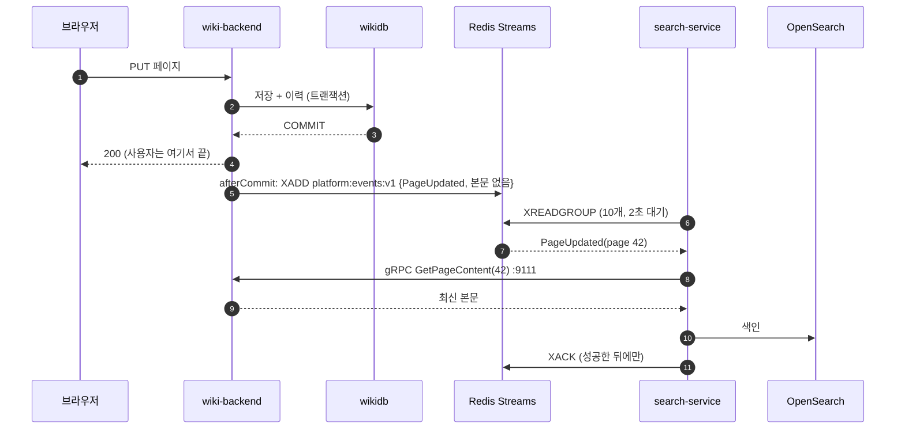
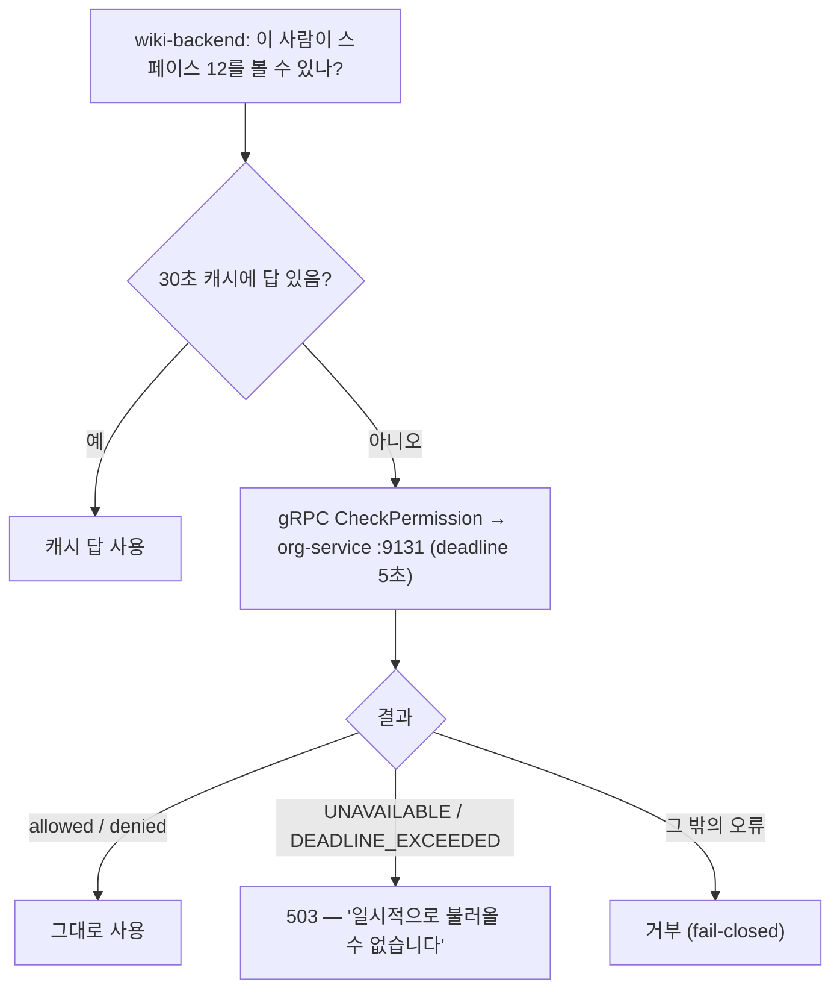
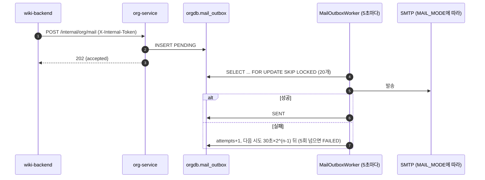

# 06 서비스끼리 대화하기 — gRPC·Redis Streams·아웃박스

## 한 줄 요약

**답을 바로 들어야 하면 gRPC로 "전화"하고, 알리기만 하면 되면 Redis Streams 게시판에 "쪽지"를 붙이며, 쪽지가 사라지면 안 되는 곳은 아웃박스(보낼 편지함)에 먼저 넣어 두고 일꾼이 꺼내 보낸다.**

---

## 왜 필요한가

### 비유 — 사무실의 세 가지 소통법

1. **전화(동기 호출, gRPC)** — "이 사람이 3층 회의실 써도 돼요?" 답을 들어야 다음 일을 한다. 상대가 안 받으면 일이 멈춘다.
2. **게시판 쪽지(비동기 이벤트, Redis Streams)** — "3층 문서가 바뀌었음." 붙여 놓고 내 일을 계속한다. 관심 있는 사람(검색 담당)이 나중에 와서 읽는다. 읽는 사람이 휴가 중이어도 쪽지는 남아 있다.
3. **보낼 편지함(아웃박스)** — 중요한 편지는 바로 우체국에 뛰어가지 않는다. 일단 내 책상 편지함에 넣는다. 우편 담당이 몇 초마다 편지함을 비워 보낸다. 우체국이 닫혀 있으면 다음에 다시 간다. 편지가 사라지지 않는다.

### 왜 다 전화로 하지 않나

위키가 페이지를 저장할 때마다 검색 서비스에 전화해서 "색인해 줘"라고 하면 어떻게 될까?

- 검색 서비스가 느리면 위키 저장도 느려진다.
- 검색 서비스가 죽으면 위키 저장이 실패한다. 검색 때문에 글을 못 쓰는 셈이다.

그래서 "꼭 지금 답이 필요한 것"만 전화로 하고, "알리기만 하면 되는 것"은 쪽지로 한다. 이것이 **동기 vs 비동기**의 구분이다.

| | 동기 (gRPC) | 비동기 (Redis Streams) |
|---|---|---|
| 언제 | 답이 있어야 다음 일을 할 때 | 알리기만 하면 될 때 |
| 우리 예 | 권한 판정, 색인할 본문 가져오기 | "페이지가 바뀌었다" 이벤트 |
| 상대가 죽으면 | 내 요청도 실패(또는 503) | 내 일은 계속된다. 쪽지는 쌓여 있다 |
| 결과 반영 | 즉시 | 조금 늦게(최종적으로 맞춰짐) |

---

## 먼저 용어 몇 개

| 용어 | 한 줄 뜻 |
|---|---|
| **gRPC** | 구글이 만든 서버 간 호출 방식. 미리 정한 계약(proto)대로 이진 데이터를 빠르게 주고받는다 |
| **proto (Protocol Buffers)** | gRPC의 계약서 파일. 메시지 모양과 함수 목록을 적는다 |
| **deadline** | gRPC 호출의 최대 대기 시간 |
| **Redis Streams** | Redis에 있는 "추가만 되는 로그" 자료구조. 쪽지를 순서대로 쌓고 소비자가 읽어 간다 |
| **소비자 그룹** | 같은 스트림을 나눠 읽는 소비자 묶음. 누가 어디까지 읽었는지 Redis가 기억한다 |
| **ACK** | "이 쪽지 처리 끝났음" 확인 |
| **DLQ (Dead Letter Queue)** | 여러 번 실패한 쪽지를 따로 모아 두는 곳 |
| **멱등(idempotent)** | 같은 일을 두 번 해도 결과가 같은 성질 |
| **아웃박스 패턴** | 보낼 메시지를 업무 데이터와 같은 트랜잭션으로 DB에 먼저 저장하고, 별도 일꾼이 꺼내 보내는 방법 |

---

## 우리 제품에서는 어떻게 쓰나

### 1. 세 가지 통신 길의 큰 지도

| 길 | 쓰는 곳 | 근거 |
|---|---|---|
| 바깥 → 서비스 | REST(HTTP JSON), 게이트웨이 경유 | 04번 |
| 서비스 ↔ 서비스, 답이 필요 | **gRPC** (내부망 전용, 호스트 포트 없음) | 루트 `README.md` "데이터·이벤트 규약" |
| 서비스 → 서비스, 알림만 | **Redis Streams** `platform:events:v1` | 같은 곳 |
| 몇몇 내부 HTTP | PAT 교환(`/internal/pat/exchange`), 메일 허브(`/internal/org/mail`), 위키 import(`/internal/wiki/import/**`), 계정 상태 맞추기(`/internal/users/{id}/status`, org → auth) — 공유 비밀 헤더로 보호, 게이트웨이·nginx 경로에 없음 | 03번, 아래 6·7절 |

이 구분은 처음 설계 때 정한 원칙이다. "바깥 API는 REST, 내부 동기 호출은 gRPC, 상태 전파는 이벤트"([[15 ALM·Wiki 백엔드 요구사항 + 서비스 분할 설계 (2026-07-19)]]).

### 2. gRPC — 계약서부터 같이 본다

#### 계약서는 한 곳에 — common-proto

proto 파일은 `platform-backend/common-proto/src/main/proto/platform/` 아래에 있다. 이 모듈을 GitHub Packages로 발행하고, 위키·ALM·검색이 **같은 버전**(지금 `0.17.0`, `common-starter`와 같은 태그)을 가져다 쓴다. 브랜치 전용 proto를 만들지 않는 것이 확정 결정이다. 계약이 서비스마다 갈라지면 조용히 어긋나기 때문이다.

| proto | 서비스 | 주요 함수 |
|---|---|---|
| `org/v1/org.proto` | `PermissionService` (org-service) | `CheckPermission`, `ListUserGrants`, `CreateGrant`, `RevokeGrant`, `ListUserTeams`, `GetMembers` 등 |
| `wiki/v1/wiki.proto` | `WikiContentService` (wiki-backend) | `GetPageContent`, `ListPageContents`(스트림), `ListAttachments`(스트림), `FilterVisiblePages` |
| `alm/v1/alm.proto` | `AlmContentService` (alm-backend) | `GetIssueContent`, `ListIssueContents`(스트림) |
| `events/v1/events.proto` | (함수 없음) | 이벤트 봉투 `EventEnvelope` — 아래 3절 |

#### gRPC 포트 — HTTP 포트 +1

| 서비스 | HTTP | gRPC |
|---|---|---|
| wiki-backend | 9110 | 9111 |
| alm-backend | 9120 | 9121 |
| org-service | 9130 | 9131 |

dev 클러스터는 +10000이지만, 위키 gRPC만 dev에서도 `9111`이다(루트 `README.md`의 알려진 예외).

#### 누가 누구에게 전화하나

- wiki-backend, alm-backend, agent-service, migration-service, search-service → org-service `CheckPermission` 등 (각자의 `GrpcPermissionClient`)
- search-service → wiki-backend `WikiContentService` (색인할 본문 가져오기, `GrpcWikiContentClient`)

wiki-backend의 콘텐츠 gRPC 서버(`:9111`)는 `SEARCH_MODE=lite`면 아예 뜨지 않는다. 받을 search-service가 없기 때문이다(`WikiGrpcServerCondition`).

#### 기다리는 시간과 실패 처리

- deadline 기본 5초(`ORG_GRPC_DEADLINE_SECONDS`). ALM 설정 주석에는 "2초는 짧아서 콜드 스타트 직후 첫 요청이 503이 났다"고 적혀 있다.
- search-service도 2026-10-18부터 호출마다 deadline을 건다(P-04). 단건은 5초(`ORG_GRPC_DEADLINE_SECONDS`, `WIKI_GRPC_DEADLINE_SECONDS`), 재색인 때 쓰는 긴 스트림은 600초(`WIKI_GRPC_STREAM_DEADLINE_SECONDS`)다. 넘기면 `DEADLINE_EXCEEDED` → 503이다.
- 위키의 권한 판정 결과는 30초 캐시한다(최대 1만 개). 같은 질문을 매번 하지 않는다.
- 실패는 두 종류로 나눈다(`wiki-backend/.../permission/GrpcPermissionClient.java`).

| gRPC 상태 | 뜻 | 처리 |
|---|---|---|
| `UNAVAILABLE`, `DEADLINE_EXCEEDED` | 전화가 안 됨(상대가 없거나 늦음) | `ServiceUnavailableException` → **503** |
| 그 밖의 오류 | 통화는 됐는데 뭔가 이상함 | **거부**(fail-closed) — 권한 없음으로 처리 |

**왜 전화 불통을 503으로 따로 올리나?** 목록 API에서 "권한 확인 실패 → 거부 → 빈 목록"으로 처리하면, 화면은 "스페이스가 하나도 없습니다"라는 정상 빈 화면을 그린다. 사용자는 문서가 다 사라졌다고 생각한다. 실제로는 org-service가 잠깐 죽은 것뿐인데. 그래서 "판정을 못 했다"는 사실을 503으로 올리고, 화면은 "일시적으로 불러올 수 없습니다 [다시 시도]"를 보여 준다. [[20 프론트-백엔드 듀얼모드 연동 — 경계 매퍼·낙관적 락·503 전파 (2026-07-22)]].

#### 서비스 간 토큰 — 내선 전화에도 사원증을 (2026-10-18)

예전에는 gRPC 채널에 인증이 없었다. "내부망이니 괜찮다"는 전제였다. 그런데 같은 도커 네트워크 안의 아무 컨테이너나 org-service에 `CreateGrant`(권한 주기)를 부를 수 있다는 뜻이기도 했다. 2026-10-18에 이것을 막았다(P-01). 확정 결정이다(루트 `CLAUDE.md` "서비스 간 신뢰").

비유하면 이렇다. 내선 전화를 받는 사람이 "사원증 번호부터 불러 주세요"라고 묻기 시작한 것이다.

| 항목 | 값 |
|---|---|
| 토큰 | `PLATFORM_GRPC_TOKEN` — 플랫폼 공용 **하나**. 보낼 때도, 검사할 때도 같은 값 |
| 싣는 곳 | gRPC 메타데이터 `x-internal-token` |
| 검사 모드 | `PLATFORM_GRPC_AUTH_MODE` — `off` / `monitor`(기본) / `enforce` |
| 부품 | `common-starter` 0.17.0의 `InternalTokenClientInterceptor`(보내기)·`InternalTokenServerInterceptor`(검사하기). 서비스는 채널·서버에 끼우기만 한다 |

**누가 보내나** — org-service에 전화하는 모든 서비스가 채널에 클라이언트 인터셉터를 끼운다.

- wiki-backend, alm-backend, agent-service, migration-service → org 채널
- search-service → org 채널과 wiki 채널 둘 다

**누가 검사하나** — gRPC 서버를 가진 서비스가 서버 인터셉터를 끼운다.

- **org-service**(`:9131`) — 핵심. compose에서 `PLATFORM_GRPC_AUTH_MODE`를 받는 곳이 org다. **2026-10-18 운영 배포에서 `enforce`까지 켰다.**
- wiki-backend(`:9111`)·alm-backend(`:9121`)의 콘텐츠 gRPC 서버도 같은 인터셉터를 끼운다. 다만 compose가 이 둘에는 모드를 따로 넘기지 않아서 기본값 `monitor`로 돈다.

**모드 세 가지**

| 모드 | 토큰이 없거나 틀리면 |
|---|---|
| `off` | 검사 안 함 |
| `monitor` | **통과시키고** 경고 로그만 남긴다. 같은 경고는 (메서드, 사유)마다 1분에 한 줄로 묶고, 상대 주소를 같이 적는다 |
| `enforce` | `UNAUTHENTICATED`로 거부한다 |

토큰 값은 로그에 남기지 않는다. 비교는 상수 시간(`MessageDigest.isEqual`)으로 한다.

**왜 바로 enforce로 켜지 않았나 — 단계 배포**

서비스가 여섯 개(org·wiki·alm·agent·migration·search)다. 한 번에 다 바꿀 수 없다. 만약 org를 먼저 enforce로 올렸는데 위키가 아직 토큰을 안 싣는 옛 이미지라면, 위키의 권한 판정이 전부 `UNAUTHENTICATED`로 돌아온다. 앞의 표에서 "그 밖의 오류"이므로 전부 거부(fail-closed)되고, 위키는 누구에게도 아무것도 보여 주지 않게 된다. 서버 토큰을 비운 채 enforce로 켜면 더 나쁘다. **모든 gRPC 호출을 거부한다**(서버가 시작할 때 경고 로그로 알린다).

그래서 순서를 정했다(`infra/keycloak/.env.example`, `INSTALL.md` §3).

1. 스타터 0.17.0과 인터셉터를 넣고 **monitor**로 배포한다. 토큰이 없어도 끊기지 않는다.
2. 토큰을 만들어(`openssl rand -hex 32`) 여섯 서비스에 같은 값을 넣고 재배포한다.
3. org 로그에서 "토큰 없음/불일치" 경고가 사라진 것을 확인한다. monitor의 경고가 "아직 안 보내는 서비스"를 찾아 주는 탐지기다.
4. org를 **enforce**로 올린다.

> [!warning] "네트워크 안이니 무인증"으로 되돌리지 않는다
> 빈 토큰으로 바로 enforce하는 것도, 인증을 다시 빼는 것도 확정 결정에 어긋난다. 토큰은 compose 기본값이 비어 있으니(`${PLATFORM_GRPC_TOKEN:-}`) 새 설치에서는 `.env`에 꼭 넣는다.

같은 날 org-service의 **gRPC 리플렉션**(grpcurl이 스키마를 둘러보는 기능)도 기본을 끔으로 바꿨다(`ORG_GRPC_REFLECTION`, dev 프로필만 켬). 위키도 `WIKI_GRPC_REFLECTION_ENABLED` 기본 false다. 리플렉션 호출에도 같은 토큰 검사가 걸린다.

### 3. Redis Streams — 쪽지 게시판

#### 무엇을 쓰나

| 항목 | 값 |
|---|---|
| Redis | `redis:7-alpine`, 컨테이너 안 6379, 호스트 `127.0.0.1:16379` |
| 스트림 이름 | `platform:events:v1` |
| 실패 쪽지함(DLQ) | `platform:events:v1:dlq` |
| 길이 제한 | `MAXLEN ~100000` (대략 10만 개 넘으면 오래된 것부터 잘림) |
| 발행자 | wiki-backend, alm-backend (`event/RedisStreamEventPublisher.java`) |
| 소비자 | search-service, 소비자 그룹 `search-service` |

#### 쪽지에는 무엇이 적히나 — 본문은 없다

쪽지는 `payload` 칸 하나에 proto로 직렬화한 `EventEnvelope`를 담는다(`events.proto`).

```
EventEnvelope {
  event_id     // UUID — 같은 쪽지를 두 번 처리하지 않기 위한 번호
  occurred_at  // 언제
  actor_id     // 누가
  source       // 어느 서비스에서
  payload      // 무엇이: PageUpdated, IssueCreated ... (페이지·첨부 10~17번, 프로젝트·이슈 20~25번)
}
```

**본문은 싣지 않는다.** "페이지 42가 바뀌었다"까지만 적는다. 소비자는 필요하면 소유 서비스에 gRPC로 본문을 받아 간다. 이유는 세 가지다.

- 쪽지가 가볍다.
- 쪽지가 늦게 처리돼도 최신 본문을 가져가므로 옛 내용으로 색인하지 않는다.
- 권한이 바뀐 문서 내용이 스트림에 남지 않는다.

#### 언제 쪽지를 붙이나 — 커밋 뒤

main의 위키는 **DB 트랜잭션이 커밋된 뒤**에 쪽지를 붙인다(`event/EventRelay.java`, `TransactionSynchronization.afterCommit()`). ALM은 2026-10-18부터 아웃박스를 거친다(5절).

- 커밋 전에 붙이면, 나중에 트랜잭션이 롤백돼도 "바뀌었다"는 쪽지가 남는다. 없는 변경을 알리는 거짓말이다.
- 커밋 뒤 붙이기가 실패하면 ERROR 로그만 남기고 요청은 성공으로 끝낸다. 코드 주석의 원칙은 "정합의 최종 근거는 DB, 색인은 재색인으로 보정"이다.

이 방식의 약점은 **커밋과 발행 사이에 서버가 죽으면 쪽지가 사라진다**는 것이다. 이걸 막는 게 아래 5절의 아웃박스다(ALM은 적용, 위키는 아직).

#### 소비자는 어떻게 읽나 — 재시도와 DLQ

`platform-backend/search-service/.../event/RedisStreamEventConsumer.java`

1. 시작할 때 소비자 그룹을 만든다(`XGROUP CREATE`, 처음부터 `0-0`). 색인 준비가 끝난 뒤에 읽기 시작한다.
2. `XREADGROUP`으로 10개씩, 2초 기다리며 읽는다.
3. 색인이 **성공한 뒤에만** ACK한다. 실패하면 ACK하지 않으므로 Redis의 "처리 대기 목록(PEL)"에 남는다.
4. 30초 넘게 묵은 쪽지는 `XPENDING`/`XCLAIM`으로 다시 가져와 재시도한다. 재시도 횟수는 Redis가 세 주므로 재시작해도 이어진다.
5. 5번(`max-retries`)을 넘게 실패하면 Lua 스크립트로 **DLQ에 옮기고 ACK**를 한 번에 한다. 원래 스트림, id, 실패 시각, 오류 문구를 같이 적는다.

> [!note] search-service가 OpenSearch 없이 켜지면 바로 죽는 이유
> 일부러 그렇게 만들었다(fail-fast). 색인할 수 없는 상태로 쪽지를 읽고 ACK하면 쪽지가 조용히 사라진다. 차라리 죽어서 눈에 띄는 편이 낫다(`INSTALL.md` §10).

#### 왜 Kafka가 아니라 Redis Streams인가

처음 설계안(2026-07-19)은 Kafka였다. 위키 백엔드를 만들기 시작할 때(2026-07-20) Redis Streams로 바꿨다. 근거는 이렇다([[15 ALM·Wiki 백엔드 요구사항 + 서비스 분할 설계 (2026-07-19)]]).

1. 진짜 요구는 "색인·알림을 쓰기 경로에서 떼어 내기"였지 Kafka 자체가 아니었다.
2. 목표 규모의 이벤트 양(초당 수십 건 미만)에 Kafka는 과하다.
3. **Redis는 이미 스택에 있다**(게이트웨이 속도 제한). 설치형 제품에 컨테이너가 하나도 안 늘어난다.
4. 발행은 `EventPublisher` 인터페이스 뒤에 있어서, 정말 Kafka가 필요해지면 구현체만 바꾸면 된다.

이것은 확정 설계 결정이다. 리뷰에서 "Kafka로 바꾸자"고 뒤집지 않는다.

> [!warning] Redis 버전 함정
> Streams는 Redis 5 이상에서만 된다. 개발 PC에 Windows용 Redis 3.2가 6379를 쓰고 있어서, 개발 환경이 12일 동안 그쪽에 붙어 이벤트를 조용히 잃은 적이 있다(2026-08-02). 그래서 발행자는 시작할 때 Redis 버전을 확인하고, 도커 Redis는 전용 포트 16379를 쓴다.

### 4. 소비자가 없을 때 — SEARCH_MODE=lite

지금 스트림 소비자는 search-service 하나뿐이다. 그리고 main의 search-service는 **위키 이벤트만** 색인한다(`WikiEventIndexer`). ALM 이벤트는 발행되지만 main에 ALM 색인기는 없다.

기본 설치(`SEARCH_MODE=lite`)에서는 search-service가 아예 뜨지 않는다. 그래도 위키·ALM은 쪽지를 계속 붙인다. 아무도 안 읽으니 `MAXLEN ~100000`에 걸려 오래된 쪽지부터 잘린다.

그래서 나중에 `opensearch`로 바꾸면 **전량 재색인이 필수**다. 잘린 구간은 영영 없고, 남은 쪽지만 재생되면 "일부만 검색된다"는 더 알아채기 어려운 증상이 나온다(`INSTALL.md` §4). 자세한 건 [[09 검색 — 라이트 검색과 OpenSearch]].

### 5. 아웃박스 패턴 — 사라지면 안 되는 메시지

#### 문제

"DB에 저장"과 "메시지 보내기"는 서로 다른 시스템이라 한 트랜잭션으로 묶을 수 없다.

- 저장 먼저, 보내기 나중 → 그 사이에 죽으면 메시지가 사라진다.
- 보내기 먼저, 저장 나중 → 저장이 실패하면 없는 일을 알린 셈이다.

#### 해법

보낼 메시지를 **같은 DB의 표(아웃박스)에 업무 데이터와 같은 트랜잭션으로** 저장한다. 그러면 "둘 다 저장되거나 둘 다 안 되거나"가 보장된다. 그다음 별도 일꾼(워커)이 표를 주기적으로 읽어 실제로 보내고, 보낸 줄에 표시한다. 보내다 실패하면 다음에 다시 보낸다. 대신 같은 메시지가 두 번 갈 수 있다(**최소 한 번 전달, at-least-once**). 그래서 받는 쪽이 `event_id`로 중복을 걸러야 한다.

#### 우리 코드의 아웃박스 — main에 있는 것과 없는 것

| 아웃박스 | 상태 | 내용 |
|---|---|---|
| **org-service 메일 아웃박스** | **main에 있음** | `V8__mail.sql`의 `mail_outbox` 표. 아래 6절 |
| **alm-backend 이벤트 아웃박스** | **main에 있음** — 10-16 피처 브랜치가 2026-10-18에 병합·배포됐다 | `V26__event_outbox.sql`의 `event_outbox` + `event_outbox_lock` |
| wiki-backend 이벤트 아웃박스 | 없음 | 위키는 커밋 뒤 발행(3절) |

**메일 아웃박스(main)가 도는 방식** (`org-service/.../mail/`)

1. 메일 요청이 오면 `mail_outbox`에 `PENDING`으로 한 줄 넣는다.
2. `MailOutboxWorker`가 5초마다 깨어나 20개씩 가져간다. `FOR UPDATE SKIP LOCKED`로 가져가서, 워커가 여러 개여도 같은 줄을 두 번 집지 않는다(잠긴 줄은 건너뛴다).
3. 보내면 `SENT`. 실패하면 30초 × 2^(n−1)씩 기다렸다 다시(지수 백오프). 5번 실패하면 `FAILED`. 관리자가 화면에서 [다시 보내기]를 누르면 처음부터 다시 시도한다.
4. 메일이 꺼져 있으면 줄은 `PENDING`으로 남는다.
5. 30일 지난 줄은 매일 새벽 4시 40분에 지운다.

**ALM 이벤트 아웃박스(main)가 도는 방식** (`alm-backend/.../event/`)

- 이슈 변경과 같은 트랜잭션으로 `event_outbox`에 이벤트를 저장한다(`EventRelay`가 이제 Redis가 아니라 아웃박스 표에 쓴다). 롤백되면 아웃박스 줄도 같이 사라진다. "본문 없는 이벤트"라는 원칙은 그대로다.
- `EventOutboxRelay`가 1초마다 돈다(한 번에 100줄씩). 먼저 잠금 행(`event_outbox_lock`)을 `SKIP LOCKED`로 잡아서 **한 곳만** 발행한다. 그래야 서버가 여러 대여도 id 순서가 지켜진다.
- 첫 실패에서 멈춘다(순서 보장). 백오프는 1초 × 2^(n−1), 최대 5분, 20회까지.
- 발행한 줄은 7일 보관 후 지운다.

### 6. 메일 허브 — 메일은 org-service 한 곳에서만 보낸다

예전에는 org(초대)·위키·ALM이 각자 메일 라이브러리와 SMTP 설정을 가졌다. 설정 이름도, 미설정 처리도 제각각이었다. 지금은 **발송 관문이 org-service 하나**다([[38 플랫폼 메일 — 설치 옵션 메일 서버 + org 중앙 발송 + 관리 화면 (2026-09-07)]]).

**내부 API** (`org-service/.../mail/InternalMailController.java`)

| API | 하는 일 |
|---|---|
| `POST /internal/org/mail` | `{to[], subject, text, html?, source}`를 받아 아웃박스에 넣고 **202** `{accepted, disabled}`. 202는 "보냈다"가 아니라 "대기열에 넣었다"다 |
| `GET /internal/org/mail/status` | `{enabled}` — 실제로 보낼 수 있는 상태인지. 부르는 쪽이 60초 캐시 |

- 헤더 `X-Internal-Token`을 `ORG_INTERNAL_TOKEN`과 비교한다(`InternalTokenFilter.java`, 상수 시간 비교). 토큰이 비어 있으면 전부 403(fail-closed).
- 게이트웨이도 nginx도 `/internal/**`을 바깥에 열지 않는다.
- 부르는 쪽: wiki-backend·alm-backend의 `OrgMailClient`, agent-service(알림 메일). **받는 사람은 부르는 쪽이 정하고**, org-service는 보내기만 한다.

**SMTP 설정은 DB 한 줄** — `mail_setting` 표(행 1개). 비밀번호는 `ORG_SETTINGS_ENC_KEY`로 AES-GCM 암호화해 저장한다. 키가 없으면 비밀번호 저장이 400으로 거절된다(평문으로 저장하지 않는다). 운영 중의 정본은 **관리 화면**(위키 `/admin/org` → 메일 설정)이다.

**설치 옵션 `MAIL_MODE`** — "어떤 메일 컨테이너를 띄우고 처음에 무슨 값을 심을지"를 정하는 스위치 하나다. 컨테이너는 compose 프로필로 켜고, `scripts/mail-up.ps1 -Mode <모드>`가 감싼다.

| 모드 | 컨테이너(프로필) | 언제 |
|---|---|---|
| `none` (기본) | 없음 | 메일 없이. 초대는 링크 복사로 전달 |
| `external` | 없음 | 회사 SMTP나 외부 메일 서비스가 이미 있을 때(`MAIL_SEED_*`) |
| `relay` | `mail-relay` — `boky/postfix:v4.4.0` | 우리가 보내기만. `MAIL_RELAY_HOST`가 비면 직접 배달, 있으면 그쪽으로 중계 |
| `full` | `mail` — `docker-mailserver:15.1.0` | 완전 폐쇄망에서 우리가 메일 서버까지. 호스트 25/465/587/993 |
| `dev` | `mailpit` — `axllent/mailpit:v1.30.0` | 개발용. 보내지 않고 잡아서 보여 준다(UI `127.0.0.1:8025`) |

`MAIL_SEED_*`는 `mail_setting` 줄이 **없을 때만** 읽힌다. 그 뒤로는 관리 화면이 정본이다.

### 7. 구성원 비활성 전파 — 이벤트 대신 내부 API와 대조 워커

#### 문제

관리자가 위키 `/admin/org`에서 퇴사자를 "비활성"으로 바꿨다고 하자. 예전에는 org-service 장부만 바뀌었다. 로그인을 담당하는 auth-server는 몰랐다. 그래서 그 사람의 **리프레시 토큰(RT)과 개인 API 토큰(PAT)이 계속 살아 있었다.**

#### 해법 (P-02, `org-service/.../authsync/`)

구성원 상태의 정본은 org다(확정 결정). org가 auth에게 알려 준다.

1. `V9__member_auth_sync.sql`이 `member` 표에 `auth_synced_enabled` 칸을 더한다. 뜻은 "auth-server에 마지막으로 반영했다고 확인된 값"이다.
2. **원하는 값**은 `status`에서 나온다. `SUSPENDED`·`DEACTIVATED`면 false, 나머지는 true.
3. `AuthAccountSyncWorker`가 5초마다(`platform.org.auth-sync.poll-ms`) 두 값이 **어긋난 줄**만 찾는다(부분 인덱스 `ix_member_auth_sync_pending`이라 평소엔 거의 비어 있다). 한 번에 최대 50줄.
4. 어긋난 줄마다 auth-server의 내부 API `PUT /internal/users/{id}/status {"active": false}`를 부른다. 헤더는 `X-Internal-Token` = `ORG_INTERNAL_TOKEN`이다.
5. auth-server는 계정을 닫는다. **RT를 전부 폐기하고, PAT 교환을 거부한다**(03번).
6. 성공하면 `auth_synced_enabled`를 맞춘다. 그 사이 상태가 또 바뀌었으면 조건부 UPDATE가 0줄이 되어, 다음 주기에 새 값으로 다시 보낸다.

다시 활성으로 바꾸면 같은 길로 계정이 다시 열린다. 마이그레이션 직후 첫 주기에는 이미 정지·퇴사한 사람도 소급해서 전파된다.

#### 왜 Redis Streams 이벤트가 아니라 내부 API인가

코드 주석(`AuthAccountSyncService.java`)에 이유가 적혀 있다.

- **org-service와 auth-server는 둘 다 Redis를 쓰지 않는다.** 이벤트로 하면 두 서비스에 Redis 의존·소비자 그룹·DLQ가 새로 생긴다.
- auth-server는 이미 org의 내부 API를 공유 토큰으로 부르고 있다(초대 확인·수락). **같은 토큰으로 방향만 반대인 호출 하나**면 된다.
- "이벤트를 보냈다"가 아니라 **"원하는 값과 반영된 값이 같은가"를 주기적으로 대조**한다. 그래서 auth-server가 죽어 있던 동안의 변경도, 상태를 바꾸는 새 화면이 생겨도 놓치지 않는다. 상태를 바꾸는 경로마다 훅을 달 필요가 없다.

비유하면 "퇴사 통보 쪽지를 붙이는 것"이 아니라 "인사과가 5초마다 출입 명단과 사원 명부를 대조해서 다른 줄만 고치는 것"이다. 쪽지는 잃어버릴 수 있지만, 대조는 다음 번에 반드시 다시 잡는다.

> [!warning] 토큰이 비면 조용히 멈추지 않고 크게 운다
> `ORG_INTERNAL_TOKEN`이나 auth 주소가 비어 있으면 워커는 보낼 수 없다. 이때 ERROR 로그로 "정지·퇴사자의 RT·PAT가 살아 있다: 대기 N건"을 남긴다. auth-server 쪽 `/internal/users/**`도 토큰이 비면 전부 거부한다(fail-closed).

---

## 흐름 그림

### 위키 저장 → 검색 색인 (opensearch 모드)



### 권한 판정 — 전화가 안 될 때



### 메일 한 통의 여정



---

## 자주 헷갈리는 점 / 함정

1. **"이벤트에 본문을 실으면 gRPC 호출이 줄지 않나"** — 확정 규약이 "본문은 싣지 않는다"다. 늦게 처리돼도 최신 내용을 가져가고, 권한이 바뀐 내용이 스트림에 남지 않게 하려는 것이다.
2. **"위키에도 이벤트 아웃박스가 있다"** — 없다. 아웃박스는 ALM(2026-10-18 main 병합)과 org 메일에만 있다. 위키는 커밋 뒤 발행이고, 그 사이 서버가 죽으면 이벤트가 빠질 수 있다. 색인은 재색인으로 보정한다.
3. **"202가 왔으니 메일이 갔다"** — 202는 "대기열에 넣었다"다. 실제 결과는 관리 화면의 발송 로그(`SENT`/`FAILED`)에서 본다.
4. **"위키·ALM 알림 메일만 안 나간다"** — 대개 `ORG_INTERNAL_TOKEN`이 서비스끼리 다르다(`/internal/org/mail`이 401). org-service·auth-server·wiki-backend·alm-backend가 같은 값이어야 한다(`INSTALL.md` §3, §10).
5. **"검색을 나중에 켜면 그동안의 변경이 자동으로 따라온다"** — 아니다. 스트림이 10만 개에서 잘렸을 수 있다. 전환 뒤 전량 재색인(`search-up.ps1 -Reindex`)이 필수다.
6. **"gRPC는 내부망이라 인증이 없다"** — 2026-10-18부터 있다. 공용 토큰 `PLATFORM_GRPC_TOKEN`을 싣고 org가 `enforce`로 검사한다. 새 서비스가 org에 전화하는데 채널에 클라이언트 인터셉터를 안 끼우면 `UNAUTHENTICATED`로 거부된다. 그래도 gRPC 포트는 여전히 호스트에 열지 않는다(두 겹 방어).
7. **"토큰을 넣었으니 바로 enforce"** — 순서가 있다. 여섯 서비스에 같은 토큰을 넣어 재배포하고, monitor 경고가 사라진 것을 본 뒤에 올린다. 한 서비스만 옛 값이면 그 서비스의 권한 판정이 전부 막힌다.
8. **"퇴사 처리하면 그 즉시 모든 세션이 끊긴다"** — 대조 워커 주기(기본 5초) 안에 RT 폐기·PAT 교환 거부가 된다. 이미 받아 둔 AT는 만료(짧은 수명)까지 남는다(03번).
9. **"DLQ에 쌓이면 자동으로 다시 처리된다"** — 아니다. DLQ는 사람이 보고 판단하는 곳이다. 색인 문제라면 재색인으로 복구한다(`INSTALL.md` §10의 점검 순서: 로그 → `XLEN` → `XPENDING` → DLQ `XLEN`).

---

## 더 읽을 거리

- [[15 ALM·Wiki 백엔드 요구사항 + 서비스 분할 설계 (2026-07-19)]] — 통신 3종 원칙과 Kafka → Redis Streams 결정
- [[16 Wave A — platform-backend·common-proto·org-service 구현기록 (2026-07-19)]] — common-proto와 PermissionService
- [[25 Wave C — search-service 구현·배포 완료기록 (2026-08-15)]] — 소비자·DLQ·재색인
- [[38 플랫폼 메일 — 설치 옵션 메일 서버 + org 중앙 발송 + 관리 화면 (2026-09-07)]] — 메일 허브
- [[44 ALM 무결성·규모 개선 11항목 — 동시 수정·CSV·검색 페이징·아웃박스·배포 롤백 (2026-10-16)]] — ALM 이벤트 아웃박스(10-18 main 병합)
- [[45 전체 검수 96건과 기능 공백 보완 — 병합·보안·성능·운영 하드닝 (2026-10-18)]] — gRPC 토큰 monitor → enforce, 구성원 비활성 전파
- [[09 검색 — 라이트 검색과 OpenSearch]]
- 코드: `platform-backend/common-proto/src/main/proto/platform/`, `wiki-backend/.../event/{EventRelay,RedisStreamEventPublisher}.java`, `wiki-backend/.../permission/GrpcPermissionClient.java`, `platform-backend/search-service/.../event/RedisStreamEventConsumer.java`, `platform-backend/org-service/.../mail/`, `platform-backend/org-service/.../authsync/`, `platform-backend/common-starter/.../common/grpc/`, `alm-backend/.../event/EventOutboxRelay.java`, `infra/README.md`의 "설치 옵션 — 메일"

---

## 스스로 점검 질문

**1. 위키가 페이지 저장 이벤트를 트랜잭션 커밋 "뒤에" 발행하는 이유는? 이 방식의 약점은?**

> [!note]- 답
> 커밋 전에 발행하면 트랜잭션이 롤백돼도 "바뀌었다"는 이벤트가 남아 거짓 알림이 된다. 약점은 커밋과 발행 사이에 서버가 죽거나 Redis가 실패하면 이벤트가 빠진다는 것이다. 위키는 이를 재색인으로 보정하고, 근본 해결은 아웃박스 패턴이다(ALM은 2026-10-18부터 main에서 아웃박스를 쓴다).

**2. search-service는 왜 색인이 성공한 뒤에만 ACK하나? 계속 실패하는 쪽지는 어떻게 되나?**

> [!note]- 답
> 먼저 ACK하면 색인이 실패해도 쪽지가 처리된 것으로 사라져 조용히 유실된다. 성공 뒤 ACK하면 실패한 쪽지가 Redis의 처리 대기 목록에 남아 재시도된다. 5번을 넘게 실패하면 DLQ(`platform:events:v1:dlq`)에 옮기고 ACK한다.

**3. Kafka 대신 Redis Streams를 고른 근거 두 가지를 들어 보라.**

> [!note]- 답
> (1) Redis는 이미 게이트웨이 속도 제한용으로 스택에 있어 설치형 제품에 컨테이너가 늘지 않는다. (2) 목표 규모의 이벤트 양(초당 수십 건 미만)에 Kafka는 과하다. 덧붙이면 진짜 요구는 "쓰기 경로에서 색인 떼어 내기"였고, 발행이 `EventPublisher` 인터페이스 뒤에 있어 필요하면 구현체만 바꿀 수 있다.
