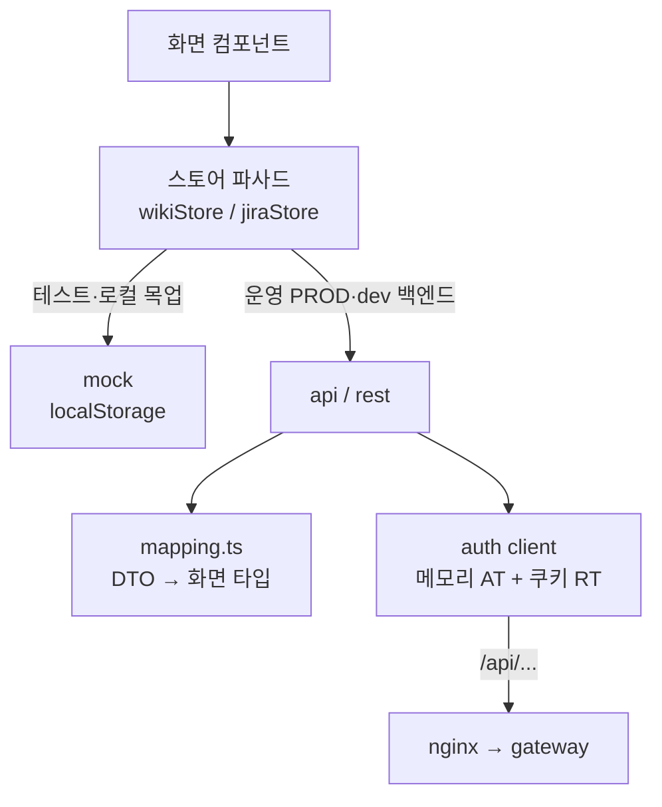
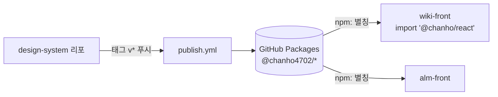

# 07 프론트엔드 — React·Vite·TypeScript와 디자인 시스템

이전 글: [[06 서비스끼리 대화하기 — gRPC·Redis Streams·아웃박스]] · 다음 글: [[08 실시간 공동 편집 — 여럿이 한 문서를 고치는 원리]]
깊은 기록: [[20 프론트-백엔드 듀얼모드 연동 — 경계 매퍼·낙관적 락·503 전파 (2026-07-22)]] · [[22 wiki-front 컨플루언스 복제 리뉴얼 + 폴더·초안·컬럼 콘텐츠 모델 (2026-07-26)]]

## 한 줄 요약

화면은 **세 개의 React 앱**(wiki-front, alm-front, myFront)이다. 셋 다 **Vite**로 빌드하고 **TypeScript**로 쓴다.
위키와 ALM은 공통 부품 상자인 **디자인 시스템(`@chanho/*`)** 을 GitHub Packages에서 받아 쓴다.
데이터는 반드시 **스토어**를 거치고, 스토어는 **목업(브라우저 안 가짜 데이터)과 REST(진짜 서버)** 두 얼굴을 가진다.

---

## 왜 필요한가

### 비유: 레고 공장과 조립 설명서

- **React** = 레고 블록. 버튼, 표, 모달 같은 화면 조각(컴포넌트)을 만들어 끼워 맞춘다.
- **디자인 시스템** = 회사 전용 레고 블록 세트. 위키와 ALM이 **같은 블록**을 쓰니 버튼 모양·색이 저절로 같다.
- **TypeScript** = 블록마다 붙은 규격표. "이 구멍엔 이 크기만 들어간다"를 미리 검사해 조립 실수를 줄인다.
- **Vite** = 조립 공장. 개발 중엔 바로바로 보여 주고, 배포할 땐 작고 빠른 파일 묶음으로 포장한다.
- **스토어 듀얼모드** = 연습용 모형 땅과 진짜 땅. 서버 없이도 모형 땅(목업)에서 화면을 만들고 시험할 수 있다.

### 용어

> [!note] SPA (Single Page Application)
> 페이지를 옮길 때 서버에서 새 HTML을 받지 않고, 브라우저 안의 자바스크립트가 화면만 바꾸는 앱. 우리 세 프론트가 모두 SPA다.

> [!note] 번들과 코드 분할
> Vite는 수백 개의 파일을 몇 개의 **번들**(묶음)로 합친다. 한 번에 다 받으면 첫 화면이 느리다.
> **코드 분할**은 "지금 필요한 조각만 먼저 받고, 나머지는 그 화면에 갈 때 받는" 기법이다. React에서는 `React.lazy`와 `import()`로 한다.

> [!note] GitHub Packages
> GitHub이 운영하는 npm 패키지 창고. 우리 디자인 시스템은 `https://npm.pkg.github.com`의 `@chanho4702` 이름으로 올라간다.

---

## 우리 제품에서는 어떻게 쓰나

### 1. 세 개의 프론트 (`package.json`·`vite.config.ts` 기준)

| | wiki-front | alm-front | myFront |
|---|---|---|---|
| 무엇 | 컨플루언스식 위키 | 지라식 이슈 관리(ALM) | 제품 소개 사이트(포털) |
| React / Router | 19 / react-router 7 | 19 / react-router 7 | 19 / react-router-dom 7 |
| Vite / TS | 7 / 5.7 | 7 / 5.7 | 6 / 5.7 |
| base 경로 | `/wiki/` (`VITE_BASE`로 바꿀 수 있음) | `/alm/` | `/` |
| dev 포트 | 5174 | 5175 | 5173 |
| UI 부품 | `@chanho/react` | `@chanho/react` | MUI v9 + emotion |
| 패키지 관리 | pnpm | pnpm | npm |
| 테스트 | vitest + Testing Library | vitest + Testing Library | 브라우저 테스트 없음(`tsc -b`, `node --test`로 스크립트만) |

- **wiki-front 주요 라이브러리**: TipTap 2.27(에디터), Yjs·Hocuspocus provider(공동 편집, [[08 실시간 공동 편집 — 여럿이 한 문서를 고치는 원리]]), react-markdown + KaTeX·mermaid(수식·다이어그램).
  본문은 Markdown 문자열로 저장한다.
- **wiki-front는 빌드가 두 번**이다. 보통 빌드와 `--mode docs` 빌드(`.env.docs`). 두 번째는 `/docs/`의 **읽기 전용 공개 문서**용이다(`VITE_WIKI_READONLY=true`).
- **alm-front 주요 라이브러리**: TipTap(멘션 포함), `@xyflow/react` + dagre(워크플로 캔버스), `@svar-ui/react-gantt`(간트), recharts(차트), dnd-kit(드래그).
- 세 앱 모두 상태 관리 라이브러리(Redux 등)를 쓰지 않는다.

### 2. 디자인 시스템 — `design-system` 리포

| 리포 안 이름 | 버전 | 발행 이름 | 내용 |
|---|---|---|---|
| `@chanho/tokens` | 0.4.0 | `@chanho4702/tokens` | 색·간격 등 디자인 토큰, CSS 변수(`--chanho-*`) 생성 |
| `@chanho/react` | 0.11.0 | `@chanho4702/react` | Button, Modal, Select, Table, Tabs, Toast 등 약 28개 컴포넌트 |
| `@chanho/org-admin` | 0.3.0 | `@chanho4702/org-admin` | 사람·팀·권한·메일 관리 화면 묶음(`OrgAdminApp`). 0.3.0에서 전역 권한의 부여·변경·회수 기록을 보는 **권한 이력** 화면(`grant-audit`)이 생겼다 |

- Storybook 문서(`apps/docs`)와 사용 예제(`examples/consumer`)도 있다.
- **발행**: `design-system/.github/workflows/publish.yml`. 태그 `v*`나 `org-admin-v*`를 푸시하면 세 패키지를 빌드하고,
  이미 올라간 버전은 건너뛰고, 이름을 `@chanho4702/...`로 바꿔 GitHub Packages에 올린다.
- **받아 쓰기**: 위키·ALM의 `package.json`이 **별칭**을 쓴다. 코드에서는 계속 `@chanho/react`로 import한다.

```json
"@chanho/react": "npm:@chanho4702/react@0.11.0",
"@chanho/tokens": "npm:@chanho4702/tokens@0.4.0",
"@chanho/org-admin": "npm:@chanho4702/org-admin@0.3.0"
```

- 프론트 리포의 `.npmrc`가 `@chanho4702` 스코프를 GitHub Packages로 보낸다. 내 PC에서 받으려면 `~/.npmrc`에 `GH_PACKAGES_TOKEN`이 필요하다.
- 예전에는 `.tgz` 파일을 리포에 넣어 나눠 썼다. 지금 세 프론트에는 tgz가 없다(`design-system/artifacts/`에 옛 파일이 남아 있지만 git이 추적하지 않는다).

### 3. 스토어 듀얼모드 — 목업과 REST

화면 컴포넌트는 `fetch`를 직접 부르지 않는다. **반드시 스토어(파사드)** 를 부른다. 스토어가 목업이냐 REST냐를 고른다.

**wiki-front** — `src/features/wiki/store/`
- `wikiStore.ts`: `const impl = USE_BACKEND ? api : mock;`
- `apiClient.ts`: `USE_BACKEND = PROD || VITE_API_PROXY 있음 || VITE_API_BASE 있음`
- `wikiMock.ts`: localStorage(`wiki.v1`)에 저장하는 가짜 서버. `wikiApi.ts`: 진짜 REST.
- `mapping.ts`: 서버 응답(DTO)을 화면 타입으로 바꾸는 순수 함수. **경계 매퍼**라고 부른다.
- 운영 빌드에서는 `USE_BACKEND`가 상수 `true`라 분기가 접혀 목업 모듈 전체가 번들에서 빠진다. `wikiApi`는 목업을 import하지 않는다.

**alm-front** — `src/features/alm/store/`
- `jiraStore.ts`는 `@alm-store-impl`이라는 **별칭**을 import한다. 어느 구현을 쓸지는 **빌드할 때** `vite.config.ts`가 정한다. `vite build`(운영)나 `VITE_ALM_DATA=rest`면 `jiraApi.ts`, 아니면 `jiraMock.ts`. vitest는 `vitest.config.ts`가 항상 목업으로 묶는다.
- 고르지 않은 쪽은 번들에 아예 들어가지 않는다. 예전에 REST 모드에서 `{ ...mock, ...rest }`로 합쳐 "REST에 없는 함수는 목업으로 대체"하던 런타임 폴백은 2026-10-18에 없앴다. 대신 REST 어댑터가 목업의 공개 함수를 **전부** 같은 시그니처로 갖는지 타입 검사(`RestConformsToStoreContract`)가 본다. 하나라도 빠지면 `typecheck`가 깨진다.
- `mapping.ts`, `agentMapping.ts`: 경계 매퍼.

**3분할 — model / api / mock** (2026-10-18, 위키·ALM 공통)
- 한 파일에 수천 줄씩 쌓였던 스토어를 도메인별로 쪼갰다. ALM은 `jiraMock`(5.9천 줄)을 `mock/*.ts` 30개로, `jiraApi`(3.3천 줄)를 `api/*.ts` 22개로, `types.ts`를 `model/*.ts`로 나눴다. 위키도 같은 모양(`model/`·`api/`·`mock/`)이다.
- `wikiStore.ts`·`wikiMock.ts`·`wikiApi.ts`·`jiraStore.ts`·`jiraMock.ts`·`jiraApi.ts`는 이름은 그대로 두고 **다시 내보내기만** 한다. 그래서 화면 코드의 import는 바뀌지 않았다. 동작도 바뀌지 않은 순수 리팩터링이다.

**myFront** — 듀얼모드 없음. 게시판 데모는 localStorage만 쓴다.

왜 이렇게 하나:
- 서버가 없어도 화면 작업과 테스트를 할 수 있다. 테스트는 **항상 목업 모드**로 돈다(`vitest.config.ts`가 env를 비운다).
- 서버 응답 모양이 바뀌어도 고칠 곳이 **매퍼 하나**다.
- 운영 빌드(`PROD`)는 무조건 REST다. 실수로 가짜 데이터가 배포될 일이 없다.

### 4. 서버를 부르는 법 — 인증 클라이언트

- 세 앱 모두 `src/auth/client.ts`(`createAuthClient`)를 쓴다.
- **Access Token은 메모리에만** 둔다. 새로고침하면 사라진다. **Refresh Token은 HttpOnly 쿠키**다(자바스크립트가 못 읽음).
- 모든 요청에 `credentials: 'include'`. 401이 오면 `POST /api/auth/refresh`를 **한 번만** 부르고(동시에 여러 개면 하나로 합침) 다시 시도한다.
- 로그인은 `/oauth2/authorization/keycloak`으로 이동. 구글은 `kc_idp_hint=google`. 자세한 건 [[03 로그인과 권한 — Keycloak·OIDC·JWT·개인 API 토큰]].
- 운영에서는 API 주소가 `""`(같은 출처)다. nginx가 `/api/`를 게이트웨이로 넘긴다.
- 개발에서 wiki-front는 `VITE_API_PROXY=http://localhost:18000`(dev 게이트웨이)로 Vite 프록시를 쓴다. myFront는 `--mode devlocal`이면 `:18000`.

### 5. 코드 분할

- wiki-front `App.tsx`: 페이지 보기·히스토리·검색·관리 등 21개 화면 모듈을 `React.lazy`로. `mermaid`는 다이어그램이 있을 때만 `import()`.
- alm-front `App.tsx`: 보드·백로그·타임라인·리포트·AI 사무실 등 20개 화면 모듈을 `React.lazy`로. 이슈 생성·검색 모달도 지연 로딩.
  `LazyContent.tsx`는 조각 파일을 못 받으면(배포 직후 옛 파일이 지워진 경우 등) 페이지를 새로고침한다.
- `vite.config`의 `manualChunks`(수동 묶음 지정)는 쓰지 않는다. Vite가 `import()` 경계로 알아서 나눈다.
- **목업을 운영 번들에서 빼면 얼마나 줄까** — ALM은 위의 빌드 시점 선택으로 메인 청크(`index-*.js`)가 722,804B → 565,963B(약 723KB → 566KB, gzip 221KB → 179KB)로 줄었다. CI는 빌드 결과에 목업 저장 키 `alm.jira.v1`이 남아 있으면 실패한다.

### 5-1. 라우터 — 편집 중 이탈 막기 (wiki-front)

- wiki-front는 2026-10-18에 `BrowserRouter`에서 **데이터 라우터**(`createBrowserRouter` + `RouterProvider`, `src/app/main.tsx`)로 바꿨다. 라우트 트리는 `App.tsx`의 선언형 `Routes`를 그대로 둔다.
- 이유는 `useBlocker` 하나다. 이 훅은 데이터 라우터에서만 동작한다. 편집 화면(`PageEditPage.tsx`)은 저장하지 않은 변경이 있을 때 **경로가 바뀌는 앱 안 이동**(사이드바 트리·상단 바·알림 링크)을 막고, 디자인 시스템 `ConfirmDialog`("나가기"/"계속 편집")로 묻는다.
- `beforeunload`는 새로고침·탭 닫기만 막는다. 그래서 둘을 같이 쓴다. 전환 전에는 트리를 누르면 미저장 편집이 확인 없이 사라졌다.

### 6. 테스트와 CI

- 명령: `pnpm typecheck && pnpm test && pnpm build` (위키·ALM). 테스트는 `vitest run`, 가짜 브라우저는 jsdom.
- Playwright 같은 진짜 브라우저 E2E는 리포에 없다. 실측이 필요할 때는 세션에서 따로 돌렸다.
- CI(`.github/workflows/ci.yml`): pnpm 11·Node 22로 install → test → build → `dist` 아티팩트 업로드 → infra-settings에 배포 신호.
  wiki-front는 `dist-docs`까지 두 개를 올린다. 프론트는 도커 이미지를 만들지 않는다([[10 배포와 운영 — Docker·nginx·GitHub Actions]]).

---

## 흐름 그림





---

## 자주 헷갈리는 점 / 함정

**1. 로컬 :5174에서 화면을 열었더니 Keycloak으로 튕긴다.**
`.env`에 `VITE_API_PROXY`가 있으면 백엔드 모드가 되어 로그인 게이트가 켜진다. 목업으로 화면만 보려면
`VITE_API_PROXY= pnpm dev --port 5199`처럼 값을 비우고 띄운다.

**2. `VITE_USE_MOCK` 같은 변수는 없다.**
실제 스위치는 위키가 `VITE_API_PROXY`/`VITE_API_BASE`, ALM이 `VITE_ALM_DATA=rest`다. 운영 빌드는 둘 다 무조건 REST.

**3. `VITE_*` 값은 빌드할 때 박힌다.**
실행 중에 바꿀 수 없다. 공동 편집 플래그처럼 바꾸려면 다시 빌드·배포한다.

**4. 디자인 시스템 버전은 프론트가 직접 올려야 따라간다.**
새 버전을 올렸다고 프론트가 자동으로 따라가지 않는다. `package.json`을 올려야 한다. 2026-10-18 기준으로는 리포의 org-admin 0.3.0을 위키·ALM 모두 쓴다(그전에는 리포 0.2.2, 프론트 0.2.1로 어긋나 있었다).

**5. 컴포넌트에서 `fetch`를 직접 부르지 않는다.**
스토어를 건너뛰면 목업 모드에서 깨지고, 매퍼를 안 거쳐 서버 모양이 화면에 새어 나온다.

**6. 값(타입·상태·우선순위)은 아이콘 + 텍스트로 보인다.**
드롭다운 옵션까지 텍스트만 쓰지 않는다. 디자인 시스템 `Select`의 `icon`, `Checkbox`의 ReactNode 라벨이 이 규칙 때문에 생겼다.

**7. myFront는 다른 세계다.**
MUI를 쓰고 디자인 시스템을 쓰지 않으며 npm을 쓴다. 위키·ALM 규칙을 그대로 옮기면 안 된다.

---

## 더 읽을 거리

- [[20 프론트-백엔드 듀얼모드 연동 — 경계 매퍼·낙관적 락·503 전파 (2026-07-22)]] — 듀얼모드가 생긴 배경
- [[22 wiki-front 컨플루언스 복제 리뉴얼 + 폴더·초안·컬럼 콘텐츠 모델 (2026-07-26)]] — 위키 화면 모델
- [[03 로그인과 권한 — Keycloak·OIDC·JWT·개인 API 토큰]] — 토큰과 쿠키
- [[10 배포와 운영 — Docker·nginx·GitHub Actions]] — 프론트 배포
- [[45 전체 검수 96건과 기능 공백 보완 — 병합·보안·성능·운영 하드닝 (2026-10-18)]] — 데이터 라우터 전환·스토어 3분할·ALM 목업 번들 분리·org-admin 0.3.0
- 리포: `wiki-front/CLAUDE.md`, `wiki-front/src/features/wiki/store/CLAUDE.md`(스토어 계약), `alm-front/docs/areas/store.md`
- 리포: `design-system/README.md`, `design-system/.github/workflows/publish.yml`

---

## 스스로 점검 질문

**Q1. wiki-front 테스트는 서버 없이도 돈다. 어떻게 가능한가?**

> [!note]- 답
> 화면은 스토어 파사드(`wikiStore.ts`)만 부르고, 스토어가 `USE_BACKEND`에 따라 목업(`wikiMock.ts`, localStorage)과 REST(`wikiApi.ts`) 중 하나를 고른다.
> `vitest.config.ts`가 `VITE_API_PROXY` 등을 비워 테스트는 항상 목업 모드로 돈다.

**Q2. 디자인 시스템에 새 컴포넌트를 추가했다. 위키 화면에서 쓰기까지 무엇을 해야 하나?**

> [!note]- 답
> design-system에서 버전을 올리고 태그(`v*`)를 푸시하면 `publish.yml`이 GitHub Packages에 `@chanho4702/react@새버전`을 올린다.
> 그다음 wiki-front `package.json`의 별칭 `"@chanho/react": "npm:@chanho4702/react@새버전"`을 올리고 설치한다. 자동으로 따라가지 않는다.

**Q3. alm-front REST 모드에서 서버에 아직 없는 기능을 화면에서 누르면 목업으로 대신 동작할까?**

> [!note]- 답
> 지금은 그럴 수 없다. 예전에는 `jiraStore.ts`가 REST 모드에서 `{ ...mock, ...rest }`로 합쳐, `jiraApi.ts`에 없는 함수가 목업으로 자동 대체됐다(데이터는 브라우저에만 저장됐다).
> 2026-10-18부터는 구현을 빌드 시점에 하나만 고르고(`@alm-store-impl` 별칭), REST 어댑터가 목업 계약을 전부 갖는지 타입 검사가 본다. 서버 어댑터에 함수가 빠지면 `typecheck`에서 먼저 깨지고, 운영 번들에는 목업이 아예 없다.
