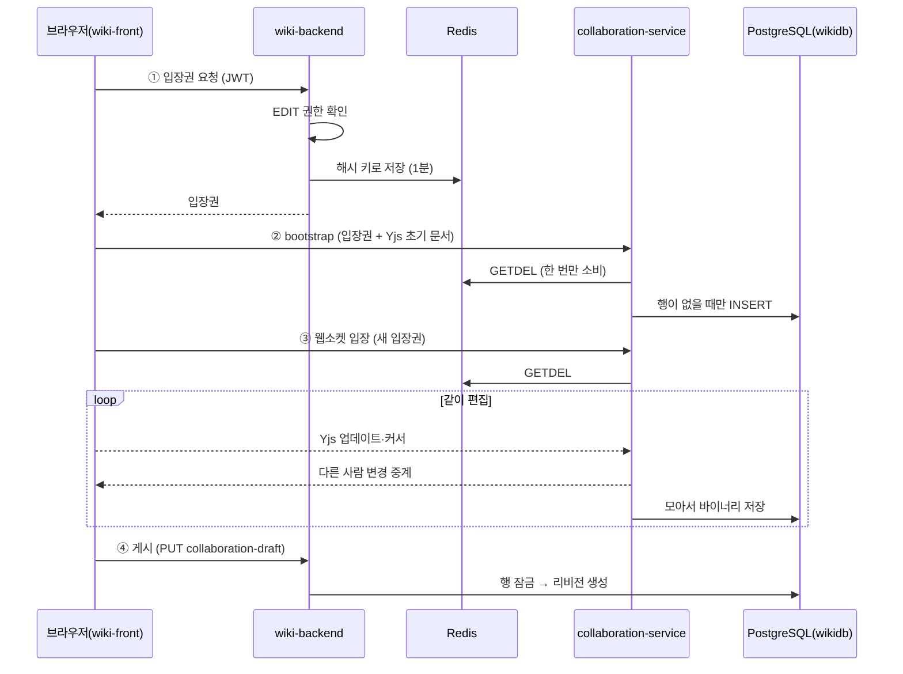
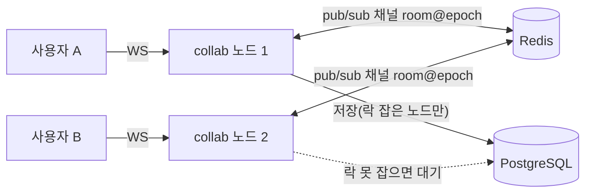

# 08 실시간 공동 편집 — 여럿이 한 문서를 고치는 원리

이전 글: [[07 프론트엔드 — React·Vite·TypeScript와 디자인 시스템]] · 다음 글: [[09 검색 — 라이트 검색과 OpenSearch]]
깊은 기록: [[43 위키 실시간 공동 편집 — 구조·설계 이유·2인 실측·운영 투입 판정 (2026-09-30)]]

## 한 줄 요약

위키 페이지를 여러 사람이 동시에 고치는 기능은 **별도 Node 서비스 `collaboration-service`(:9150)** 가 맡는다.
병합은 **Yjs(CRDT)**, 서버는 **Hocuspocus**, 통로는 **웹소켓**이다.
서버는 운영에 떠 있지만, **화면 스위치(`VITE_WIKI_COLLABORATION_ENABLED`)는 아직 꺼져 있다.**

---

## 왜 필요한가

### 비유: 한 장의 화이트보드 vs 각자의 복사본

옛날 방식은 "복사본을 각자 고쳐서 마지막에 낸 사람 것이 이긴다"다.
위키의 일반 저장이 이 방식이다. 두 사람이 동시에 고치면 늦게 낸 쪽이 409(충돌)를 받는다.
이 잠금 방식은 [[05 데이터 — PostgreSQL·Flyway·JPA·낙관적 락]]에서 다룬 **낙관적 락**이다.

공동 편집은 **한 장의 화이트보드**다. 모두가 같은 판에 쓰고, 남의 손이 움직이는 게 실시간으로 보인다.
이렇게 하려면 두 가지 문제를 풀어야 한다.

1. **동시에 같은 곳을 고치면 어떻게 합치나** → CRDT가 푼다.
2. **브라우저와 서버가 쉬지 않고 주고받는 통로** → 웹소켓이 푼다.

### 용어 세 개

> [!note] 웹소켓(WebSocket)
> 보통의 HTTP는 "묻고 답하고 끊는" 전화다. 웹소켓은 **끊지 않고 계속 열어 두는 전화**다.
> 서버가 먼저 "상대가 글자를 넣었어"라고 말할 수 있다.

> [!note] CRDT
> "충돌 없이 합쳐지는 자료구조"다. 편집이 어떤 순서로 도착해도 **모두 같은 결과**로 합쳐진다.
> 그래서 서버에 "내가 먼저야?"라고 물어보지 않아도 된다. 오프라인 중에 쓴 글도 다시 연결되면 자동으로 합쳐진다.

> [!note] Yjs와 Hocuspocus
> **Yjs**는 자바스크립트로 만든 CRDT 라이브러리다. 문서를 `Y.Doc`이라는 객체로 다룬다.
> **Hocuspocus**는 Yjs 문서를 웹소켓으로 중계·저장해 주는 서버 프레임워크다. 우리는 직접 띄운다(셀프호스팅).

---

## 우리 제품에서는 어떻게 쓰나

### 등장인물

| 누구 | 역할 | 실제 위치 |
|---|---|---|
| wiki-front | TipTap 에디터 + Yjs. 화면에서 편집 | `wiki-front/src/features/wiki/editor/collaboration/` |
| wiki-backend | 편집 권한 확인 후 **1회용 입장권(ticket)** 발급, 게시 처리 | `wiki-backend/.../collaboration/CollaborationTicketController.java` |
| collaboration-service | 웹소켓 방 운영, Yjs 병합, 저장 | `collaboration-service/src/` |
| Redis | 입장권 보관(1분), 노드 사이 변경 중계, 리셋 신호 | compose `redis` |
| PostgreSQL | Yjs 문서의 **정본**(바이너리 그대로) | `wikidb.collaboration_document` |

### 사용한 기술과 버전 (실제 값)

- 서버: `@hocuspocus/server` 4.6.0, `@hocuspocus/extension-redis` 4.6.0, `@hocuspocus/extension-database` 4.6.0, `yjs` 13.6.32, `pg` 8.23.0, `ioredis` 6.0.0 (`collaboration-service/package.json`)
- 런타임: Node.js 24, pnpm, TypeScript, 테스트는 vitest
- 프론트: `@hocuspocus/provider` 4.6.0, `@tiptap/extension-collaboration` 2.27.2, `@tiptap/extension-collaboration-cursor` 2.27.2, `y-prosemirror` 1.3.7, `yjs` 13.6.32 (`wiki-front/package.json`)

### 배선 (설정 파일 기준)

- **compose**: `infra/keycloak/docker-compose.yml`의 `collaboration-service`.
  이미지 `ghcr.io/chanho4702/collaboration-service:${COLLABORATION_TAG:-latest}`, `PORT: 9150`,
  `REDIS_URL: redis://redis:6379/0`, `DATABASE_URL: …/wikidb`, `MAX_DOCUMENT_BYTES` 기본 10485760(10MiB).
  헬스체크는 `http://127.0.0.1:9150/health`. 메모리 상한 `mem_limit: ${COLLABORATION_MEM_LIMIT:-192m}`(2026-10-18 전 서비스 상한 도입).
  페이지 영구 삭제·스페이스 삭제 때 wiki-backend가 `collaboration_document`(Yjs 상태)도 함께 지운다. 예전에는 남았다(2026-10-18 `PageDataPurger`).
- **nginx**: `infra/nginx/default.conf`의 `location ~ ^/api/wiki/collaboration(?:/|$)`.
  웹소켓 업그레이드 헤더(`Upgrade`, `Connection "upgrade"`), `proxy_read_timeout 1h`, `client_max_body_size 16m`.
- **게이트웨이**: `gateway-server/src/main/resources/application.yml`의 라우트 `wiki-collaboration-bootstrap`(HTTP)과
  `wiki-collaboration`(WS). 대상은 env `COLLABORATION_SERVICE_HTTP_URI`·`COLLABORATION_SERVICE_URI`
  (compose에서 `http://collaboration-service:9150`, `ws://collaboration-service:9150`).
  웹소켓 프레임 상한은 16MiB로 올려 두었다.
- **dev 오프셋**: 서비스 기본 포트는 코드상 `19150`이다(`src/config.ts`). 운영 포트 + 10000 규칙 그대로다.

### 한 번 편집하는 동안 일어나는 일

1. **입장권 받기** — 브라우저가 평소처럼 JWT를 들고 `POST /api/wiki/pages/{pageId}/collaboration-ticket`을 부른다.
   wiki-backend가 스페이스 EDIT 권한과 페이지 제한을 확인한다.
   통과하면 무작위 값을 만들어 Redis에 **SHA-256 해시 키로** 1분간 저장한다.
   키 모양은 `wiki:collaboration:ticket:v1:<해시>`다.
2. **처음 문서 넣기(bootstrap)** — 이 방에 아직 공동 초안이 없으면, 브라우저가 현재 본문으로 Yjs 문서를 만들어 한 번 올린다.
   `POST /api/wiki/collaboration/pages/{pageId}/bootstrap`, 헤더 `Authorization: Collaboration <ticket>`.
   두 사람이 동시에 처음 들어와도 **첫 요청만** 행을 만든다. 나머지는 이미 있는 초안을 받는다.
3. **웹소켓 입장** — 새 입장권으로 방 `page:<pageId>`에 들어간다.
   서버는 Redis `GETDEL`로 입장권을 **딱 한 번만** 꺼내 쓴다. 다시 쓰면 거부된다.
4. **같이 쓰기** — 글자 하나하나가 Yjs 업데이트로 오가고 자동으로 합쳐진다.
   커서와 이름표(awareness)는 서버가 **입장권 속 신원으로 덮어쓴다.** 남의 이름으로 위장할 수 없다.
5. **저장** — 서버가 잠깐 모았다가(debounce) Yjs 상태를 PostgreSQL에 바이너리로 저장한다.
6. **게시** — `PUT /api/wiki/pages/{id}/collaboration-draft`. 지금 공동 초안을 **정식 리비전**으로 찍는다.
   page 행과 초안 행을 잠그고, 버전이 기대값과 같을 때만 리비전을 만든다. 게시 뒤에도 공동 편집은 이어진다.

### 왜 위키 서버(Spring) 안에 넣지 않았나

- Spring REST는 "짧게 묻고 답하기"에 맞춰져 있다. 웹소켓은 한 사람이 몇 시간씩 연결을 잡고 있다.
  섞으면 편집하는 사람이 많을 때 조회 성능이 떨어질 수 있다.
- Yjs·Hocuspocus 생태계가 자바스크립트라서 Node를 골랐다.
- 외부 SaaS가 아니라 직접 띄우는 서버라서 **온프렘 설치판**에 그대로 넣을 수 있다.

(이 이유들은 43번 노트에서 코드와 문맥으로 재구성한 것이다. `collaboration-service/CLAUDE.md`에는 결정만 있다.)

### 되돌리면 안 되는 약속 (`collaboration-service/CLAUDE.md` "되돌리지 말 것")

1. CRDT는 Yjs, 서버는 셀프호스팅 Hocuspocus.
2. 웹소켓 인증은 **wiki-backend가 발급한 짧은 1회용 입장권만**. Access Token을 웹소켓 URL이나 이 서비스로 보내지 않는다.
3. 입장권 원문은 저장·로그하지 않는다. 해시 키로 `GETDEL` 한 번만 소비한다.
4. 입장권의 `room`과 실제 방 이름이 다르면 거부한다. 형식이 틀리거나, 만료됐거나, Redis가 죽어도 **거부(fail-closed)** 한다.
5. Yjs 상태는 PostgreSQL에 바이너리 그대로. Markdown으로 다시 만든 것을 정본으로 쓰지 않는다. Redis는 중계와 커서만.
6. 로그는 stdout JSON. 입장권·Authorization·본문은 남기지 않는다([[11 로그와 관측 — Alloy·Loki·Grafana]]).
7. 종료할 때 새 연결을 막고, 저장 대기분을 비운 뒤 제한 시간 안에 끈다.

### 지금 상태 — 플래그는 꺼져 있다

- 스위치: `VITE_WIKI_COLLABORATION_ENABLED`. `wiki-front/src/features/wiki/editor/collaboration/useCollaborationSession.ts`에서
  `import.meta.env.VITE_WIKI_COLLABORATION_ENABLED === "true"`로 읽는다. `.env.example`에는 `false`로 주석 처리돼 있다.
- **빌드할 때 박히는 상수**다. 켜려면 이 값을 넣고 **다시 빌드·배포**해야 한다. 서버만 켜 둔다고 화면에 나오지 않는다.
- 2026-10-01에 큰 결함 두 개(다른 경로 저장 뒤 영구 정지, 64KB 웹소켓 프레임 상한)와 재연결 고착을 고쳐 배포했다.
  배포 이미지 기준 실측 E2E 14/14 통과.
- 그래도 켜지 않은 이유: 남은 "높음" 항목이 있다(43번 노트 §8 기준).
  - 권한 회수·삭제·이동이 이미 열린 세션에 반영되지 않는다.
  - 다른 노드에서 온 커서 정보가 버려질 수 있다.
  - Redis 순단 중 노드 간 덮어쓰기 위험.
  - 10MB를 넘는 문서가 조용히 저장되지 않는다.

---

## 흐름 그림

노드가 여러 대일 때는 이렇게 된다.

---

## 자주 헷갈리는 점 / 함정

**1. "서버가 떠 있으니 기능도 켜진 것이다" — 아니다.**
화면 플래그가 빌드 상수다. 서버가 건강해도(`/health` 200) 사용자는 공동 편집을 못 본다.

**2. "웹소켓에도 JWT를 실으면 되지 않나" — 일부러 안 한다.**
웹소켓은 인증 정보가 URL에 실리기 쉽고, URL은 로그에 남는다.
그래서 권한 판단은 원래 하던 wiki-backend가 하고, 웹소켓에는 **1분짜리 1회용 표**만 보낸다.
이 경로는 게이트웨이에서 JWT 없이 열려 있고, **입장권이 유일한 인증**이다.

**3. `generation`과 `reset_epoch`는 다르다.**
- `generation`: 게시 세대. 정상 게시할 때마다 +1.
- `reset_epoch`: 리셋 세대. **다른 경로의 저장**(일반 저장, 복원, 이관 등)으로 초안을 새로 시작할 때만 +1.
저장 가드는 `reset_epoch`만 본다. `generation`으로 막으면 게시 한 번에 남은 편집자가 쫓겨난다(실제로 리뷰에서 잡힌 결함).

**4. 초안 행을 지우면 안 된다.**
메모리에 남은 옛 문서가 다음 저장 때 행을 **되살린다.** 그래서 행은 "제자리 리셋"한다.
리셋되면 서버가 연결을 close 코드 **4409**로 닫고, 화면은 비교 패널을 보여 준다.

**5. 크기 제한이 세 군데 있다.**
- collaboration-service `MAX_DOCUMENT_BYTES`: 10MiB
- 게이트웨이 웹소켓 프레임: 16MiB (원래 기본 64KB라 큰 문서가 무한 재연결했다)
- nginx 본문: 공동 편집 두 경로만 `16m` (기본 1MB면 413)
한 곳만 고치면 다른 곳에서 막힌다.

**6. 채널 이름이 바뀐 버전끼리 섞어 배포하지 않는다.**
Redis 중계 채널이 `<prefix>:<room>@<reset_epoch>`로 바뀌었다. 옛 버전 노드와 섞어 롤링 배포하면 안 된다.

**7. 일반 저장과 공동 편집은 다른 잠금 원리다.**
일반 저장은 낙관적 락(버전이 다르면 409). 공동 편집은 CRDT 병합(충돌이 아예 안 난다). 게시 순간에만 다시 버전을 대조한다.

---

## 더 읽을 거리

- [[43 위키 실시간 공동 편집 — 구조·설계 이유·2인 실측·운영 투입 판정 (2026-09-30)]] — 실측 결과와 결함 목록 전체
- [[05 데이터 — PostgreSQL·Flyway·JPA·낙관적 락]] — 일반 저장의 409 원리
- [[04 게이트웨이와 서비스 찾기 — Spring Cloud Gateway·Eureka]] — 라우트가 어떻게 정해지나
- [[10 배포와 운영 — Docker·nginx·GitHub Actions]] — nginx·compose
- 리포: `collaboration-service/README.md`(인증 흐름·bootstrap·리셋 표), `collaboration-service/CLAUDE.md`(되돌리지 말 것·경계 계약)
- 리포: `wiki-front/README.md`(플래그 설명), `wiki-front/docs/backend/2026-08-16-w14-content-collaboration-architecture.md`

---

## 스스로 점검 질문

**Q1. 공동 편집 서버가 운영에서 건강한데도 사용자 화면에 공동 편집이 안 보인다. 왜인가?**

> [!note]- 답
> 프론트 플래그 `VITE_WIKI_COLLABORATION_ENABLED`가 꺼져 있기 때문이다. 이 값은 Vite **빌드 시점 상수**라서,
> 켜려면 값을 `true`로 넣고 wiki-front를 다시 빌드·배포해야 한다. 남은 "높음" 결함 때문에 일부러 꺼 두었다.

**Q2. 웹소켓 연결에 Access Token 대신 1회용 입장권을 쓰는 이유 두 가지는?**

> [!note]- 답
> ① 웹소켓은 인증 정보가 URL에 실리기 쉽고 URL은 로그에 남는다. 새어도 이미 쓴 1분짜리 표만 넘어가게 한다.
> ② 편집 권한 판단을 원래 하던 wiki-backend 한 곳에 둔다. collaboration-service는 JWT를 몰라도 된다.
> 입장권은 Redis에 해시 키로 저장되고 `GETDEL`로 한 번만 소비된다.

**Q3. 편집 중에 누군가 "일반 저장"으로 같은 페이지 버전을 올렸다. 공동 초안은 어떻게 되나?**

> [!note]- 답
> wiki-backend가 같은 트랜잭션 안에서 초안 행을 **제자리 리셋**한다(`reset_epoch` +1, `reset_pending=true`).
> 커밋 뒤 Redis `wiki:collaboration:reset` 신호를 보낸다. collaboration-service는 옛 epoch 문서의 연결을
> close 4409로 닫고 저장 없이 내린다. 화면은 비교 패널을 보여 주고 최신본 기준으로 다시 시작한다.
> 행을 지우지 않는 이유는 메모리의 옛 문서가 행을 되살리기 때문이다.
