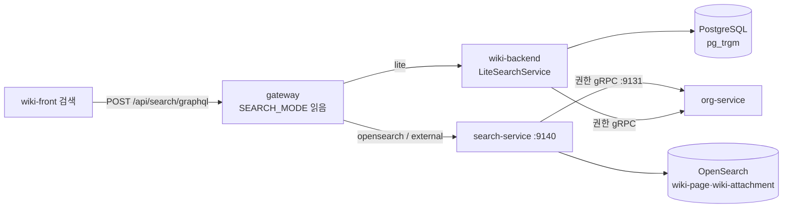
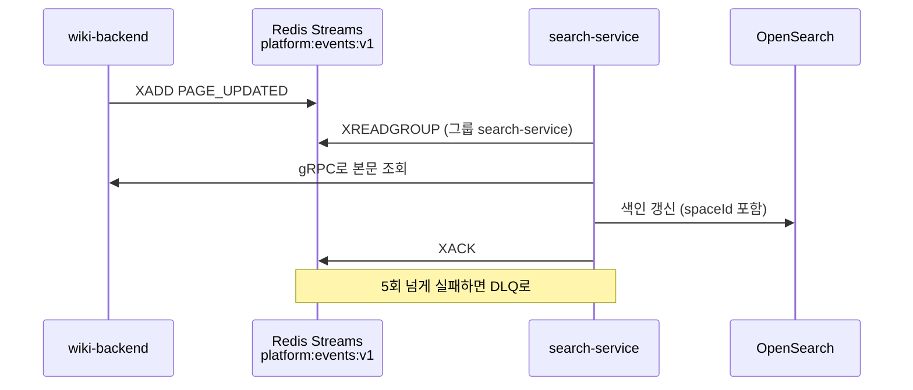

# 09 검색 — 라이트 검색과 OpenSearch

이전 글: [[08 실시간 공동 편집 — 여럿이 한 문서를 고치는 원리]] · 다음 글: [[10 배포와 운영 — Docker·nginx·GitHub Actions]]
깊은 기록: [[25 Wave C — search-service 구현·배포 완료기록 (2026-08-15)]] · [[41 ALM 검색 질의어(AQL)·값 아이콘·해결일·저장 필터 + 후속 정리 (2026-09-06~09-23)]]

## 한 줄 요약

위키 검색은 설치 옵션 스위치 **`SEARCH_MODE` 하나**로 바뀐다.
- `lite`(기본): 위키 서버가 **PostgreSQL**로 직접 찾는다. 컨테이너 추가 없음.
- `opensearch`: 전용 **search-service + OpenSearch**가 찾는다.
- `external`: search-service만 띄우고 고객사 OpenSearch를 쓴다.

**게이트웨이**가 이 값 하나에서 "어디로 보낼지"를 스스로 계산한다. ALM은 이와 별개로 **AQL**이라는 자체 질의어로 이슈를 찾는다.

---

## 왜 필요한가

### 비유: 동네 서점 vs 대형 도서관 색인실

- **lite** = 동네 서점 주인이 책장을 직접 훑는다. 책이 적으면 충분히 빠르고, 따로 직원을 둘 필요가 없다.
- **opensearch** = 도서관에 **색인실**을 따로 둔다. 책이 들어올 때마다 카드(색인)를 만들어 둬서, 책이 많아도 빨리 찾는다.
  대신 색인실 직원 월급(메모리 약 1.75GiB)이 든다.

작은 회사에 설치하면 동네 서점이면 충분하다. 그래서 **기본값이 lite**다.
"검색을 끈다"는 말은 **검색이 없어지는 게 아니라 라이트 검색으로 간다**는 뜻이다(확정 결정).

### 용어

> [!note] 전문 검색과 OpenSearch
> 문서 본문 안의 단어로 찾는 것이 **전문 검색**이다. **OpenSearch**는 이 일만 전문으로 하는 검색 엔진이다(Elasticsearch에서 갈라진 오픈소스).
> 문서를 미리 쪼개 **역색인**(단어 → 문서 목록)을 만들어 둔다.

> [!note] nori
> 한국어 형태소 분석기. "검색했다"를 "검색" + "하다"로 쪼개 준다. 우리 OpenSearch 이미지에 플러그인으로 들어 있다.

> [!note] pg_trgm
> PostgreSQL 확장. 글자를 세 개씩 묶은 조각(trigram)으로 색인을 만들어, `LIKE '%단어%'` 같은 부분 일치 검색을 빠르게 해 준다.

---

## 우리 제품에서는 어떻게 쓰나

### 1. 세 가지 모드 (`INSTALL.md` 표 기준)

| 모드 | 추가 컨테이너 | `/api/search/**`이 가는 곳 | 추가 메모리 |
|---|---|---|---|
| `lite` (기본) | 없음 | `lb://wiki-backend` | 0 |
| `opensearch` | opensearch + search-service | `http://search-service:9140` | 약 1.75GiB |
| `external` | search-service만 (`OPENSEARCH_URI` 사용) | `http://search-service:9140` | 약 436MiB |

**스위치를 두는 곳**
- `infra/keycloak/.env.example`의 `SEARCH_MODE=lite`. 운영에서는 `C:\deploy\platform.env`.
- compose: 게이트웨이에 `SEARCH_MODE: ${SEARCH_MODE:-lite}`만 넘긴다.
  opensearch와 search-service에는 `profiles: ["search"]`가 붙어 있어서, 프로필을 켤 때만 뜬다.
- 바꾸는 스크립트: `scripts/search-up.ps1 -Mode lite|opensearch|external`. 프로필을 바꾸고 게이트웨이를 재시작한다. `-Reindex` 옵션도 있다.
- 배포(`deploy.yml`): `SEARCH_MODE=lite`면 search-service 배포를 건너뛴다(성공 처리).

### 2. 게이트웨이가 값 하나에서 세 가지를 파생한다

코드: `gateway-server/src/main/java/com/platform/gateway/search/`

| 파생하는 것 | 어떻게 | 파일 |
|---|---|---|
| **라우트 대상** | lite → wiki-backend, 그 외 → `http://search-service:9140` | `SearchMode.routeUri()` |
| **헬스 대시보드 행** | lite는 search-service·opensearch 행을 뺀다. external은 opensearch만 뺀다 | `SearchMode.probesComponent()`, `HealthAggregator` |
| **화면용 기능 정보** | `GET /api/platform/features` → `{"search":{"mode","unified","reindex"}}` | `PlatformFeaturesController` |

- 시작할 때 `SearchModeEnvironmentPostProcessor`가 env를 읽어 `platform.search.route-uri`를 만든다. 모르는 값이면 경고 후 lite.
- `application.yml`의 `search` 라우트는 `uri: ${platform.search.route-uri}`이고 **기본값을 일부러 안 뒀다.** 엉뚱한 곳으로 보내느니 기동 실패가 낫다.
- `SEARCH_SERVICE_URI`를 env로 직접 넣으면 파생보다 우선한다. **비상구**일 뿐이다. compose 기본값으로 되살리면 스위치가 무력화된다(확정 결정).

왜 이렇게 했나: 예전엔 라우트, 헬스 행, 화면 플래그를 각각 따로 설정해서 서로 어긋날 수 있었다. 값 하나에서 다 만들면 어긋날 수가 없다.

### 3. 위키 화면은 어떻게 아나

- `wiki-front/src/features/wiki/store/platformApi.ts`의 `fetchPlatformFeatures()`가 `/api/platform/features`를 한 번 묻고 세션 동안 기억한다.
- 실패하면 무조건 **lite로 본다.** 허용 목록에 `opensearch`, `external`만 있고 나머지는 lite.
- 쓰는 곳: 검색 화면의 "라이트 모드" 안내(`SearchPage.tsx`), 관리자 "재색인" 메뉴(`WikiTopBar.tsx`, `SearchAdminPage.tsx`).

### 4. 라이트 검색 — 위키 서버가 직접

코드: `wiki-backend/src/main/java/.../search/LiteSearchService.java`, `LiteSearchController.java`

- search-service와 **같은 GraphQL 계약**(`/graphql`, `resources/graphql/search.graphqls`)을 쓴다. 그래서 화면은 모드가 바뀌어도 같은 요청을 보낸다.
- 찾는 방법: 제목·본문·첨부 파일명에 `lower(col) like '%q%'`. 제목에 맞으면 점수 3, 본문만 맞으면 1.
  검색어 속 `%`·`_`·`\`는 와일드카드가 아니라 **글자 그대로** 찾는다(`'50%'`, `snake_case`). 예전에는 `%` 한 글자가 전 문서를 훑었다(2026-10-18 수정).
- 거르기: 스페이스, 문서 종류(`pageTypes` — PAGE·FOLDER·BLOG), 날짜. 화면에도 스페이스·종류 필터가 생겼다(F-01). `pageTypes`는 라이트 검색에만 있고 search-service 스키마에는 아직 없다.
- 빠르게: `V18__search_trgm.sql`이 `pg_trgm` 확장과 GIN 색인을 **시도**한다. 확장을 못 만들면 그냥 넘어가고 느린 전체 훑기로 동작한다.
- 한계: 부분 문자열 일치만(형태소 분석 없음), **위키만**, 재색인 없음(404).
- 권한: org-service에 "이 사람이 볼 수 있는 스페이스"를 묻는다. 페이지 단위 제한은 **먼저** "볼 수 없는 페이지 집합"을 구해 SQL이 빼고 센다.
  그래서 `total`·정렬·쪽 경계가 권한을 적용한 뒤의 값이다. 예전에는 후보 500건을 자른 뒤 제한을 걸러서, 앞쪽이 전부 제한 문서면 뒤 문서가 안 나왔다(10-16 작업, 10-18 main 병합).
- 숨김 문서가 1,000건을 넘으면 본문 없는 키만 최대 1만 건까지 읽어 거른다. 그것도 넘치면 `totalExact=false`이고 화면은 "N건 이상"으로 적는다.
- **초안**은 작성자·스페이스 ADMIN·전역 ADMIN에게만 보인다(확정 결정). 검색도 같은 판정(`EffectivePermissionService`)을 타므로 남의 초안은 결과에 나오지 않는다. `includeDrafts=true`를 줘도 볼 수 있는 초안만 나온다(권한을 넓히지 않는다).

### 5. OpenSearch 검색 — search-service

코드: `platform-backend/search-service/` (port 9140, GraphQL `/graphql`)

**색인을 어떻게 채우나 — 이벤트로**
- 위키가 페이지를 만들거나 고치면 Redis Streams `platform:events:v1`에 이벤트를 넣는다([[06 서비스끼리 대화하기 — gRPC·Redis Streams·아웃박스]]).
- search-service가 소비자 그룹 `search-service`로 읽는다(`RedisStreamEventConsumer`). 내용은 protobuf `EventEnvelope`.
- `WikiEventIndexer`가 PAGE·SPACE·ATTACHMENT 생성/수정/삭제를 처리한다. 본문은 wiki-backend gRPC(:9111)로 가져온다.
  이 위키 콘텐츠 gRPC 서버는 `SEARCH_MODE=lite`면 **아예 뜨지 않는다**. 유일한 손님인 search-service가 없는데 전 문서를 주는 서버를 열어 둘 이유가 없기 때문이다. 그래서 compose가 wiki-backend에도 `SEARCH_MODE`를 넘긴다(2026-10-18).
- search-service의 gRPC 호출에는 모두 **데드라인**이 있다. org·wiki 단건 호출 5초, 재색인 백필 스트림 전체 600초. 서비스 간 토큰(`PLATFORM_GRPC_TOKEN`)도 싣는다([[06 서비스끼리 대화하기 — gRPC·Redis Streams·아웃박스]]).
- 5번 넘게 실패한 이벤트는 DLQ `platform:events:v1:dlq`로 옮긴다.
- 색인 이름은 별칭 `wiki-page`, `wiki-attachment`. 실제 색인은 `-v1`, 재색인하면 `-vN`이 새로 생기고 별칭만 옮긴다.
- OpenSearch 이미지: `infra/opensearch/Dockerfile` = `opensearchproject/opensearch:2.19.0` + `analysis-nori`.

**권한 필터 — 남의 스페이스 문서는 안 보인다**
1. org-service gRPC(:9131) `PermissionService.listUserGrants`로 내 권한을 받는다. GLOBAL이면 전체, 아니면 SPACE 권한 목록.
2. 화면이 요청한 스페이스는 **좁힐 수만 있고 넓힐 수 없다**(`AccessScope.resolveFilter`).
3. 볼 수 있는 스페이스가 하나도 없으면 OpenSearch에 묻지도 않고 빈 결과.
4. 쿼리: `title^3, content, filename`에 `multi_match` + `terms spaceId` 필터. 색인 문서마다 `spaceId`가 들어 있어 이걸로 거른다.
5. 페이지 단위 제한은 위키 gRPC `filterVisiblePages`로 100개씩 다시 거른다. 초안 가시성도 이 필터가 같이 본다.
6. org-service가 응답하지 않으면 **빈 결과가 아니라 503**이다. "권한을 모르면 보여 주지 않는다".

**기동 백오프** — OpenSearch가 늦게 뜨면 `OpenSearchIndexBootstrap`이 5초부터 두 배씩 최대 60초 간격으로 다시 시도한다. 준비될 때까지 검색은 503.

### 6. ALM 검색 — AQL

ALM(이슈 관리)은 통합 검색이 아니라 **자체 질의어 AQL**로 이슈를 찾는다. 지라의 JQL을 본뜬 것이다.

```text
project = WEB AND status != 완료 AND assignee = currentUser() ORDER BY priority DESC
labels IN (bug, urgent) AND created >= -7d
sprint IN openSprints()
```

코드: `alm-backend/src/main/java/com/platform/almbackend/search/aql/`

- **REST**: `POST /api/alm/issues/query`, `POST /api/alm/issues/query/validate`, `GET /api/alm/issues/query/fields`.
- **처리 순서**: `AqlLexer`(글자를 낱말로) → `AqlParser`(낱말을 나무 구조 AST로) → `AqlValidation` → `AqlResolver`(이름·날짜를 실제 값으로) → `AqlSpecification`(JPA 질의로).
  **서버의 AST가 정본**이다. 문법이 틀리면 400 `{error, position, expected}`로 어디가 틀렸는지 알려 준다.
- **필드**: project, key, type, status, priority, assignee, reporter, labels, component, sprint, fixVersion, resolution, parent, created, updated, due, resolved, text, summary, archived 등. 한국어 별칭도 된다.
- **연산자**: `= != IN NOT IN IS EMPTY IS NOT EMPTY < <= > >= ~ !~` (필드마다 다름).
- **상한**: 질의 4000자, 결과 기본 50·최대 200, 조건 절 200개, 괄호 깊이 50.
- **시간대**: `Asia/Seoul`. 주의 시작은 월요일. `-7d`, `startOfWeek()` 같은 상대 날짜.
- **저장 필터**: `/api/alm/me/filters` (이름 60자, 질의 4000자, 이름 중복 거부).
- **권한**: 내가 접근할 수 있는 프로젝트 범위가 **항상 AND로** 붙는다. 보관된 이슈는 `archived`를 언급하지 않으면 빠진다.

> [!warning] ALM 통합 검색은 main에 없다
> `events.proto`에는 ALM 이벤트 정의가 있고 alm-backend도 같은 스트림에 이벤트를 넣는다.
> 그러나 main의 search-service에는 ALM을 색인하는 코드가 없다. ALM 이벤트는 조용히 무시된다.
> ALM 통합 검색은 미머지 브랜치 `feat/wave-d-alm-search`에만 있고, **재이식하지 않기로** 했다(확정 결정). 제품 기능으로 세지 않는다.

---

## 흐름 그림





---

## 자주 헷갈리는 점 / 함정

**1. lite에서 opensearch로 바꾸면 반드시 전체 재색인한다.**
lite 동안에도 위키는 이벤트를 계속 넣지만 읽는 소비자가 없다. 스트림은 `MAXLEN ~100000`으로 잘리므로 오래된 이벤트는 사라진다.
그래서 전환 뒤에는 `search-up.ps1 -Reindex`(또는 관리자 재색인)로 처음부터 다시 만든다.

**2. `SEARCH_SERVICE_URI`를 compose 기본값으로 되살리지 않는다.**
이 값이 있으면 `SEARCH_MODE` 파생보다 우선한다. 기본값으로 박으면 스위치가 아무 일도 안 하게 된다.

**3. env의 모드와 스크립트 `-Mode`가 다르면 막힌다.**
게이트웨이는 env에서 라우트를 만든다. 컨테이너만 바꾸고 env를 안 바꾸면 라우트가 엉뚱한 곳을 본다. `search-up.ps1`이 이 불일치를 거부한다.

**4. 검색 결과가 "없다"와 "모른다"는 다르다.**
권한 서비스가 죽으면 search-service는 빈 목록이 아니라 503을 준다. 빈 목록을 주면 "문서가 없다"로 오해하기 때문이다.

**5. AQL의 `!=`는 빈 값도 뺀다.**
`assignee != kim`은 "담당자가 kim이 아니고, **담당자가 비어 있지도 않은**" 이슈다(JQL과 같은 동작).
빈 값까지 포함하려면 `assignee != kim OR assignee IS EMPTY`.

**6. AQL 라벨은 대소문자를 구분한다.**
`labels = Bug`와 `labels = bug`는 다르다. 정확히 일치해야 한다.

**7. 라이트 검색의 `total`은 드물게 하한일 수 있다.**
권한을 적용한 뒤 세므로 보통은 정확하다. 숨김 문서가 아주 많아 1만 건 스캔 상한을 넘을 때만 `totalExact=false`이고, 화면은 "N건 이상"으로 표시한다.

**8. 남의 초안이 검색에 안 나오는 것은 버그가 아니다.**
초안은 작성자·스페이스 ADMIN·전역 ADMIN만 본다(확정 결정). 게시하면 검색에 나온다.

---

## 더 읽을 거리

- [[25 Wave C — search-service 구현·배포 완료기록 (2026-08-15)]] — search-service를 만든 기록
- [[26 wiki-front 통합 검색 UI + 라이브 JWT E2E (2026-08-15)]] — 검색 화면
- [[41 ALM 검색 질의어(AQL)·값 아이콘·해결일·저장 필터 + 후속 정리 (2026-09-06~09-23)]] — AQL 설계
- [[06 서비스끼리 대화하기 — gRPC·Redis Streams·아웃박스]] — 이벤트·gRPC 원리
- [[04 게이트웨이와 서비스 찾기 — Spring Cloud Gateway·Eureka]] — `lb://`가 무엇인가
- 리포: `INSTALL.md`(검색 모드 표), `gateway-server/.../search/SearchMode.java`, `platform-backend/search-service/`, `alm-backend/.../search/aql/`

---

## 스스로 점검 질문

**Q1. 고객사가 "검색은 꺼 주세요"라고 했다. 무엇을 설정하고, 사용자는 어떤 검색을 쓰게 되나?**

> [!note]- 답
> `SEARCH_MODE=lite`(기본값)로 둔다. opensearch·search-service 컨테이너는 뜨지 않는다.
> 사용자는 검색이 없는 게 아니라 위키 서버의 **라이트 검색**(PostgreSQL 부분 일치, 위키만)을 쓴다. 게이트웨이가 `/api/search/**`를 wiki-backend로 보낸다.

**Q2. 게이트웨이가 `SEARCH_MODE` 하나에서 파생하는 세 가지는?**

> [!note]- 답
> ① `/api/search/**` 라우트 대상(wiki-backend 또는 search-service:9140),
> ② 관리자 헬스 대시보드에 보일 행(lite면 search-service·opensearch 제외),
> ③ `/api/platform/features` 응답(화면이 라이트 안내·재색인 메뉴를 정하는 데 씀).
> 값 하나에서 다 만들기 때문에 셋이 서로 어긋날 수 없다.

**Q3. AQL로 `status != 완료`를 검색했더니 상태가 비어 있는 이슈가 안 나왔다. 버그인가?**

> [!note]- 답
> 버그가 아니다. AQL은 JQL처럼 `!=`, `NOT IN`, `!~`에서 **빈 값을 제외**한다(`AqlSpecification`의 `excludeEmpty`).
> 빈 값도 원하면 `status != 완료 OR status IS EMPTY`로 쓴다. 반대로 `NOT (...)`은 정확한 여집합이다.
