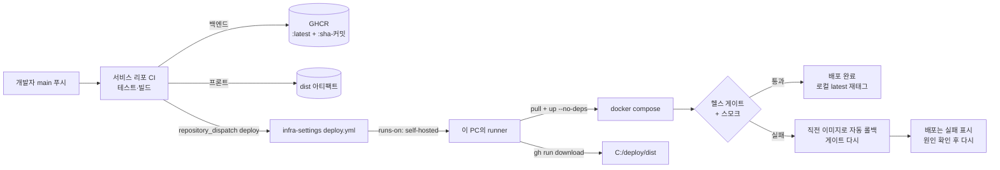
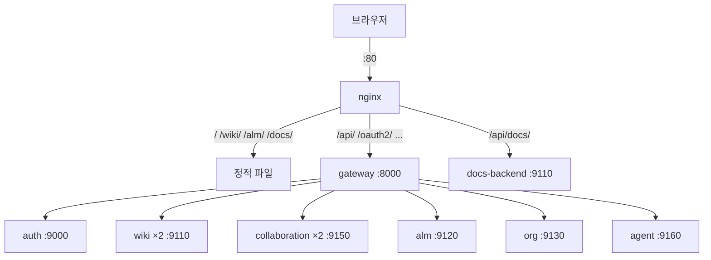

# 10 배포와 운영 — Docker·nginx·GitHub Actions

이전 글: [[09 검색 — 라이트 검색과 OpenSearch]] · 다음 글: [[11 로그와 관측 — Alloy·Loki·Grafana]]
깊은 기록: [[13 백엔드 컨테이너화 + compose 통합 — CI-CD Wave 1 (2026-07-15)]] · [[11 nginx 통합배포 + 3앱 SSO (2026-07-14)]] · [[21 dev-offset 개발환경 클러스터 + 6롤 에이전트 하네스 (2026-07-22)]]

## 한 줄 요약

모든 서비스는 **도커 컨테이너**로 돌고, **docker compose 파일 하나**가 그 목록이다.
바깥에서 들어오는 문은 **nginx(:80) 하나**뿐이다.
코드를 main에 올리면 **GitHub Actions**가 이미지를 만들어 **GHCR**에 올리고, 이 PC의 **self-hosted runner**가 받아서 그 서비스만 바꿔 끼운다.

---

## 왜 필요한가

### 비유: 도시락 공장

- **도커 이미지** = 완성된 도시락. 재료(코드)와 그릇(자바·노드 런타임)이 한 상자에 들어 있다. 어디서 데워도 맛이 같다.
- **컨테이너** = 데워서 상에 올린 도시락. 같은 도시락을 두 개 올릴 수도 있다.
- **docker compose** = 오늘의 상차림표. "어떤 도시락을 몇 개, 무엇 다음에 올린다".
- **nginx** = 식당 정문 안내원. 손님(브라우저)은 정문 하나로만 들어오고, 안내원이 알맞은 자리로 보낸다.
- **GitHub Actions** = 주방 자동화. 레시피(코드)가 바뀌면 새 도시락을 만들어 창고(GHCR)에 넣고, 식당에 "새 메뉴 왔다"고 알린다.
- **self-hosted runner** = 식당에 상주하는 직원. 알림을 받으면 창고에서 새 도시락을 가져와 상을 바꾼다.

### 용어

> [!note] GHCR
> GitHub Container Registry. GitHub이 운영하는 도커 이미지 창고다. 우리 이미지는 `ghcr.io/chanho4702/<이름>`에 있다.

> [!note] repository_dispatch
> 한 GitHub 리포가 다른 리포에 "이 이벤트 처리해 줘"라고 보내는 신호다. 서비스 리포 CI가 infra-settings 리포에 `deploy` 신호를 보낸다.

> [!note] self-hosted runner
> GitHub Actions 작업을 GitHub 서버가 아니라 **우리 PC에서** 실행하는 프로그램이다. 이 PC에 직접 컨테이너를 띄워야 하니 필요하다.

---

## 우리 제품에서는 어떻게 쓰나

### 1. compose — 상차림표

- 파일: `infra/keycloak/docker-compose.yml` (프로젝트 이름 `name: platform` 고정). 리포 루트에는 compose 파일이 없다.
- 기본 `up -d`로 상시 컨테이너 20개 + 한 번 돌고 끝나는 초기화 컨테이너 4개가 정의된다(`infra/README.md`, `INSTALL.md` 기준).
- 이미지: `ghcr.io/chanho4702/<이미지>:${<X>_TAG:-latest}`. 예: `GATEWAY_TAG`, `WIKI_TAG`, `COLLABORATION_TAG`, `ALM_BACKEND_TAG`, `AGENT_TAG`, `SEARCH_TAG`.
  각 서비스에 `build: ../../<리포>`도 있어서 로컬에서 직접 빌드할 수도 있다.
- 컨테이너 이름은 대부분 `platform-<이름>`이다(`platform-gateway`, `platform-auth`, `platform-org` …).
  **wiki-backend와 collaboration-service는 이름을 일부러 비워 뒀다.** 두 개씩 띄우기(scale) 위해서다.
- 외부 이미지(postgres·redis·keycloak·nginx)는 버전 + `@sha256` 다이제스트로 고정했다. "같은 태그인데 내용이 바뀐" 이미지가 들어오지 않게 하려는 것이다.

**메모리 상한 — 도시락 그릇 크기를 정한다(2026-10-18).**
- **모든 상시 컨테이너에 `mem_limit`**이 있다. 서비스마다 `<SVC>_MEM_LIMIT` env로 바꾼다(예: `WIKI_MEM_LIMIT=1g`, `0`은 제한 없음).
  기본값 예: wiki-backend·alm-backend·postgres·keycloak 768m, gateway·org·agent 640m, auth 512m, eureka 384m, collaboration 192m, nginx 128m.
- **Java 서비스는 상한의 50%를 최대 힙으로** 쓴다. 공통 조각 `x-java-opts`가 `JAVA_TOOL_OPTIONS=-XX:MaxRAMPercentage=50 -XX:+ExitOnOutOfMemoryError`를 넣는다(Keycloak은 55%). 나머지 절반은 메타스페이스·스레드 같은 힙 밖 메모리 몫이다.
- 왜: 그전에는 상한이 없어 JVM 기본값(호스트 RAM의 25% ≈ 3.6GiB)이 컨테이너마다 최대 힙이었고, 운영 머신(14.56GiB) 실측 합계가 약 12.6GiB였다. 예: eureka 419MiB → 384m 상한 + 힙 옵션으로 234MiB.
- 상한을 넘으면 커널이 **그 컨테이너만** 죽이고(OOM) `restart: unless-stopped`가 되살린다. 표와 합계는 `INSTALL.md` §1 "메모리".

**로그 로테이션.** 공통 조각 `x-logging`이 모든 서비스에 `json-file` 드라이버 + `max-size 20m × max-file 5`(서비스당 최대 100MB)를 건다. 전에는 도커 로그가 끝없이 쌓였다([[11 로그와 관측 — Alloy·Loki·Grafana]]).

**포트 원칙 — 앱은 포트를 열지 않는다.**

| 구분 | 서비스 | 호스트에서 보이나 |
|---|---|---|
| 정문 | nginx | `${NGINX_PORT:-80}` — 열림 |
| 로그인 | keycloak | `${KC_HOST_PORT:-8080}` — 열림(기본은 LAN까지. `KC_HOST_BIND=127.0.0.1`이면 루프백만) |
| 루프백만 | postgres 5433, redis 16379, grafana 3000, MinIO 콘솔 9001 등 | `127.0.0.1`에서만 |
| 안 열림 | gateway, auth, org, wiki, alm, collaboration, agent, search, eureka … | 도커 내부 DNS로만 |

게이트웨이(:8000)도 포트를 게시하지 않는다. Windows가 8000번을 예약해 버려 컨테이너를 다시 만들지 못한 사고가 있었다(compose 주석).

**profiles — 설치 옵션 스위치.** `profiles:`가 붙은 서비스는 그 프로필을 켤 때만 뜬다.

| 프로필 | 켜지는 것 | 무엇이 켜나 |
|---|---|---|
| `search` | opensearch, search-service | `SEARCH_MODE` ([[09 검색 — 라이트 검색과 OpenSearch]]) |
| `mail-dev` / `mail-relay` / `mail-full` | Mailpit / Postfix / docker-mailserver | `MAIL_MODE` |
| `agent-runner` | 플랫폼 러너 컨테이너 | [[12 AI 에이전트 서비스 — 꺼지지 않는 개발팀]] |

**헬스체크와 순서** — 대부분 `depends_on: condition: service_healthy`다. "DB가 건강해진 뒤 앱을 띄워라".
게이트웨이는 eureka·redis에만 의존한다. 제품 서비스 하나가 죽어도 입구가 같이 죽지 않게 하려고 일부러 뺐다.

### 2. nginx — 정문 안내원

- 설정: `infra/nginx/default.conf`, 이미지 `nginx:1.27.5-alpine`(다이제스트 고정), **80번만** 듣는다. 443(TLS) 설정은 없다.
- `localhost`가 아닌 호스트(예: `127.0.0.1`)로 오면 `http://localhost`로 301. 로그인 redirect_uri와 쿠키 출처를 하나로 맞추려는 것이다.
- `server_tokens off` — 응답 헤더·오류 페이지에 nginx 버전을 싣지 않는다.
- `/__nginx_health` — compose 헬스체크 전용. "nginx가 요청을 받는가"만 보고 `ok` 한 줄을 준다.

| 경로 | 어디로 | 특이점 |
|---|---|---|
| `/` | myFront 정적 파일(`/srv/portal`) | 미리 렌더링한 페이지 포함 |
| `/wiki/`, `/alm/`, `/docs/` | 각 앱 정적 파일(`/srv/apps`) | 없는 경로는 각 `index.html`(SPA) |
| `/api/`, `/oauth2/`, `/login/`, `/invite/`, `/.well-known/` | `gateway:8000` | 토큰 접두사 `chanho_pat_`·`agp_`·`agr_`에만 IP당 20r/s 제한 |
| `/api/wiki/collaboration` | gateway | 웹소켓 업그레이드, 1시간, 본문 16m |
| `/api/agent/mcp`, `/api/agent/office/stream` | gateway | 버퍼링 끔, 1시간(스트리밍) |
| `/api/wiki/pages/*/attachments`, `/api/alm/issues/*/attachments` | gateway | 첨부 업로드 본문 **21m** |
| `/api/org/me/avatar`, `/api/org/members/*/avatar` | gateway | 아바타 본문 **5m** |
| `/api/docs/` | `docs-backend:9110` 직행 | 공개 문서 인스턴스, 읽기 전용 |

**압축과 캐시(2026-10-18).**
- `gzip`은 **정적 파일 location에서만** 켠다. API 응답(JSON·SSE·MCP 스트림·웹소켓)에는 켜지 않는다. 스트림을 압축 버퍼에 모으면 이벤트가 늦게 흐르기 때문이다.
- 해시가 붙은 빌드 파일(`/wiki/assets/`, `/alm/assets/`, `/docs/assets/`, `/assets/`)은 `Cache-Control: public, max-age=31536000, immutable`(1년). 파일 이름이 내용으로 바뀌니 오래 둬도 안전하다.
- `index.html`과 해시 없는 파일은 `no-cache` — "저장하되 쓰기 전에 새것인지 물어봐라". 새 배포가 바로 보이게 하려는 것이다.

정적 파일은 호스트 폴더 `C:/deploy/dist/{portal,wiki,alm,docs}`를 바인드 마운트한다.

### 3. CI → CD — 코드가 운영에 닿기까지

**① 서비스 리포 CI** (예: `wiki-backend/.github/workflows/ci.yml`)
- PR과 main 푸시에서 돈다. `./gradlew build -PappVersion=<sha7>-<날짜>`로 테스트와 jar 빌드.
- **main일 때만** GHCR에 이미지 두 개를 올린다: `:latest`와 `:sha-<커밋 전체 sha>`.
- 그리고 `peter-evans/repository-dispatch@v3`로 `chanho4702/infra-settings`에 `deploy` 신호. 내용은 `{service, sha, run_id, repo}`.

프론트(wiki-front, alm-front, myFront)는 이미지를 만들지 않는다. `dist` 폴더를 **아티팩트**로 올리고 신호만 보낸다.

**② infra-settings 배포** (`.github/workflows/deploy.yml`)
- `runs-on: self-hosted`. 러너 폴더는 `C:\MSA_TEMPLATE\actions-runner`, 이 PC에 등록돼 있다.
- 서비스별 `concurrency`로 같은 서비스 배포가 겹치지 않게 한다.
- **태그 규칙**: 신호로 온 배포는 항상 `sha-<sha>`를 쓴다. sha가 40자리 16진수가 아니면 실패한다. `latest`로 대신하지 않는다.
- 서비스 이름은 16개 허용 목록과 **정확히** 같아야 한다(예전엔 "wiki"가 "wiki-backend"에 부분 일치하는 사고가 있었다).
- 프론트는 **소스 리포도 허용 목록**으로 고정한다(`myfront`→`chanho4702/myFront`, `wiki`·`docs`→`chanho4702/WIKI`, `alm`→`chanho4702/ALM`). `run_id`는 숫자여야 한다. 전에는 신호에 담긴 리포를 그대로 믿었다.
- **Secret guard 스텝**(`scripts/check-secrets.ps1`): 배포 전에 `platform.env`의 핵심 비밀번호가 비었거나 기본값이면 경고한다. 아래 6절.

**③ infra-settings 자체 CI** (`.github/workflows/ci.yml`, 2026-10-18 추가)
- push·PR마다 GitHub 호스트 러너(`windows-latest`)에서 `scripts/tests/*.test.ps1`을 돌린다. 운영 PC와 운영 도커에는 닿지 않는다.
- 모든 `.ps1`이 **UTF-8 BOM**인지, 구문 오류가 없는지도 본다. 구문 오류는 운영 러너에서 처음 터지기 쉬워서다.
- 시간에 민감한 `deploy-health-gate.test.ps1`은 CI에서 빼고 로컬에서 단독으로 돌린다(호스트 러너 속도가 들쭉날쭉해서).

**백엔드 배포 순서** (`scripts/deploy-backend-rollout.ps1`이 2~5를 한다)
1. `C:\deploy\platform.env`(= `infra/keycloak/.env` 사본)가 없으면 실패.
2. 그 서비스의 `<X>_TAG`를 정하고 `docker compose pull <svc>`.
3. 교체 전에 **지금 돌고 있는 이미지를 `rollback-<서비스>` 태그로 붙잡아 둔다**.
4. `docker compose up -d --no-build --no-deps --scale <svc>=N <svc>`. N은 wiki-backend·collaboration-service만 2, 나머지 1.
5. **헬스 게이트**(`scripts/deploy-health-gate.ps1`, **최대 240초**): compose healthy만으로 끝내지 않고, 컨테이너마다 HTTP로 묻는다.
   자바는 `/actuator/health`가 `"status":"UP"`, 노드는 `/health` OK, eureka는 `/eureka/apps` 200.
   - 통과하면 그 이미지를 로컬 **`latest`로 다시 태그**한다(아래 4절).
   - 실패하면 **붙잡아 둔 직전 이미지로 자동 롤백**하고 게이트를 다시 돈다(아래 4절).
6. **스모크**: nginx 경유로 `http://localhost/`와 `http://localhost/.well-known/jwks.json`이 응답하는지 최대 30회 확인.

**프론트 배포 순서** (`scripts/deploy-frontend-dist.ps1`)
1. `gh run download`로 아티팩트를 `C:\deploy\dist\<폴더>.new`에 받는다.
2. 지금 dist의 `assets/` 중 새 빌드에 없는 **옛 해시 파일을 새 dist에 합친다**(최근 3회 또는 7일 보존). 배포 직전에 열려 있던 탭이 옛 화면 조각을 계속 받을 수 있게 하려는 것이다.
3. 지금 폴더를 `.bak`으로, `.new`를 제자리로 바꾼다.
4. `docker compose restart nginx` (Windows 바인드 마운트가 옛 파일을 붙들 수 있어서).

### 4. sha 태그와 롤백

- `latest`는 "가장 최근"이라 계속 바뀐다. **`sha-<커밋>`은 영원히 그 커밋**이다. 그래서 sha 태그가 롤백의 닻이다.
- main 기준 롤백 방법(`INSTALL.md` §9):
  - `deploy.yml`을 수동 실행(`workflow_dispatch`)하며 `tag: sha-<예전 커밋>`을 넣는다. 또는
  - `.env`/`platform.env`에 `<X>_TAG`를 예전 sha로 고정한다.
- 프론트는 `.bak` 폴더가 한 세대 남아 있다. 자동으로 되돌리지는 않는다.
- **이미지를 되돌려도 DB 스키마는 되돌아가지 않는다**(`infra/runbooks/installation-cases.md`). Flyway 마이그레이션은 앞으로만 간다([[05 데이터 — PostgreSQL·Flyway·JPA·낙관적 락]]).

**자동 롤백 (2026-10-18 main 배포)** — `scripts/deploy-backend-rollout.ps1`
- 게이트가 실패하면 교체 전에 붙잡아 둔 `rollback-<서비스>` 이미지로 같은 scale·`--no-deps`·`--pull never`로 다시 올리고 게이트를 다시 돈다.
- **롤백이 성공해도 배포는 빨간불**이다(종료 코드 2). 요청한 버전이 배포되지 않았기 때문이다. 3은 "롤백도 실패 — 즉시 사람 확인".
- 스위치: 수동 실행 입력 `auto_rollback`, 신호 배포는 리포 변수 `DEPLOY_AUTO_ROLLBACK`(없으면 `true`).
  **파괴적 마이그레이션**(컬럼 삭제·이름 변경·NOT NULL 추가 등)이 든 커밋은 푸시 전에 `false`로 둔다. 옛 앱이 새 스키마 위에서 떠도 쓰기에서 깨질 수 있기 때문이다.

**로컬 `latest` 재태그.** 배포는 sha 태그를 그 스텝 안에서만 쓴다. 그래서 전에는 로컬 `latest`가 옛 이미지로 남았고,
태그 env 없이 도는 수동 `docker compose up`(dev-up-local·search-up·mail-up·비밀번호 교체 런북)이 서비스를 **수 주 전 이미지로 조용히 되돌렸다**(gateway·org·wiki 실측).
이제 배포가 성공할 때마다 그 이미지를 로컬 `latest`로도 태그한다. 그 전에 배포된 것은 `scripts/sync-image-tags.ps1`(기본은 계획만, `-Apply`일 때 태그)로 한 번 맞춘다.

### 5. dev 오프셋 +10000 — 개발 클러스터

운영 도커 스택을 끄지 않고 **같은 PC에서** 개발용 서비스를 따로 띄우려고, 개발 포트는 운영 포트 + 10000이다(확정 결정).

| 서비스 | 운영(도커) | 개발(IntelliJ) |
|---|---|---|
| gateway | 8000 | **18000** |
| auth-server | 9000 | 19000 |
| wiki-backend | 9110 | 19110 |
| org-service | 9130 (gRPC 9131) | 19130 (gRPC 19131) |
| collaboration-service | 9150 | 19150 |
| agent-service | 9160 | 19160 |
| eureka | 8761 | 18761 |

- 백엔드는 IntelliJ의 `<리포>/.run/bootRun (dev).run.xml`(Gradle `bootRun`, `SPRING_PROFILES_ACTIVE=dev`)로 띄운다.
- 프론트는 VSCode + Windows Terminal 탭. `scripts/dev-up-local.ps1`이 한 번에 연다.
  도커 백킹 서비스(postgres·keycloak·redis 등)를 `--no-recreate`로 올리고(떠 있는 운영 컨테이너는 다시 만들지 않는다), Redis 7(16379)을 확인하고, Keycloak redirect를 맞춘 뒤, myFront :5173·wiki-front :5174·alm-front :5175 탭을 연다.
- `infra/keycloak/sync-dev-redirects.sh`: 돌고 있는 Keycloak의 `platform-bff` 클라이언트에 :18000·:19000 같은 dev 주소를 redirect로 등록한다.
- Redis를 16379로 쓰는 이유: 이 PC의 6379에는 Streams를 지원하지 않는 Windows Redis 3.2가 떠 있다.

### 6. PowerShell 스크립트 (`scripts/`)

모든 `.ps1`은 **UTF-8 BOM**으로 저장한다(확정 결정, 한글 깨짐 방지).

| 스크립트 | 하는 일 |
|---|---|
| `dev-up-local.ps1` / `dev-down.ps1` | dev 오프셋 클러스터 올리기 / 종료 안내. `dev-down`은 **기본으로 아무것도 내리지 않는다**. `-StopBacking`은 백킹 서비스만 멈추고, 운영 앱이 떠 있으면 거부한다 |
| `search-up.ps1 -Mode lite\|opensearch\|external` | 검색 프로필 전환 + 게이트웨이 재시작 |
| `mail-up.ps1 -Mode …` / `mail-setup.ps1` | 메일 프로필 전환 / full 모드 계정·DKIM |
| `smoke-stack.ps1` | 정적 점검 + 살아 있는 스택 점검 |
| `deploy-backend-rollout.ps1` / `deploy-health-gate.ps1` | 백엔드 교체·자동 롤백·latest 재태그 / 컨테이너별 HTTP 준비 확인 |
| `deploy-frontend-dist.ps1` | 프론트 dist 교체 + 옛 해시 파일 보존 |
| `sync-image-tags.ps1` | 실행 중 이미지와 로컬 `latest` 맞추기(기본 계획만) |
| `check-secrets.ps1` | 기본값 비밀번호 가드 |
| `backup-platform.ps1` / `restore-drill.ps1` | DB 9개+저장소 묶음 백업 / 격리 컨테이너에 복원 연습 |
| `backup-alm.ps1` / `register-backup-task.ps1` | ALM 핫 백업 / 매일 백업 예약 작업 등록 |

> [!warning] `dev-down`이 운영을 내리던 사고
> 예전 `dev-down.ps1`은 `docker compose down`을 했다. 이 compose는 프로젝트 이름이 `platform`으로 **운영 배포 스택과 같은 프로젝트**라, 개발 종료 한 번에 운영 컨테이너 20여 개가 다 내려갔다. 2026-10-18에 "기본은 안내만"으로 바꿨다.

### 7. 운영 하드닝 — 비밀번호·백업·Keycloak (2026-10-18)

**기본값 비밀번호 가드.**
- 대상: `POSTGRES_PASSWORD`·`KC_ADMIN_PASSWORD`·`KC_ADMIN_CLIENT_SECRET`·`MINIO_ROOT_PASSWORD`·`GRAFANA_ADMIN_PASSWORD`·`OIDC_CLIENT_SECRET`. 비었거나 compose 기본값·예시값이면 걸린다. 값은 출력하지 않는다.
- **지금은 경고만** 한다. 바로 막으면 비밀번호를 아직 안 바꾼 운영 배포가 전부 멈추기 때문이다.
- auth-server도 같은 정책을 갖는다. compose가 과도기 값 `PLATFORM_DEFAULT_SECRETS_POLICY=warn`을 준다.
- 교체는 **사용자가** 런북 `infra/runbooks/secret-rotation.md`대로 한다. 끝나면 `REQUIRE_STRONG_SECRETS=true`·`PLATFORM_DEFAULT_SECRETS_POLICY=enforce`로 잠근다. 그 뒤로는 기본값으로 배포·기동이 실패한다.

**백업 예약 작업.**
- `scripts/register-backup-task.ps1 -Register`가 Windows 작업 스케줄러에 **매일 03:00** 작업(기본 이름 `MSA-Platform-Backup-ALM`)을 등록한다. 등록 뒤 첫 실행이 성공했다(45번 노트).
- 이 작업은 `backup-alm.ps1`을 부른다. almdb `pg_dump` + MinIO ALM 첨부 미러로, 서비스를 멈추지 않는 **핫 백업**이다. 보존 기본 30일.
- 사용자가 로그온해 있을 때만 돈다. Docker Desktop 엔진이 사용자 세션에서만 돌기 때문이다.
- 플랫폼 전체(DB 9개·볼륨·키) 정합 백업(`backup-platform.ps1 -Mode Execute -Quiesced`)은 쓰기 중단이 필요해서 **예약에 넣지 않았다**. 유지보수 시간에 사람이 한다.
- 같은 디스크의 백업은 서버 유실 대비가 아니다. 외부 사본은 `infra/runbooks/backup-restore.md`.

**Keycloak 운영 모드 스위치.**
- 기본은 지금처럼 개발 모드(`start-dev --import-realm`)다. `platform.env`에 `KC_START_COMMAND=start --import-realm`을 넣으면 운영 모드로 뜬다.
- 전환 절차·데모 계정 비활성·자가가입 정리는 런북 `infra/runbooks/keycloak-production-mode.md`. 실제 전환은 사용자 몫이다.

런북 목록은 `infra/runbooks/index.md`에 있다.

---

## 흐름 그림

---

## 자주 헷갈리는 점 / 함정

**1. `--no-deps`는 빼면 안 된다.**
러너 체크아웃에는 `.env`(gitignore)가 없다. `--no-deps` 없이 올리면 keycloak·postgres까지 "설정이 달라졌다"며 다시 만들어진다(실측).
대가: 배포가 의존 서비스와 초기화 컨테이너를 돌리지 않는다. 그래서 docsdb·agentdb·migrationdb는 **처음 한 번 손으로** 만든다.

**2. 새로 compose에 추가한 서비스는 배포로 자동으로 뜨지 않는다.**
배포는 "신호 온 서비스 하나"만 다룬다. 관측 스택·메일·opensearch는 배포가 건드리지 않는다. 처음엔 `docker compose up -d <svc>`로 올린다.

**3. scale을 명시하지 않으면 2개가 1개로 줄어든다.**
wiki-backend·collaboration-service를 `--scale` 없이 올리면 compose가 1개로 되돌린다. 그래서 배포가 N을 꼭 넘긴다.

**4. 러너가 꺼져 있으면 배포가 "대기"에서 멈춘다.**
CI는 초록인데 배포가 queued로 몇 분째라면, 이 PC의 러너(`DESKTOP-4TUOSLF`)가 offline인지 본다(19번 노트).

**5. 검색을 끈 설치에서 search-service 배포는 건너뛴다.**
`SEARCH_MODE=lite`면 배포가 exit 0으로 끝난다. 이 게이트가 없으면 opensearch 없이 search-service가 떠서 헬스 게이트가 반드시 실패한다.

**6. 문서와 코드가 다를 땐 코드가 정답이다.**
예전 `README.md` §배포는 `platform.env`가 없으면 "경고만 남기고 생략"이라 했지만 `deploy.yml`은 **실패**했다. 2026-10-18 문서 정합으로 README도 "필수"로 맞췄다. 그래도 어긋나 보이면 워크플로 파일을 본다.

**7. nginx를 우회해서 :8000을 찌르지 않는다.**
게이트웨이는 호스트에 열려 있지 않다. 스모크도 nginx :80을 거친다.

**8. 게이트 오탐으로 자동 롤백이 세 번 돌았다(2026-10-18 실제 사고).**
wiki·alm·agent 배포가 헬스 게이트에서 실패해 직전 이미지로 자동 롤백됐다. 코드 결함이 아니었다.
같은 PC에서 무거운 테스트·Codex 리뷰·빌드를 동시에 돌려 Docker CLI(`compose ps`·`docker exec`)가 제때 답하지 못했고, 메모리 상한을 건 직후라 JVM 기동도 느렸다.
롤백 자체는 설계대로 동작했고, DB 마이그레이션이 호환이라 옛 앱도 문제없이 떴다.
- 교훈 ①: **무거운 테스트·빌드와 배포를 겹치지 않는다.** 배포는 운영 PC의 러너에서 돈다.
- 교훈 ②: 게이트 상한을 120초 → **240초**로 늘렸다(커밋 `e87837c`).
- 교훈 ③: 배포 직후 잠깐 healthy로 보인 것을 성공으로 오인하지 않는다. **배포 워크플로의 결론(success)**으로 판정한다.

**9. 비밀번호를 바꿨다면 가드를 잠근다.**
가드는 지금 경고만 한다. 교체를 마치고 `REQUIRE_STRONG_SECRETS=true`를 넣지 않으면, 누군가 기본값으로 되돌려도 배포가 그대로 통과한다.

---

## 더 읽을 거리

- [[13 백엔드 컨테이너화 + compose 통합 — CI-CD Wave 1 (2026-07-15)]] — compose 설계 배경
- [[11 nginx 통합배포 + 3앱 SSO (2026-07-14)]] — nginx 한 문으로 세 앱 묶기
- [[21 dev-offset 개발환경 클러스터 + 6롤 에이전트 하네스 (2026-07-22)]] — +10000 규칙의 이유
- [[44 ALM 무결성·규모 개선 11항목 — 동시 수정·CSV·검색 페이징·아웃박스·배포 롤백 (2026-10-16)]] — 자동 롤백 설계
- [[45 전체 검수 96건과 기능 공백 보완 — 병합·보안·성능·운영 하드닝 (2026-10-18)]] — main 병합, 메모리 상한·백업 예약·비밀번호 가드, 게이트 오탐 롤백 3건
- [[04 게이트웨이와 서비스 찾기 — Spring Cloud Gateway·Eureka]] · [[11 로그와 관측 — Alloy·Loki·Grafana]]
- 리포: `INSTALL.md`(설치·메모리 §1·롤백 §9), `infra/README.md`(구성 요소·포트·최초 배포 주의), `.github/workflows/deploy.yml`·`ci.yml`, `scripts/deploy-backend-rollout.ps1`, `infra/nginx/default.conf`, `infra/runbooks/index.md`

---

## 스스로 점검 질문

**Q1. wiki-backend를 main에 푸시했다. 운영 컨테이너가 바뀌기까지 거치는 단계를 순서대로 말해 보라.**

> [!note]- 답
> ① wiki-backend CI가 테스트·빌드 → ② GHCR에 `:latest`와 `:sha-<커밋>` 푸시 → ③ infra-settings에 `repository_dispatch(deploy)` →
> ④ 이 PC의 self-hosted runner가 `deploy.yml` 실행(서비스·태그 검증, 비밀번호 가드) → ⑤ `WIKI_TAG=sha-<커밋>`으로 pull →
> ⑥ 지금 이미지를 `rollback-wiki-backend`로 붙잡아 둠 → ⑦ `up -d --no-build --no-deps --scale wiki-backend=2` →
> ⑧ 헬스 게이트(actuator UP, 최대 240초) → 통과하면 로컬 `latest` 재태그, 실패하면 자동 롤백 → ⑨ nginx 경유 스모크.

**Q2. 방금 배포한 버전이 이상하다. 바로 전 버전으로 되돌리려면? 그리고 무엇은 되돌아가지 않나?**

> [!note]- 답
> `deploy.yml`을 수동 실행하며 `tag: sha-<이전 커밋>`을 넣거나, `platform.env`의 `<X>_TAG`를 이전 sha로 고정해 다시 올린다.
> sha 태그는 변하지 않으므로 정확히 그 버전이 돌아온다. 단, **DB 스키마(Flyway)는 되돌아가지 않는다.**
> 헬스 게이트가 실패한 배포라면 손대기 전에 이미 자동 롤백됐을 수 있다(배포는 빨간불로 남는다). 자동 롤백은 "앱이 떴나"만 보므로, 게이트는 통과했지만 동작이 이상한 경우는 위처럼 손으로 되돌린다.

**Q3. 개발 중인 gateway를 IntelliJ로 띄웠더니 18000번이다. 왜 8000이 아닌가?**

> [!note]- 답
> dev 오프셋 규칙(운영 포트 + 10000) 때문이다. 같은 PC에서 운영 도커 스택(8000)과 개발 클러스터가 동시에 돌 수 있게 포트를 겹치지 않게 했다.
> `gateway-server/src/main/resources/application-dev.yml`에 `port: 18000`으로 들어 있다. 확정 설계 결정이다.
