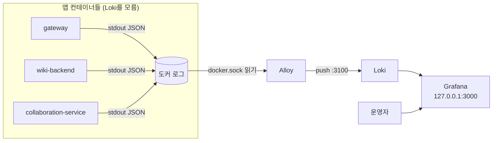
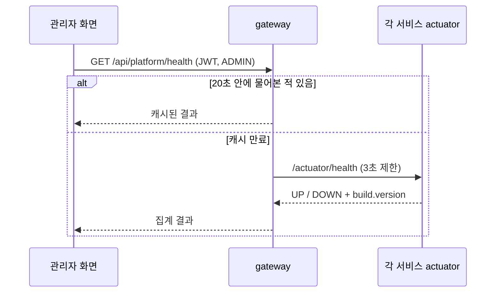

# 11 로그와 관측 — Alloy·Loki·Grafana

이전 글: [[10 배포와 운영 — Docker·nginx·GitHub Actions]] · 다음 글: [[12 AI 에이전트 서비스 — 꺼지지 않는 개발팀]]
깊은 기록: [[19 게이트웨이 평가 + rate-limit XFF 수정 + Loki 로그 관측 스택 (2026-07-20)]]

## 한 줄 요약

**앱은 화면(stdout)에 JSON 한 줄씩 찍기만 한다.** 그걸 **Alloy**가 주워 **Loki**에 쌓고, 사람은 **Grafana**에서 찾아본다.
앱은 Loki가 있는지조차 모른다. 이것이 확정 설계 결정이다(앱에서 Loki 직결 금지).

---

## 왜 필요한가

### 비유: 각자 일기장 vs 중앙 기록실

서비스가 열 개 넘게 돈다. 문제가 생기면 "어느 서비스에서 무슨 일이 있었나"를 봐야 한다.
컨테이너마다 `docker logs`를 하나씩 열어 보는 건, **열 명의 일기장을 한 권씩 빌려 읽는 것**과 같다.

그래서 **중앙 기록실**을 둔다.
- **Alloy** = 배달부. 각 방(컨테이너)을 돌며 일기를 걷어 간다.
- **Loki** = 기록실 서고. 받은 일기를 보관하고 찾아 준다.
- **Grafana** = 열람실. 사람이 앉아서 검색하고 그래프로 본다.

### 용어

> [!note] stdout
> 프로그램이 "그냥 출력"하는 기본 통로다. 도커는 컨테이너의 stdout을 자동으로 모아 둔다.

> [!note] 구조화 로그(JSON 로그)
> 사람용 문장 대신 `{"level":"INFO","service.name":"gateway","status":503}`처럼 **칸이 정해진 한 줄**로 남기는 로그.
> 기계가 칸별로 거를 수 있다. 우리는 **ECS** 형식(Elastic Common Schema, 필드 이름 약속)을 쓴다.

> [!note] 관측(Observability)
> 시스템 밖에서 "지금 안이 어떤가"를 알 수 있게 하는 것. 보통 로그·지표(메트릭)·추적(트레이싱) 셋을 말한다.
> **우리는 지금 로그만 있다.** 메트릭·트레이싱 도구(Prometheus, OpenTelemetry 등)는 코드에서 찾을 수 없다.

---

## 우리 제품에서는 어떻게 쓰나

### 1. 앱 쪽 — JSON만 찍는다

- 백엔드는 **Spring Boot 4.0.6**이다. 구조화 로깅이 프레임워크에 들어 있어서 **라이브러리 추가가 없다.**
  `logback-spring.xml` 같은 설정 파일도 없다.
- 스위치는 환경변수 하나다. compose(`infra/keycloak/docker-compose.yml`)가 각 서비스에
  `LOGGING_STRUCTURED_FORMAT_CONSOLE: ecs`를 넣는다.
  eureka, gateway, auth-server, board-service, org-service, wiki-backend, docs-backend, alm-backend, agent-service,
  migration-service, search-service 모두 같다.
- 일부는 YAML에도 있다. `gateway-server/src/main/resources/application-docker.yml`,
  `platform-backend/search-service/src/main/resources/application.yml`의 `logging.structured.format.console: ecs`.
- **로컬 개발(IntelliJ, 프로필 없음)은 평문**이다. 사람이 읽기 편하게 둔 것이다. 컨테이너에서만 JSON이 된다.
- Node 서비스인 collaboration-service도 stdout JSON을 쓴다(`src/logger.ts`). 입장권·본문은 찍지 않는다.

### 2. 게이트웨이 요청 로그 — requestId

`gateway-server/.../filter/RequestLoggingFilter.java`가 모든 요청에 두 줄을 남긴다.

- `request.in` — 들어올 때
- `request.out` — 나갈 때. `status`, `latencyMs`(걸린 시간) 포함
- `requestId` — 들어온 `X-Request-Id`가 `[A-Za-z0-9._-]{1,64}` 모양이면 그대로 쓰고, 아니면 새 UUID를 만든다.
  이상한 문자로 로그를 오염시키는 공격(로그 인젝션)을 막는다.
- **같은 ID를 응답 헤더 `X-Request-Id`에도 싣는다**(2026-10-18). 사용자가 오류 화면에서 요청 ID를 보고하면, 운영자는 그 값으로 Loki를 찾는다.
  CORS 노출 헤더에도 넣어서 교차 오리진 프론트도 이 값을 읽을 수 있다.
- **필터 순서를 가장 앞으로 옮겼다**(2026-10-18). 예전엔 라우팅 단계에서만 도는 필터라, PAT 거부·보안 체인이 끊은 401/403/503과
  `/api/platform/**`·`/fallback/**` 응답이 로그에 한 줄도 남지 않았다. 조사 때 가장 필요한 것들이었다. 지금은 PAT 교환 필터·보안 체인보다 앞(`WebFilter`, order -102)에 선다.

> [!warning] 아직 없는 것
> 뒤쪽 서비스(wiki-backend 등)는 `X-Request-Id`를 읽어 자기 로그에 넣지 않는다. `traceId`도 없다.
> 그래서 "한 요청이 여러 서비스를 거친 길"을 한 번에 이어 보기는 아직 어렵다. 게이트웨이 구간까지만 이어진다.

### 3. 수집 쪽 — Alloy·Loki·Grafana

모두 같은 compose 파일(`infra/keycloak/docker-compose.yml`)에 있고, `profiles:`가 없어서 **항상 같이 뜬다.**

| 서비스 | 이미지 | 포트 | 하는 일 |
|---|---|---|---|
| loki | `grafana/loki:3.1.1` | 게시 안 함(도커 망 안 3100) | 로그 저장·검색. 리포 설정 `infra/observability/loki-config.yaml`(아래) |
| alloy | `grafana/alloy:v1.5.1` | 게시 안 함 | 도커 소켓으로 컨테이너 발견 → 로그 tail → Loki로 push |
| grafana | `grafana/grafana:11.3.1` | `127.0.0.1:3000`만 | 조회 화면. 내 PC(루프백)에서만 열린다 |

셋 다 메모리 상한(384m · 256m · 256m)과 헬스체크(Loki `/ready`, Alloy `/-/ready`, Grafana `/api/health`)가 있다(2026-10-18). 아무 서비스도 이들의 healthy를 기다리지 않으므로, 내려도 제품은 영향이 없다.

**Loki 설정** (`infra/observability/loki-config.yaml`, 2026-10-18)
- 이미지 기본 설정(단일 노드·파일시스템)에 세 가지를 더했다. 저장 경로는 기본과 같아서 기존 볼륨의 로그를 그대로 읽는다.
- **보존 30일**: `limits_config.retention_period`가 `LOKI_RETENTION_PERIOD`(기본 `720h`)이고, 컴팩터(`retention_enabled: true`)가 실제로 지운다.
  보존이 없으면 로그 볼륨이 끝없이 자라 디스크가 차고, 디스크가 차면 Postgres까지 전부 멈춘다.
- **사용 통계 끔**: `analytics.reporting_enabled: false`. Alloy도 `--disable-reporting`. 온프렘·폐쇄망 제품이라 바깥(Grafana Labs)으로 통계를 보내지 않는다.

**도커 로그 로테이션** — compose 공통 조각 `x-logging`이 모든 서비스에 `json-file` + `max-size 20m × max-file 5`를 건다(서비스당 최대 100MB, `DOCKER_LOG_MAX_SIZE`·`DOCKER_LOG_MAX_FILE`로 조정).
전에는 도커 데몬 기본값이라 컨테이너 로그가 끝없이 쌓였다. Alloy는 도커 API로 읽으므로 로테이션과 상관없이 수집한다.

**Alloy 설정**: `infra/observability/config.alloy`

1. `discovery.docker`가 `/var/run/docker.sock`(읽기 전용 마운트)으로 **실행 중인 모든 컨테이너**를 찾는다.
2. `discovery.relabel`이 라벨을 붙인다. `container`(컨테이너 이름), `service`(compose 서비스 이름).
3. `loki.source.docker`가 로그를 읽어 `job="docker"` 라벨과 함께 `http://loki:3100/loki/api/v1/push`로 보낸다.

**Grafana 설정**: `infra/observability/grafana/provisioning/`
- 데이터소스 `datasources/loki.yml` — Loki(uid `loki`)를 기본값으로.
- 대시보드 `dashboards/definitions/wiki-collaboration.json` — "Wiki Collaboration" 하나.
  새 협업 세션, 인증 거부, 저장 지연 p95, 노드별 활성 세션 같은 패널이 전부 로그 질의(LogQL)로 그려진다.
- 익명 Admin은 2026-09-13에 없앴다. 지금은 로그인 폼이 켜져 있고, 익명 접근 기본값은 `false`다.

### 4. 조회 예

Grafana(`http://localhost:3000`) → Explore → Loki에서:

```logql
{service="gateway"} | json | status=`503`
{service="collaboration-service"} | json
```

`{...}` 안은 **라벨**로 고르는 것이고, `| json`은 로그 줄 안의 JSON 칸을 그때 펼쳐 거르는 것이다.

### 5. 왜 앱이 Loki로 직접 보내지 않나 (확정 결정)

다른 길로 **loki4j**가 있다. 앱 안에 Loki 전송기를 넣어 직접 push하는 방식이다. 쓰지 않는다.

- 앱이 **Loki를 몰라도 된다.** 새 서비스는 JSON만 찍으면 Alloy가 알아서 줍는다. 서비스가 계속 느는 우리 구조에 맞다.
- loki4j는 서비스마다 전송기 설정과 Loki 주소가 필요하다. 하나라도 잘못 쓰면 그 서비스만 로그가 빠진다.
- Loki가 잠시 죽어도 앱은 영향이 없다. 앱은 그냥 stdout에 쓰고 있을 뿐이다.
- 확인: 코드 전체에서 `loki4j`는 검색되지 않는다.

### 6. 헬스체크 — "살아 있나"를 묻는 창구

로그가 "무슨 일이 있었나"라면 헬스체크는 **"지금 살아 있나"** 다.

**Spring Actuator** — Spring 앱에 붙는 운영용 창구다.
- 노출은 `management.endpoints.web.exposure.include: health,info` 두 개뿐이다.
- `info.build.enabled: true`라서 `build.version`이 나온다. 관리자 대시보드의 "버전" 열이 이 값이다.
- 별도 관리 포트는 없다. 앱 포트에 같이 붙는다.

**compose 헬스체크** — 도커가 주기적으로 찔러 본다.
- 대부분 TCP 포트가 열렸는지만 본다: `bash -c 'exec 3<>/dev/tcp/127.0.0.1/<포트>'`.
  예: gateway 8000, auth 9000, board 9100, wiki 9110, alm 9120, org 9130, search 9140, agent 9160, migration 9170, eureka 8761.
- 예외: collaboration-service는 `/health`를 HTTP로, postgres는 `pg_isready`, redis는 `redis-cli ping`, keycloak은 `/health/ready`,
  nginx는 `/__nginx_health`, loki·alloy·grafana는 각자의 준비 주소(2026-10-18 추가).
- 그래서 배포는 compose healthy만 믿지 않고, 따로 **헬스 게이트**가 컨테이너마다 actuator를 HTTP로 묻는다([[10 배포와 운영 — Docker·nginx·GitHub Actions]]).
- 이 결과로 `depends_on: condition: service_healthy`가 동작한다. "DB가 건강해진 뒤에 앱을 띄워라"는 뜻이다.

**관리자 대시보드 헬스 집계**
- `GET /api/platform/health` (`gateway-server/.../platform/PlatformController.java`).
  JWT 필수, 전역 ADMIN만, 개인 API 토큰(PAT)은 거부.
- `HealthAggregator.java`가 각 서비스에 물어보고 결과를 **20초 캐시**한다(실패는 5초).
  probe 3초, 전체 5초 타임아웃. Loki(`/ready`)와 Grafana(`/api/health`)도 대상에 있다.
- 왜 캐시하나: 관리자 화면을 여러 명이 열어도 서비스 전체를 매번 찌르지 않게 하려고.

**actuator는 밖에서 안 보인다**
- 게이트웨이는 호스트 포트를 게시하지 않는다.
- nginx(`infra/nginx/default.conf`)는 `^/(api|oauth2|login|invite|\.well-known)/`만 게이트웨이로 넘긴다.
  `/actuator`는 그 목록에 없어서 정적 화면 쪽으로 떨어진다. 따로 막는 블록이 있는 게 아니라 **애초에 안 넘긴다.**

---

## 흐름 그림





---

## 자주 헷갈리는 점 / 함정

**1. 새로 추가한 관측 서비스는 CI 배포로 뜨지 않았다.**
배포는 "바뀐 서비스 하나"만 다시 띄운다. 처음 loki·alloy·grafana를 compose에 넣었을 때 아무도 띄우지 않아서
한 번은 손으로 올려야 했다: `cd infra/keycloak && docker compose up -d loki alloy grafana` (19번 노트).
Alloy는 도커 소켓을 tail하므로 이미 돌던 컨테이너 로그도 거슬러 수집했다.

**2. 라벨에 아무거나 넣지 않는다.**
`requestId`나 `status`를 라벨로 만들면 값 종류가 폭발해 Loki가 느려진다(카디널리티 폭발).
라벨은 `job`·`container`·`service`처럼 종류가 적은 것만. 나머지는 JSON 안에 두고 `| json`으로 거른다.

**3. 로컬에서 로그가 JSON이 아니라고 놀라지 않는다.**
IntelliJ로 띄운 dev 클러스터는 일부러 평문이다. JSON은 compose 환경변수에서 켠다.

**4. "UP"이 곧 "정상 동작"은 아니다.**
compose 헬스체크 대부분은 **포트가 열렸는지만** 본다. DB 연결이 끊겨도 포트는 열려 있을 수 있다.
더 자세한 건 actuator `/health`(wiki-backend는 db·redis를 본다)를 봐야 한다.

**5. 30일보다 오래된 로그는 없다.**
2026-10-18부터 Loki 보존이 30일(`LOKI_RETENTION_PERIOD=720h`)이다. 더 오래 봐야 하는 조사라면 값을 늘리되, 디스크 여유를 같이 본다.
도커 자체 로그도 서비스당 100MB에서 잘린다. `docker logs`로 아주 옛날 줄이 안 보이는 것은 정상이다.

**6. Grafana 기본 계정.**
`GRAFANA_ADMIN_USER/PASSWORD`의 기본값이 admin/admin이다. 루프백에서만 열리지만, 설치판에서는 바꿔야 한다.
배포 전 비밀번호 가드(`scripts/check-secrets.ps1`)가 `GRAFANA_ADMIN_PASSWORD`가 기본값이면 경고한다. 교체 절차는 `infra/runbooks/secret-rotation.md`.
이미 있는 볼륨은 env만 바꿔서는 적용되지 않는다(빈 볼륨 최초 기동 때만) — 화면이나 `grafana cli admin reset-admin-password`로 바꾼다.

**7. Java 서비스 첫 줄이 JSON이 아니다.**
메모리 상한과 함께 넣은 `JAVA_TOOL_OPTIONS` 때문에 기동 때 stderr에 `Picked up JAVA_TOOL_OPTIONS` 한 줄이 찍힌다. JVM이 찍는 것이라 JSON이 아니다. Loki에서 `| json`이 그 한 줄만 파싱에 실패한다. 무시해도 된다.

**8. 응답 헤더의 요청 ID로 찾는다.**
사용자가 "오류 났어요"라고 하면 브라우저 개발자 도구의 응답 헤더 `X-Request-Id`를 받아, `{service="gateway"} | json | requestId="<값>"`으로 찾는다.

---

## 더 읽을 거리

- [[19 게이트웨이 평가 + rate-limit XFF 수정 + Loki 로그 관측 스택 (2026-07-20)]] — 도입 과정, "방법 A"를 고른 이유
- [[45 전체 검수 96건과 기능 공백 보완 — 병합·보안·성능·운영 하드닝 (2026-10-18)]] — Loki 보존·로그 로테이션·요청 로그 순서
- [[10 배포와 운영 — Docker·nginx·GitHub Actions]] — compose·nginx
- [[04 게이트웨이와 서비스 찾기 — Spring Cloud Gateway·Eureka]] — 게이트웨이 필터
- [[08 실시간 공동 편집 — 여럿이 한 문서를 고치는 원리]] — 유일한 Grafana 대시보드의 주인공
- 리포: `infra/observability/config.alloy`, `infra/observability/loki-config.yaml`, `infra/observability/grafana/provisioning/`, `infra/README.md`(관측 절)
- 리포: `gateway-server/src/main/java/com/platform/gateway/filter/RequestLoggingFilter.java`,
  `gateway-server/src/main/java/com/platform/gateway/platform/HealthAggregator.java`

---

## 스스로 점검 질문

**Q1. 새 백엔드 서비스를 하나 추가했다. 그 로그가 Grafana에 나오게 하려면 무엇을 해야 하나?**

> [!note]- 답
> compose에 서비스를 넣고 `LOGGING_STRUCTURED_FORMAT_CONSOLE: ecs`로 stdout JSON을 켜면 끝이다.
> Alloy가 도커 소켓으로 실행 중인 모든 컨테이너를 찾아 자동 수집한다. 앱에 Loki 주소나 전송 라이브러리(loki4j)를 넣지 않는다 — 확정 결정이다.

**Q2. `{service="gateway"} | json | status="503"` 에서 `service`는 라벨이고 `status`는 아니다. 왜 status를 라벨로 안 만들었나?**

> [!note]- 답
> 라벨은 값의 종류가 적어야 한다. status, requestId처럼 값이 다양한 칸을 라벨로 만들면 Loki 색인이 폭발해 느려진다.
> 그래서 로그 줄의 JSON 안에 두고, 조회할 때 `| json`으로 펼쳐 거른다.

**Q3. 관리자 대시보드의 서비스 상태가 방금 서비스를 껐는데도 잠깐 "정상"으로 보인다. 왜인가?**

> [!note]- 답
> 게이트웨이 `HealthAggregator`가 헬스 결과를 **20초 캐시**하기 때문이다(실패 결과는 5초).
> 관리자 화면을 여러 명이 열어도 모든 서비스를 매번 찌르지 않게 하려는 설계다. 최대 20초 늦게 반영된다.
