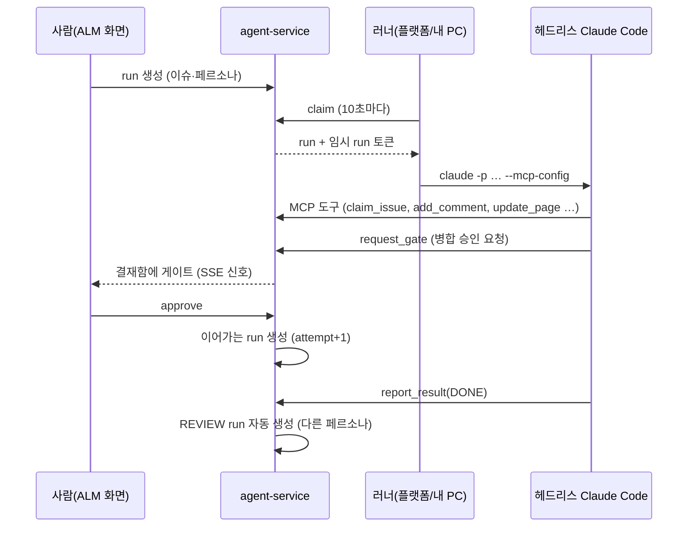
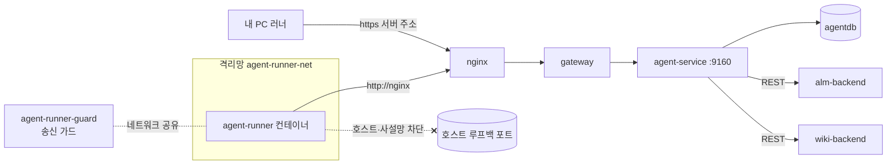

# 12 AI 에이전트 서비스 — 꺼지지 않는 개발팀

이전 글: [[11 로그와 관측 — Alloy·Loki·Grafana]] · 다음 글: [[13 용어 사전]]
설계 문서: `C:\myBrain\내 로컬\msa\MSA_TEMPLATE 설계문서\specs\2026-09-05-agent-service-design.md`

## 한 줄 요약

**agent-service(:9160)** 는 AI 코딩 에이전트(Claude Code)를 **플랫폼의 팀원**으로 들이는 서비스다.
에이전트는 **페르소나**(이름 있는 AI 팀원)로 등록되고, **MCP 도구**로 ALM 이슈와 위키 페이지를 직접 다룬다.
일은 **run**(실행 한 번) 단위로 돌고, 중요한 결정은 **게이트**에서 사람이 승인한다. 실제 작업은 **러너**가 서비스 밖에서 한다.

---

## 왜 필요한가

### 비유: 야간 근무 팀과 팀장 결재함

- **페르소나** = 사원증을 받은 AI 직원. "지호(백엔드)", "리뷰어" 같은 이름과 역할이 있다. 이슈·댓글·위키 글이 전부 그 이름으로 남는다.
- **run** = 업무 지시서 한 장. "이 이슈를 처리해"가 run 하나다.
- **게이트** = 팀장 결재함. AI가 "병합해도 될까요?"를 올리면 사람이 승인이나 반려를 누른다.
- **러너** = 실제로 책상에 앉아 일하는 작업 공간. 회사 서버 안 별도 방(플랫폼 러너)일 수도, 내 PC(로컬 러너)일 수도 있다.
- **AI 사무실 화면** = 사무실 CCTV. 누가 지금 무슨 일을 하는지 실시간으로 본다.

사람이 퇴근해도 AI 팀원은 이슈를 집어 일하고, 사람은 출근해서 결재함만 보면 된다. 그래서 "꺼지지 않는 개발팀"이다.

### 용어

> [!note] MCP (Model Context Protocol)
> AI 모델이 외부 도구를 부르는 **표준 콘센트**다. 우리 서버가 "이슈 검색", "댓글 달기" 같은 도구를 MCP로 내놓으면,
> Claude Code 같은 에이전트가 그 도구를 꽂아 쓴다.

> [!note] 헤드리스 Claude Code
> 화면 없이 명령 한 줄로 돌리는 Claude Code. `claude -p "<지시>"` 형태로 실행하고 결과를 JSON으로 받는다.

---

## 우리 제품에서는 어떻게 쓰나

### 1. 기본 정보

- 리포: `agent-service/`. Spring Boot 4 / Java 24, PostgreSQL `agentdb`, Flyway(V1~V18).
- 포트 `9160`, dev `19160`. Gradle 모듈은 셋: 서비스 본체, `worker-core`(작업 실행 코드, Spring·DB 없음), `runner`(`agent-runner.jar`).
- 주요 테이블: `persona`, `pat_token`, `run`, `gate`, `usage_ledger`(비용 장부), `tool_call_audit`(도구 호출 감사), `credential`(LLM 키), `runner`, `review_setting`, `run_directive`, `agent_setting`(킬 스위치 같은 키-값 설정, V17).

### 2. 페르소나 — AI 팀원의 신분

- 신원 사슬: auth-server 사용자 `agent:<slug>` → org-service 멤버(`kind=AGENT`) → agentdb `persona`.
  사람과 같은 조직·권한 체계([[03 로그인과 권한 — Keycloak·OIDC·JWT·개인 API 토큰]])를 탄다.
- 역할(`PersonaRole`): PLANNER, DESIGNER, FRONTEND, BACKEND, OPS, REVIEWER, MANAGER.
- 코드에 미리 박힌 페르소나는 없다. 관리자가 `POST /api/agent/personas`로 만든다.
- 페르소나마다 기본 모델, 말투, 스킬을 줄 수 있다. 스킬은 작업 공간에 `.claude/skills/persona-<slug>/SKILL.md`로 깔린다.

### 3. run — 일 한 건의 수명

**시작하는 길**
- 스케줄러: ALM에서 라벨 `auto` + 상태 `todo`인 이슈를 집는다. **기본은 꺼짐**(`SCHEDULER_ENABLED`).
- 사람이 직접: `POST /api/agent/runs`(이슈 키, 지시, 모델, 페르소나).
- 회의: `POST /api/agent/meetings`, 회고·매니저 순찰은 정해진 시각에.
- 디스패처는 QUEUED run을 오래된 순 100건씩 본다. 이때 **서버가 직접 돌릴 수 있는 run만** 고른다. 예전에는 돌릴 수 없는 QUEUED run이 100칸을 채워 SERVER run이 굶는 문제가 있었다(2026-10-18 수정).

**종류(`RunType`)**: TASK, REVIEW, MEETING, RETRO, ESCALATION, MANAGER.
**상태(`RunStatus`)**: QUEUED → RUNNING → (WAITING_APPROVAL) → DONE / FAILED / BLOCKED / CANCELLED.

**게이트(`GateKind`: MERGE, ESCALATION, PLAN)**
- 에이전트가 MCP 도구 `request_gate`를 부르면 run은 WAITING_APPROVAL, `gate` 행이 생긴다.
- 사람이 `POST /api/agent/gates/{id}/approve` → **이어가는 새 run**(attempt+1)이 생기고 원래 run은 닫힌다. 에이전트가 기다리며 붙잡고 있지 않는다.
- 반려 → run은 닫히고 다시 이어지지 않는다.

**리뷰 루프**(`REVIEW_ENABLED`, 기본 켜짐)
- TASK가 DONE이면 **다른 페르소나**의 REVIEW run이 자동으로 생겨 변경분을 본다.
- 통과해야 리뷰어가 이슈를 완료로 옮긴다. 떨어지면 수정 run. 반려 2번(`REVIEW_REJECT_MAX=2`)을 넘으면 BLOCKED.

**끝내는 법**: 에이전트는 반드시 `report_result(DONE|FAILED|BLOCKED)`를 불러야 한다. 서버가 워크로그를 자동으로 남긴다.
**인프라 오류**는 재시도하지 않고 바로 BLOCKED + 댓글 + 관리자 메일. 사람이 `POST /runs/{id}/resume`으로 다시 시작한다.

**안전장치**
- 예산: `BUDGET_MONTHLY_USD=100`, `BUDGET_PER_RUN_USD=5`.
- 킬 스위치: `POST /api/agent/kill-switch`(전역 관리자). **DB(`agent_setting`)에 저장**하므로 재시작·배포 뒤에도 유지된다.
  켜면 RUNNING run을 취소 경로로 멈추고(run 토큰 철회), 러너는 heartbeat 응답의 `stopRunIds`로 작업을 내린다.
  상태를 읽지 못하면 "켜짐"으로 본다(fail-closed). QUEUED·WAITING_APPROVAL은 건드리지 않으니, 끄면 다음 드레인이 이어 간다.
  화면은 myFront `/app/agents`의 킬 스위치 카드(켤 때 확인 대화상자)와 관리자 대시보드 `/app`의 "AI 에이전트" 카드(정지됨/정상, 월 비용/상한, 실패·차단 run, 승인 대기 게이트)다.
- 외부 MCP 호출(사람 PAT `agp_`)에는 예산·킬 스위치가 걸리지 않는다.

### 4. LLM과 키

- 작업은 **헤드리스 Claude Code CLI**로 한다. `worker-core/.../WorkerExecution.java`가 명령을 만든다:
  `claude -p … --permission-mode dontAsk --strict-mcp-config --mcp-config <파일> --output-format json --max-turns N [--model]`.
- 1:1 채팅 기능만 Anthropic Messages API를 직접 부른다(도구 없음, 기본 모델은 `CHAT_MODEL`).
- LLM 키는 `credential` 테이블에 **AES-256-GCM**으로 암호화해 저장한다. 마스터 키는 env `AGENT_CREDENTIAL_MASTER_KEY`(32바이트).
  마스터 키를 바꾸면 저장된 키를 다 다시 넣어야 한다.
- 키 고르는 순서: 프로젝트 키 > 전역 키 > env `ANTHROPIC_API_KEY`. 고른 키는 작업자에게 `ANTHROPIC_API_KEY`로만 넘긴다.

### 5. 러너 두 종류 — 일은 서비스 밖에서

> [!warning] 규칙: 서비스 컨테이너 안에서 작업자를 돌리지 않는다
> 같은 컨테이너·같은 사용자로 돌리면 `/proc/1/environ`으로 마스터 키, DB 비밀번호, 내부 토큰이 보인다. 플랫폼 내부망에도 닿는다.
> 그래서 compose가 `AGENT_IN_PROCESS_EXECUTION: "false"`로 막아 둔다(`agent-service/CLAUDE.md` §8 운영 주의).

| | 플랫폼 러너 | 내 PC 러너 |
|---|---|---|
| 어디서 | compose `agent-runner` 컨테이너(`profiles: ["agent-runner"]`) | 내 PC에서 `java -jar agent-runner.jar --server <url>` |
| 네트워크 | 격리망 `agent-runner-net`만. nginx(`http://nginx`)를 통해서만 서버에 닿음. **송신 가드**가 호스트·사설망으로 가는 길을 막음 | 인터넷으로 서버 주소에 접속 |
| 토큰 | `RUNNER_TOKEN` = `AGENT_PLATFORM_RUNNER_TOKEN` | AI 팀 설정에서 발급한 `agr_…` |
| 맡는 run | SERVER run | LOCAL run |
| LLM 비용 | 플랫폼 키(claim 응답으로 받음). 키 없으면 BLOCKED | **그 PC의 Claude 구독**. 플랫폼 키는 절대 안 받음 |

**플랫폼 러너를 지키는 두 겹**(2026-10-18 추가)
- **송신 가드**(`infra/agent-runner-guard`): 러너는 `network_mode: service:agent-runner-guard`로 가드 컨테이너의 네트워크를 함께 쓴다. 가드가 iptables OUTPUT 규칙을 건다.
  - 막음: 브리지 게이트웨이(호스트 자신), `host.docker.internal`, 사설·링크로컬·CGNAT 대역(사내 LAN, 클라우드 메타데이터 `169.254.169.254`).
  - 허용: 루프백, DNS(53), 러너망 서브넷(= 관문 nginx), 공인 인터넷(git clone·LLM API), `AGENT_RUNNER_EGRESS_ALLOW_CIDRS`(꼭 필요한 사설 주소만).
  - 왜: 검수 실측에서 가드가 없으면 러너가 `host.docker.internal`을 통해 **호스트 루프백에만 열어 둔 포트**(Postgres 5433, Redis 16379 등)에 닿았다. 가드를 붙이자 막혔다(`scripts/tests/agent-runner-guard.live-fixture.test.ps1`).
  - 규칙 하나라도 실패하면 가드가 healthy가 되지 않아 러너가 뜨지 않는다(fail-closed). 러너에는 NET_ADMIN이 없어 워커가 규칙을 못 푼다. 러너 자체도 `cap_drop: ALL`, `no-new-privileges`.
- **러너 토큰 은닉**: 워커는 러너와 같은 uid로 돈다. 그래서 엔트리포인트가 `RUNNER_TOKEN`을 0700 임시 파일로 옮기고 env에서 지운 채 JVM을 띄운다. 러너는 파일을 읽자마자 지우고, `prctl(PR_SET_DUMPABLE, 0)`과 `-XX:+DisableAttachMechanism`으로 `/proc/<러너>/environ` 읽기와 jcmd 힙 덤프를 막는다.
  남은 한계: 동시 실행(`RUNNER_CONCURRENCY>1`)이면 옆 워커의 env가 보인다. 워커 uid 분리가 다음 과제다.

**러너 프로토콜**(`agent-service/CLAUDE.md` §4 "실행 위치")
- `POST /api/agent/runners/heartbeat` 30초마다. 90초 동안 소식이 없으면 offline, 그 러너의 run은 BLOCKED.
- `/claim`: 할 일이 없으면 204, 10초마다 다시 묻는다. 두 러너가 같은 run을 잡지 않게 조건부 UPDATE로 원자적으로 잡는다.
- `GET /harness`: 작업 규칙 묶음(zip + ETag). `POST /runs/{id}/result`: 결과 보고(여러 번 보내도 한 번만 반영).
- 러너 토큰(`agr_`)과 에이전트 토큰(`agp_`)은 서로의 자리에서 거부된다.

**Windows에서 배운 것**
1. `ProcessBuilder`가 명령줄의 JSON을 망가뜨린다 → MCP 설정은 파일(`.mcp-run.json`)로 넘기고 끝나면 지운다.
2. JDK가 인자 안의 `"`를 이스케이프하지 않아 프롬프트가 첫 따옴표에서 잘렸다 → `ProcessCommandExecutor.escapeWindowsArg`로 고쳤다.
3. `claude.cmd`만 있으면 cmd.exe가 여러 줄 프롬프트를 자른다 → 러너가 시작을 거부한다.

### 6. MCP 도구 — 24종

서버는 agent-service 안에 있다(Spring AI `spring-ai-starter-mcp-server-webmvc`). 엔드포인트 `POST /api/agent/mcp`, 서버 이름 `platform-agent`.

| 묶음 | 도구 |
|---|---|
| 기본 | `whoami`, `ping` |
| ALM | `list_projects`, `get_project_context`, `search_issues`, `get_issue`, `create_issue`, `claim_issue`, `update_issue`, `assign_issue`, `update_issue_status`, `add_comment`, `log_work`, `link_pr` |
| 위키 | `list_spaces`, `find_pages`, `get_page`, `create_page`, `update_page`, `append_to_page` |
| run 전용 | `report_progress`, `request_gate`, `report_result`, `get_harness_bundle` |

(코드 `tools/*Tools.java`의 `@McpTool` 기준 24종. README와 `agent-service/CLAUDE.md` §6도 2026-10-18에 24종으로 맞췄다. 예전 기록에는 18종·22종이 남아 있다.)

**인증**
- 사람이 내 Claude Code를 붙일 때: 페르소나에 묶인 토큰 `agp_…`(SHA-256 해시만 저장, 기본 90일).

```bash
claude mcp add --transport http platform https://<호스트>/api/agent/mcp \
  --header "Authorization: Bearer agp_<발급받은 토큰>"
```

- 러너 안의 작업자: run마다 발급되고 run이 끝나면 폐기되는 **임시 run 토큰**. `report_*`, `request_gate`는 run 토큰만 부를 수 있다.
- nginx는 MCP 경로를 IP당 20r/s로 제한하고 버퍼링을 끈다(스트리밍).

### 7. ALM의 "AI 사무실" 화면

- 경로(`alm-front/src/app/App.tsx`): `/projects/:id/ai-office`, `/ai-office/runs`, `/ai-office/runs/:runId`, `/ai-office/gates`.
- 프로젝트에 AI 팀이 켜져 있을 때만 "AI 사무실" 탭이 보인다.
- 부품: `alm-front/src/features/alm/office/` — `OfficeCanvas`(픽셀 사무실), `TeamCards`, `AgentRunsPage`, `AgentGatesPage`(결재함), `MeetingConveneModal`, `PersonaEditorDialog`, `AiTeamSettings` 등.
- **실시간 갱신 — SSE**
  - `GET /api/agent/office/stream?projectId=` 를 fetch 스트리밍으로 연다.
  - 서버는 데이터가 아니라 **"뭔가 바뀌었다" 신호**(run, gate, audit, directive, persona)만 보낸다. 화면이 `GET /api/agent/office`를 다시 부른다.
  - 15초마다 하트비트, 30분 타임아웃, 사용자당 5개·전체 200개 제한(넘으면 429).
  - 전송은 **구독자별 비동기**다. 스케줄러는 구독자마다 한 칸짜리 슬롯에 신호를 넣기만 하고, 실제 전송은 구독자별 가상 스레드가 한다. 느린 브라우저 하나가 다른 사람의 신호를 막지 않는다. 밀린 신호는 마지막 하나로 합쳐지고, 한 번 전송이 20초를 넘으면 그 구독을 정리한다.
  - 신호는 JVM 안에서만 흐르므로 **인스턴스 하나**가 전제다.
  - 폴링도 같이 한다: 평소 10초, 스트림이 살아 있으면 60초.
  - nginx `location = /api/agent/office/stream`: `proxy_buffering off`, `proxy_cache off`, `proxy_read_timeout 1h`.

- **run 기록 화면**(`/ai-office/runs`, `/runs/:runId`): run 목록·상세는 **프로젝트 보기 권한**(org `CheckPermission(PROJECT, id, VIEW)`)으로 거른다. 전역 관리자는 전부, 그 밖은 볼 수 있는 프로젝트의 run만 본다. 사무실 SSE도 프로젝트 구독에 보기 권한이 필요하다.
- **run 비용**: run 목록·상세에 `cost`(`costUsd`, 입력·출력 토큰, 기록 수)가 붙는다. 비용 장부(`usage_ledger`)의 PLATFORM 행을 더한 값이고, 기록이 없으면 0이 아니라 `null`이다(V18 인덱스).

> [!note] SSE (Server-Sent Events)
> 서버 → 브라우저 **한 방향**으로 이벤트를 계속 흘려보내는 HTTP 연결. 웹소켓보다 단순하다.
> nginx가 응답을 모았다가 한꺼번에 보내면(버퍼링) 실시간이 아니게 되므로 버퍼링을 끈다.

### 8. 우리 팀도 이걸로 일한다 — AGP

- `AGP`는 ALM 프로젝트 **agent-platform**의 키다. agent-service 자신의 백로그가 거기 있다.
- 커밋 메시지에 `(AGP-57)`처럼 이슈 키를 단다. `CommitLinkParser`가 정규식 `[A-Z][A-Z0-9_]{1,11}-\d+`로 커밋과 이슈를 잇는다.

---

## 흐름 그림





---

## 자주 헷갈리는 점 / 함정

**1. 페르소나 목록이 코드에 없다고 버그가 아니다.**
페르소나는 실행 중 관리자가 만드는 데이터다. 새 설치에는 페르소나가 없다.

**2. 게이트 승인은 "멈춘 작업을 다시 깨우는 것"이 아니다.**
승인하면 **새 run**이 생긴다. 원래 run은 CANCELLED로 닫힌다. run 목록에 같은 이슈가 attempt 1, 2로 보이는 이유다.

**3. 내 PC 러너는 플랫폼 LLM 키를 받지 않는다.**
비용은 그 PC의 Claude 구독으로 나간다. 장부에는 `credential_scope=LOCAL`로 남는다.

**4. 킬 스위치는 이제 재시작해도 풀리지 않는다.**
예전(2026-10-18 이전)에는 메모리에만 있어서 재시작하면 풀렸다. 지금은 DB에 저장되고, 켜는 순간 실행 중인 run도 취소된다. 되돌릴 수 없는 취소가 따라오므로 화면은 켤 때 확인을 받는다.

**5. 플랫폼 러너는 기본으로 뜨지 않는다.**
`agent-runner` 프로필이다. 배포는 `AGENT_PLATFORM_RUNNER_TOKEN`이 설정돼 있을 때만 러너 이미지도 같은 태그로 올린다.

**6. 옛 문서마다 도구 개수가 다르다.**
예전 메모에는 18, 22가 있다. 지금은 코드·README·CLAUDE.md 모두 24다. 어긋나면 **코드가 정답**이다.

**7. 인프라 오류는 자동 재시도하지 않는다.**
같은 실패를 반복하며 돈을 쓰지 않게 하려는 것이다. BLOCKED를 보면 원인을 고치고 사람이 `resume`한다.

---

## 더 읽을 거리

- 설계: `C:\myBrain\내 로컬\msa\MSA_TEMPLATE 설계문서\specs\2026-09-05-agent-service-design.md`
- 리포: `agent-service/README.md`(연결 방법), `agent-service/CLAUDE.md`(2026-10-18에 1517줄 → 204줄로 다시 썼다. §4 도메인 개념 — run·실행 위치·러너·킬 스위치·사무실·run 조회 권한·비용·크레덴셜, §6 MCP 도구, §8 운영 주의)
- 리포: `alm-front/src/features/alm/office/`, `infra/nginx/default.conf`(MCP·SSE location), `infra/agent-runner-guard/guard.sh`(송신 가드), `myFront/src/app/agents/KillSwitchCard.tsx`
- [[03 로그인과 권한 — Keycloak·OIDC·JWT·개인 API 토큰]] — 토큰과 org 멤버
- [[10 배포와 운영 — Docker·nginx·GitHub Actions]] — compose 프로필·nginx
- [[01 우리 제품 한눈에 — WIKI·ALM·AI 에이전트·게시판·제품 사이트]] — 제품 관점 소개

---

## 스스로 점검 질문

**Q1. 왜 AI 작업자를 agent-service 컨테이너 안에서 바로 돌리지 않고 별도 러너로 돌리나?**

> [!note]- 답
> 같은 컨테이너·같은 사용자로 돌리면 작업자가 `/proc/1/environ`으로 LLM 마스터 키·DB 비밀번호·내부 토큰을 읽을 수 있고, 플랫폼 내부망에도 닿는다.
> 그래서 compose가 `AGENT_IN_PROCESS_EXECUTION: "false"`로 막고, 격리망의 플랫폼 러너나 내 PC 러너가 nginx를 거쳐서만 서버와 대화하게 했다.

**Q2. 에이전트가 `request_gate`로 병합 승인을 요청했고 사람이 승인했다. 그다음 무슨 일이 일어나나?**

> [!note]- 답
> 원래 run은 CANCELLED로 닫히고, attempt+1인 **이어가는 새 run**이 생긴다. 러너가 그 run을 claim해 작업을 이어 간다.
> 작업자가 승인을 기다리며 연결을 붙잡고 있지 않는다. 반려하면 run은 닫히고 이어지지 않는다.

**Q3. AI 사무실 화면은 실시간인데 왜 폴링도 하나? SSE로 무엇을 보내나?**

> [!note]- 답
> SSE로는 데이터가 아니라 "run/gate/audit/directive/persona가 바뀌었다"는 **신호만** 보낸다. 화면은 신호를 받으면 `GET /api/agent/office`를 다시 부른다.
> 스트림이 끊길 수 있으니 폴링을 같이 한다(평소 10초, 스트림이 살아 있으면 60초). nginx는 이 경로의 버퍼링을 꺼서 신호가 바로 가게 한다.
